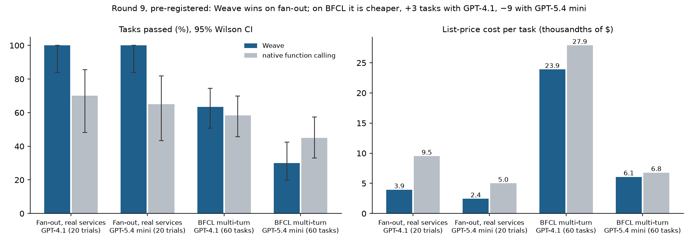

<div align="center">

# Weave

**Your agent writes one short script. Weave runs every tool call in it, in parallel where it can.**

[](https://github.com/AtharvRaotole/weave/actions/workflows/ci.yml)
[](https://github.com/AtharvRaotole/weave/releases)
[](LICENSE)

[Quickstart](#quickstart) · [Getting started](docs/getting-started.md) · [Benchmarks](docs/benchmarks.md) · [Paper](docs/paper/weave.md) · [Production](docs/production.md) · [Full reference](docs/reference.md)


</div>

With native function calling, every round of tool calls costs a model round trip, and every raw result goes back
into context. With Weave, the model writes one script in a restricted Python subset (loops, comprehensions,
helpers). A Rust runtime runs the script's independent reads together, orders writes by their declared effects, and
returns only what the script printed.

## Results



Pre-registered, on fresh tasks, against native function calling with the same model, tools and settings
([paper §5.17](docs/paper/weave.md), [all rounds](docs/benchmarks.md)):

- **Fan-out on real services** (SQLite, git, files, HTTP, PyPI): **40/40 vs 27/40** passed, **2.1–2.7 s vs 4.3 s** per
  task, at **0.45–0.50× the cost** (GPT-4.1 and GPT-5.4 mini).
- **BFCL v4 multi-turn** (public tasks and grader): **0.86× the cost** and 25 % fewer tokens. Success: **+3 tasks with
  GPT-4.1 (38 vs 35 of 60), but −9 with GPT-5.4 mini (18 vs 27), a significant loss.**
- **tau-bench retail** (a conversation, one confirmation per write): a draw.

Round 9 used `WeaveTool(compact=True)`, which is on `main` and not yet in a release.

Use Weave for fan-out (the same lookup over many items), chains of dependent lookups, and filtering results before
the model sees them. Skip it when each step waits for a person, or when a small model must think after every result.

## Install

```bash
curl -fsSL https://raw.githubusercontent.com/AtharvRaotole/weave/main/scripts/install.sh | sh   # prebuilt wheels
# or from source (needs Rust):  pip install "git+https://github.com/AtharvRaotole/weave@v1.0.0"
```

The package is `weave-lang` (import `weave`); it is not on PyPI yet. Python 3.9–3.13, Linux, macOS and Windows.
More options: [getting started](docs/getting-started.md).

## Quickstart

```python
import weave
from openai import OpenAI

@weave.declare(effect="read", arity=1)
def order_total(order_id: str) -> int:
    """Return an order's total in dollars."""
    return {"o1": 12, "o2": 30, "o3": 7}[order_id]

tool = weave.WeaveTool([order_total])   # one tool: run_weave(source)
client = OpenAI()
messages = [{"role": "user", "content": "What do orders o1, o2 and o3 add up to?"}]
while True:
    msg = client.chat.completions.create(model="gpt-4.1", messages=messages,
                                         tools=[tool.chat_tool()], **tool.request_options).choices[0].message
    messages.append(msg)
    if not msg.tool_calls:
        break
    messages += [tool.handle(call) for call in msg.tool_calls]
print(msg.content)
```

No API key? `python examples/demo.py` and `python examples/quickstart.py` run offline.

## Works with

| stack | how |
|---|---|
| OpenAI Chat Completions / Responses | `tool.chat_tool()`, `tool.responses_tool()` |
| OpenAI Agents SDK | `Agent(tools=[tool.agents_tool()])` |
| LangChain / LangGraph | `tool.langchain_tool()` |
| Claude Desktop, Cursor, any MCP client | `weave mcp-config --client claude --config tools.json --write` |
| Rust hosts, the `weave` CLI | [runtime reference](docs/runtime.html), [CLI](docs/cli.html) |

## Learn more

- [Getting started](docs/getting-started.md): recipes for each stack, chat assistants, MCP servers.
- [Running in production](docs/production.md): guarantees with their tests, isolation, budgets, privacy.
- [Benchmarks](docs/benchmarks.md) and the [paper](docs/paper/weave.md): every round, every loss, pre-registrations.
- [Full reference](docs/reference.md): the long-form guide. [Architecture](docs/architecture.md), [roadmap](ROADMAP.md),
  [contributing](CONTRIBUTING.md), [security](SECURITY.md), [citation](CITATION.cff).

[MIT](LICENSE). The speculative cache draws on Nichols et al.,
[Optimizing Agentic Language Model Inference via Speculative Tool Calls](https://arxiv.org/abs/2512.15834).
