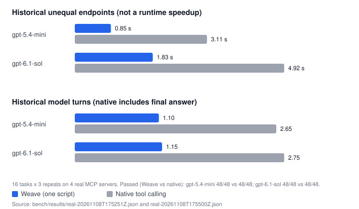
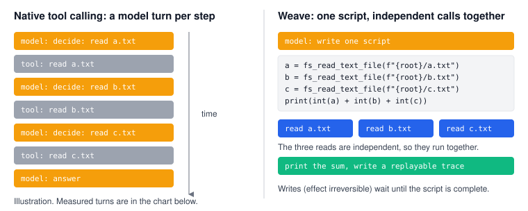

<div align="center">

# Weave

**Let an LLM agent write one short script instead of making one tool call per turn.**

Weave is a small Python-like language and a Rust runtime for LLM-written tool code.
Independent calls run together, irreversible calls wait until the script is complete,
and every run writes a trace that replays the same output.

[](https://github.com/AtharvRaotole/weave/actions/workflows/ci.yml)
[](LICENSE)


[Quickstart](#quickstart) · [Docs](docs/index.html) · [Benchmarks](docs/benchmarks.md) · [MCP proxy](#use-it-with-mcp-servers) · [Changelog](CHANGELOG.md) · [Contributing](CONTRIBUTING.md)



<sub>16 tasks × 3 repeats on four real MCP servers (filesystem, fetch, git, memory), measured 2026-11-08.
Both modes passed 48/48 on both models. Data: <a href="bench/results/real-20261108T175251Z.json"><code>real-20261108T175251Z.json</code></a>,
<a href="bench/results/real-20261108T175500Z.json"><code>real-20261108T175500Z.json</code></a>; chart drawn by <a href="bench/make_charts.py"><code>bench/make_charts.py</code></a>.</sub>

</div>

## Highlights

- **Fewer round trips.** On real MCP servers the model needed 1.10 turns per task with Weave against 2.65 with native function calling (gpt-5.4-mini), and 1.15 against 2.75 (gpt-6.1-sol). [Details](docs/benchmarks.md#does-it-generalize-m11-16-tasks-4-servers-2-models)
- **Faster end to end.** Median wall time per task was 0.849 s against 3.108 s (3.7x lower) and 1.833 s against 4.923 s (2.7x lower), at the same 48/48 pass rate.
- **Parallel by default, safe by construction.** Every tool declares an effect (`pure`, `read`, `reversible`, `irreversible`). Reads overlap; writes keep their order; irreversible calls never start before the script is complete.
- **Replayable.** Each run records a JSON trace. Replay reproduces the prints and bindings without calling a tool.
- **Sandboxed.** No imports, files, network, or function definitions. Host tools are the only way out, with step, size, depth, and wall-clock limits.
- **Drop-in for MCP.** `weave-mcp` sits in front of existing MCP servers and gives the model one `weave_run` tool over all of them.

## How it works

<p align="center"></p>

With native function calling the model sees each result before it picks the next call, so a task with three dependent-free reads still costs several model round trips. With Weave the model writes the whole plan once. The runtime parses it, builds a dataflow graph, runs independent calls together, and holds anything irreversible until the last line has arrived.

## Install

Weave is not on PyPI yet. Build it from a checkout (Rust 1.97+ and Python 3.9+), or install a wheel from the
[GitHub release](https://github.com/AtharvRaotole/weave/releases):

```bash
git clone https://github.com/AtharvRaotole/weave && cd weave
python3 -m venv .venv
.venv/bin/pip install 'maturin>=1.8,<2'
.venv/bin/maturin develop --release
```

## Quickstart

Run a script over your own Python tools:

```python
from weave import Engine

def weather(city: str) -> str:
    return f"18C {city}"

engine = Engine()
engine.tool("weather", weather, effect="read", timeout_ms=1000, retries=1)
source = 'a = weather("Paris")\nb = weather("Oslo")\nprint(a, b)\n'   # the two reads run together
result = engine.run(source)
print(result.stdout)                                                # 18C Paris 18C Oslo
engine.replay(source, result.trace_json())                          # same output, no tool calls
```

Give an agent one tool that runs Weave scripts over your functions
([`examples/run_weave_tool.py`](examples/run_weave_tool.py) is a full OpenAI loop):

```python
import weave

@weave.declare(effect="read", arity=1)
def order_total(order_id):
    """Integer total of one order."""
    return {"o1": 12, "o2": 30}[order_id]

tool = weave.WeaveTool([order_total])
tools = [tool.chat_tool()]              # pass to Chat Completions; tool.responses_tool() for Responses
# for each tool call the model makes:  messages.append(tool.handle(call))
```

`python examples/speedup.py` times four delayed reads sequentially and through Weave on your machine, and checks that replay matches.

## Use it with MCP servers

`weave-mcp` is an MCP server over stdio. Point it at the servers you already use and the model gets one script tool over all of them:

```bash
cargo build --release -p weave-mcp
./target/release/weave-mcp --config my-upstreams.json
```

```json
{"upstreams": [
  {"name": "fs", "command": "npx", "args": ["-y", "@modelcontextprotocol/server-filesystem", "/data"],
   "prefix": "fs_",
   "results": {"list_directory": "lines"},
   "examples": {"list_directory": {"path": "/data"}}},
  {"name": "fetch", "command": "uvx", "args": ["mcp-server-fetch"], "prefix": "web_",
   "effects": {"fetch": "read"}}
]}
```

- `prefix` is prepended to each upstream tool name.
- `effects` overrides a tool's effect. Without an override, a tool marked
  `readOnlyHint` is `read`, and anything else is `irreversible`.
- `results` shapes a tool's text result: `lines` returns a list of non-empty
  lines, and `json` returns the parsed value.
- `examples` gives sample arguments. At startup each listed read-only tool is
  called once, and its truncated output appears in the listing, so a model
  knows the result format before it writes a parser.
- Parameters that take objects or lists of objects are spelled out in the
  listing, e.g. `entities: list[{name: str, entityType: str, observations: list[str]}]`.
It exposes `weave_check`, `weave_run`, and `weave_replay`. [`examples/real_mcp_upstream.py`](examples/real_mcp_upstream.py) runs a script against the real filesystem server; [docs/mcp.html](docs/mcp.html) covers the protocol details.

## How it compares

| | Native function calling | Hand-written `asyncio.gather` / DAG | **Weave** |
| --- | --- | --- | --- |
| Who plans the calls | the model, one turn at a time | you, in code | the model, in one script |
| Model turns per task (real MCP, gpt-5.4-mini) | 2.65 mean | — | **1.10 mean** |
| Independent calls overlap | only within one turn | yes | yes, from the dataflow graph |
| Branches and loops on results | across turns | yes | yes, in the script |
| Irreversible calls held until the plan is complete | no | up to you | yes |
| Replayable trace | no | no | yes |
| `research_brief`, mock tools at 40 ms | — | 0.064 s (gather), 0.064 s (DAG) | **0.062 s** (sequential: 0.181 s) |

Turn counts are from [`real-20261108T175251Z.json`](bench/results/real-20261108T175251Z.json); mock timings are medians of three repeats from [`mock-20261108T021733Z.json`](bench/results/mock-20261108T021733Z.json). On the mock suite Weave matched the best hand-written schedule on all three tasks; the full tables are in [docs/benchmarks.md](docs/benchmarks.md).

## The language

Scripts are a subset of Python, parsed with `ruff_python_parser`:

```python
city = "Paris"
temp = weather(city)
air = air_quality(city)
print(f"{city}: {temp}, {air}")
if "bad" in air:
    page(city)
```

`weather` and `air_quality` start together. `page` is irreversible, so it runs only after the whole script has been received and its inputs are ready.

Supported: assignment (including unpacking and `+=`), calls with keyword arguments, `if`/`elif`/`else`, conditional expressions, `for` with `break` and `continue`, `try`/`except ToolError`, lists, dicts, f-strings, common `str`/`list`/`dict` methods, and builtins such as `len`, `range`, `sorted`, `enumerate`, `zip`, and `parse_json`. `import`, `def`, `class`, `while`, `with`, `lambda`, comprehensions, and `await` are rejected with a one-line error an LLM can fix. Full reference: [docs/language.html](docs/language.html).

`check` runs before any tool does. Each diagnostic is one line with a location and a hint an LLM can apply:

```python
import os
result = serch("q")
page = fetch("a", "b")
print(missing)
missing = 1
```

```text
L1:C1: `import` is not supported hint: inline values or fetch them with a tool
L2:C10: unknown tool `serch` hint: did you mean `fetch`?
L3:C8: tool `fetch` takes 1 argument(s), got 2 hint: pass 1 positional argument(s) to `fetch`
L4:C7: name `missing` is used before assignment hint: assign `missing` on an earlier line, on every branch that reaches here
```

## Effects

Every tool has an effect. A tool registered with no effect is irreversible.

| Effect | When it runs |
| --- | --- |
| `pure` | As soon as its arguments are ready. Independent pure calls overlap. |
| `read` | As soon as its arguments are ready and earlier writes that could change what it observes have finished. Independent reads overlap. |
| `reversible` | After earlier reads and writes it could conflict with. It may run before the script is finished, because the host can undo it. |
| `irreversible` | Only after the script is complete, and after earlier observable work. |

`and`, `or`, and conditional expressions stay lazy. Loop iterations with no carried assignment and no writes run together; `total = total + n` stays sequential.

## More features

- **Streaming.** `Session.push` runs each completed top-level statement while the model is still generating; irreversible calls wait for `finish`. In a deterministic demo the first tool started after 0.049 s instead of 0.146 s ([data](bench/results/stream-20261108T022244Z.json)).
- **Traces and replay.** Values are tagged so integers and dict order round-trip. Replay matches calls by tool and arguments and stops with `replay diverged` if the script asks for something the trace doesn't have. [docs/runtime.html](docs/runtime.html)
- **Timeouts, retries, cancellation.** Async tools are dropped on timeout; cooperative tools get a `CancelToken`; `Engine(worker_pool=N)` with `hard_deadline=True` runs a call in a worker process that is killed on timeout. [docs/runtime.html](docs/runtime.html)
- **Speculative pre-execution.** An optional predictor pre-runs reads while the model is generating and drops cached results a later write could change. [Measured hit rates](docs/benchmarks.md#speculative-pre-execution)
- **Rust, Python, CLI.** The `weave` crate (`Engine::register`, `run`, `replay`, `session`), a PyO3 module that releases the GIL, and a `weave` command (`check`, `run`, `replay`, `trace`). [docs/cli.html](docs/cli.html)

## Correctness

`cargo test` runs a differential fuzzer ([`crates/weave/tests/differential.rs`](crates/weave/tests/differential.rs)) that generates random programs over a key-value store and runs each five ways: an independent tree-walking oracle, Weave forced sequential, parallel Weave with jittered delays, a streamed session fed in random chunks, and a speculative run. Prints, bindings, the final store, the irreversible log, and the multiset of calls must match, and every trace must replay. 300 seeds run by default; set `WEAVE_DIFF_SEEDS` for more.

## Limitations

- Not on PyPI yet; install from source or a release wheel. The name `weave` on PyPI belongs to another project, so the PyPI package will need a different name ([docs/releasing.md](docs/releasing.md)).
- Benchmarks so far use OpenAI models only, on 16 real-server tasks and 16 mock tasks. With 48 runs per row, a difference of one or two passes is within noise.
- Cooperative cancellation cannot stop a sync Python tool that ignores its token; use `hard_deadline=True` for that.
- The language is deliberately small: no user-defined functions, no `while`, no comprehensions.

## Repository layout

- `crates/weave` — parser, checker, scheduler, trace
- `crates/weave-py` — PyO3 module (`python/weave` is the Python package)
- `crates/weave-mcp` — MCP server and upstream proxy
- `crates/weave-cli` — `weave` command for scripted tools
- `bench/` — mock suite, real-model and real-server evals, results
- `docs/` — static docs and [benchmarks](docs/benchmarks.md)

## Contributing

Bug reports and pull requests are welcome. See [CONTRIBUTING.md](CONTRIBUTING.md) for the build and test commands, and [SECURITY.md](SECURITY.md) to report a sandbox escape privately.

## License

[MIT](LICENSE). Speculative pre-execution follows the tool cache from Nichols et al., [arXiv 2512.15834](https://arxiv.org/abs/2512.15834).
