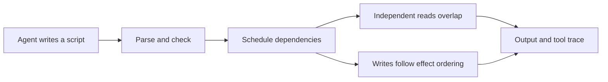
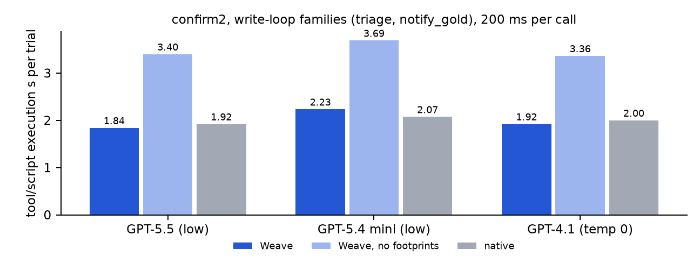

<div align="center">

# Weave

**Write a tool workflow. Run independent calls together.**

A Rust runtime for agent-written workflows, with a small Python-like language,
Python bindings, and an MCP proxy.

[](https://github.com/AtharvRaotole/weave/actions/workflows/ci.yml)
[](https://github.com/AtharvRaotole/weave/releases)
[](LICENSE)


[Quickstart](#quickstart) · [Getting started](docs/getting-started.md) · [Agent integration](#give-your-agent-one-workflow-tool) · [MCP](#connect-mcp-servers) · [Benchmarks](#benchmarks) · [Production use](docs/production.md) · [Contributing](CONTRIBUTING.md)

</div>

**Measured result (pre-registered, held-out, [paper](docs/paper/weave.md)):** against native
*parallel* function calling on the same model, tools and endpoint, Weave used **39–52% of the
tokens** and **1.6–2.0 fewer model turns** per task on GPT-5.5, GPT-5.4 mini and GPT-4.1, with equal
or higher success (30/30 vs 30/30, 30/30 vs 30/30, 28/30 vs 23/30). A second pre-registered round fixed the
one loss: with footprint-aware ordering, loops that write now run their backend calls at native speed
(0.96–1.07×, down from about 2×). Against real services (SQLite, git, files, HTTP, PyPI), Weave used
44–77% of the tokens and passed as often or more, but saved turns only on the GPT-5 models.
[Details below](#benchmarks).

Weave lets an agent express tool calls, dependencies, branches, and loops in one
script. The runtime runs independent reads concurrently and applies ordering
rules to tools that change state. You keep your existing Python functions or
stdio MCP servers.

Use it to fetch several records, combine their results, and make decisions in
code. Tasks that need fresh model reasoning after each result can still use
several model turns. Native function calling can also batch independent calls;
Weave adds local control flow and scheduling across a script.

**Where you can use it:** any Python app that calls a function-calling model
API (`WeaveTool` gives you one Chat Completions or Responses tool), the OpenAI
Agents SDK (`tool.agents_tool()`), any MCP client that launches stdio servers
(the `weave-mcp` binary, which can also proxy your other stdio MCP servers), the
`weave` CLI, and Rust hosts. [Getting started](docs/getting-started.md) has
copy-paste recipes for each.

> **Production posture (1.0):** Weave is supported in production when the host
> trusts its own tools, runs them with worker isolation and deadlines, and treats
> tool results as model-visible. Each guarantee is tied to a CI test; the
> non-guarantees are inherent (no rollback of remote effects, tool code is not
> sandboxed, in-process tools have soft deadlines). Read
> [Running Weave in production](docs/production.md) before connecting write tools.
> v0.1.0 is a historic experimental release with known defects; do not use it.

## Quickstart

No model account or API key is needed for this example.

### Install

**Prebuilt wheels:** download the wheel matching your Python version, operating
system, and architecture from the [latest release](https://github.com/AtharvRaotole/weave/releases/latest).
In a virtual environment, run `python -m pip install /path/to/downloaded.whl`,
replacing the path with the actual filename. The release includes CPython
3.9–3.13 wheels for Linux x86_64/aarch64, macOS Intel/Apple Silicon, and Windows
x64. Wheels do not require Rust.

**From source — macOS/Linux:** install [Rust via rustup](https://rustup.rs/) and
Python 3.9–3.13 first. The checkout pins Rust 1.99.1; the declared minimum is 1.97.

```bash
git clone https://github.com/AtharvRaotole/weave.git
cd weave
python3 -m venv .venv
source .venv/bin/activate
python -m pip install "maturin>=1.8,<2"
maturin develop --release --locked
```

<details>
<summary>From source — Windows PowerShell</summary>

Install Rust via rustup, its required C++ build tools, and Python 3.9–3.13, then:

```powershell
git clone https://github.com/AtharvRaotole/weave.git
cd weave
py -m venv .venv
.\.venv\Scripts\python -m pip install "maturin>=1.8,<2"
.\.venv\Scripts\maturin build --release --locked --out dist
.\.venv\Scripts\python -m pip install --no-index --find-links dist weave-lang
```

Run the example below with `.\.venv\Scripts\python`.

</details>

**Package name:** the distribution is `weave-lang` (import name `weave`).
`pip install weave-lang` is the intended public command, but the package is not
on PyPI yet: today, install a release wheel as above, or build from the tagged
source with `pip install "git+https://github.com/AtharvRaotole/weave@v1.0.0"`
(needs Rust). `pip install weave` installs
[Weights & Biases Weave](https://github.com/wandb/weave), a different project
with the same import name, so do not install both in one environment.

Check the install from a checkout with `python examples/quickstart.py` (prints
`49`, then `quickstart ok`).

### Run your first workflow

Save this as `demo.py` and run `python demo.py`:

```python
import time
from weave import Engine

def stock(product: str) -> int:
    time.sleep(0.1)  # Stand-in for an I/O-bound API call.
    return {"keyboard": 8, "mouse": 12}[product]

engine = Engine()
engine.tool("stock", stock, effect="read", arity=1, timeout_ms=1000)

source = """
keyboards = stock("keyboard")
mice = stock("mouse")
print(keyboards + mice)
"""

result = engine.run(source)
print(result.stdout, end="")  # 20

# Replay uses recorded results; it does not call stock again.
replayed = engine.replay(source, result.trace_json())
assert replayed.stdout == result.stdout
```

The two `stock` calls can overlap; `print` waits for both results. Run
`python examples/speedup.py` from a checkout for a timed comparison and replay check.

## How execution works



- **Local control flow:** branches, loops, and result processing run in the runtime.
- **Concurrent I/O:** independent `pure` and `read` tool calls can run together.
- **Effect ordering:** tools declare how they interact with external state.
- **Recorded calls:** JSON traces capture arguments, results, and handled tool errors.
- **Streaming:** `Session.push()` accepts incremental source; irreversible calls wait for `finish()`.

The restricted language is implemented in Rust. Scripts are not evaluated with
Python's `eval` or `exec`. Registered host tools provide external access.

## Give your agent one workflow tool

`WeaveTool` exposes your Python functions through one function-calling tool:

```python
import weave

@weave.declare(effect="read", arity=1)
def order_total(order_id):
    """Return an order's integer total."""
    return {"o1": 12, "o2": 30}[order_id]

tool = weave.WeaveTool([order_total])
tools = [tool.chat_tool()]
# Pass `tools` to Chat Completions.
# For a returned tool call: messages.append(tool.handle(call))
```

Use `tool.responses_tool()` for a Responses definition, or `tool.agents_tool()`
with the optional `openai-agents` package.
[`examples/run_weave_tool.py`](examples/run_weave_tool.py) contains a complete
loop and an offline smoke test. The wrapper returns printed output or repairable
errors; successful output is truncated to 20,000 characters by default.

Registered Python tools are synchronous functions; scripts may pass positional
or signature-bound keyword arguments. Rust hosts also have async tool registration.
For production, pass `worker_pool=N` so every tool runs in a killable worker
process (see [isolation](docs/isolation.md)); `await tool.run_async(source)` and
the Agents SDK tool kill that work when the awaiting task is cancelled. Raise
`weave.ToolError("message")` for error text the model should see; other
exceptions reach the script as their type only.

## Connect MCP servers

`weave-mcp` proxies local **stdio** MCP servers. Build it separately from the Python wheel:

```bash
cargo build --release --locked -p weave-mcp
```

Save this as `upstreams.json`, replacing `/absolute/path/to/data` with an existing
directory you intend to expose. This example requires Node.js/npx:

```json
{
  "upstreams": [
    {
      "name": "filesystem",
      "command": "npx",
      "args": ["-y", "@modelcontextprotocol/server-filesystem", "/absolute/path/to/data"],
      "prefix": "fs_",
      "results": {"list_directory": "lines"}
    }
  ]
}
```

Configure your MCP client to launch the binary with absolute paths:

```json
{
  "mcpServers": {
    "weave": {
      "command": "/absolute/path/to/weave/target/release/weave-mcp",
      "args": ["--config", "/absolute/path/to/upstreams.json"]
    }
  }
}
```

On Windows, use `weave-mcp.exe` and Windows paths. Use a unique prefix for each
upstream and review its tools and directory permissions before connecting it.

The proxy exposes `weave_check`, `weave_run`, and `weave_replay`, **plus upstream
tools**. To give a model only the script interface, filter the tool list in your
host. `weave_run` returns only stdout/status by default; `debug: true` returns
bindings and a full trace, which may contain sensitive intermediate data.
Upstreams start with an allowlisted environment and discarded stderr, and their
error payloads are withheld from scripts unless the upstream sets `"debug": true`.
Upstream `outputSchema`, titles and annotations are forwarded. See
[privacy](docs/privacy.md).

Optional settings include `effects`, text-result shaping with `results` (`text`, `lines`
or `json`), and `examples` that make sample read calls at startup. Without an
override, `readOnlyHint` maps to `read`; other tools default to `irreversible`.
Treat annotations as declarations from the server, not verified permissions.

Run `python examples/real_mcp_upstream.py` for a filesystem smoke test using
temporary data. See [MCP reference](docs/mcp.html) for configuration details.

## Effects and language

| Effect | Scheduling rule |
| --- | --- |
| `pure` | Runs when arguments are ready; promises no observable external effects. |
| `read` | Waits for earlier writes; independent reads can overlap. |
| `reversible` | Waits for earlier observable calls; can run while source is still streaming. |
| `irreversible` | Also waits until the complete script has arrived. This is the default. |

Effects control scheduling, not permissions, transactions, or automatic rollback.
The host is responsible for compensating `reversible` operations. Resource
footprints guide speculative cache invalidation; they do not parallelize writes.

The language supports assignment, `if`/`elif`/`else`, `for`, `break`, `continue`,
`try`/`except ToolError`, lists, dictionaries, f-strings, and selected builtins and
methods. Imports, user-defined functions, classes, `while`, comprehensions, and
`await` are rejected. This is a Python-like subset with its own value semantics.
See the [language reference](docs/language.html).

## Benchmarks


**Benchmark v4 (2026-11-10, [paper](docs/paper/weave.md), [pre-registration](docs/paper/preregistration.md),
[all tables](docs/paper/results-tables.md)).** Ten held-out tool-use tasks in seven families: fan-out, partial
failures, two-level dependent lookups, pointer chains, conditional writes, deduplicated irreversible sends, and argmax.
They run against a simulated backend with seeded per-call latency. **Native** gets one JSON tool per function,
including return types, and may call tools in parallel; the harness runs the reads of a turn concurrently. **Weave**
gets one `run_weave` tool. The two arms share the prompt, model, settings and endpoint. A trial passes only if the
answer **and** the backend's write log are right. The suites and hypotheses were committed before the held-out run,
and each configuration ran once (3 repeats × 10 tasks × 2 latencies).

| model, 200 ms/call | pass weave | pass native | turns W / N | Δ wall per task [95% CI] | tokens W/N [95% CI] |
|---|---|---|---|---|---|
| `gpt-5.5-2026-04-23` (low) | 30/30 | 30/30 | 2.00 / 4.00 | −2.9 s [−3.8, −2.1] | 0.39 [0.31, 0.48] |
| `gpt-5.4-mini-2026-03-17` (low) | 30/30 | 30/30 | 2.30 / 4.00 | −2.1 s [−2.8, −1.5] | 0.44 [0.36, 0.54] |
| `gpt-4.1-2025-04-14` (temp 0) | 28/30 | 23/30 | 2.43 / 4.03 | −1.4 s [−2.4, −0.1] | 0.52 [0.40, 0.69] |

What it shows:

- **Fewer turns and about half the tokens.** Native sends every tool result back through the model and pays for it
  again on each later turn. A Weave script returns only what it prints. On the scaling suite, native tokens grow by
  about 78 per fanned-out item and native turns grow by one per chain hop. Weave stays flat
  ([chart](assets/benchmark-v4-scaling.png)).
- **The speedup comes from model round trips, not from concurrency.** At 0 ms backend latency the saving is almost
  the same as at 200 ms. Loop pipelining still matters: with it switched off, Weave's backend time on fan-out
  tasks rises 4–5×.
- **Where Weave lost in round 1.** In a loop that writes (`triage`), each read waited for the previous write, so
  Weave's backend time was about 2× native's. Round 2 fixed this (below).
- **Not covered.** Only OpenAI models were run in full. On Gemini's free tier only 4 of 20 trials finished in round 1
  and none in round 2 (daily quota of 20 requests). The NVIDIA-hosted GLM endpoint timed out at every attempt. No
  Anthropic key was available. The tasks are synthetic and written by the maintainer. See the paper's
  threats-to-validity section.

**Round 2 (pre-registered in [Addendum 2](docs/paper/preregistration.md), fresh seeds).**



- **Footprint-aware ordering.** Tools can declare what they read and write, for example
  `declare(effect="read", reads=["ticket:{ticket_id}"])`. A read then waits only for writes that overlap it, and loops
  that write are pipelined. On the write-in-loop tasks of `confirm2`, Weave/native backend time is 0.97, 1.07 and 0.96
  (GPT-5.5, GPT-5.4 mini, GPT-4.1). The same engine without the declarations is about 1.5× slower. Undeclared tools keep
  the old, conservative order.
- **confirm2** (13 tasks, 200 ms): Weave passed 13/13, 39/39 and 37/39, against native's 13/13, 37/39 and 30/39. Weave
  used 0.36–0.46× native's tokens and 2.0–2.4 turns against about 4, and was 2.2–3.9 s faster per task. The REPL echo fix
  held: 71 GPT-4.1 scripts ended in a bare expression, and every one got its value back.
- **Real services** (`real`: SQLite, a git repository, JSON files, a local HTTP server, and the public PyPI API; no
  injected latency; grading reads the real end state):

| model | pass W / N | turns W / N | Δ wall per task [95% CI] | tokens W/N [95% CI] |
|---|---|---|---|---|
| `gpt-5.5-2026-04-23` (low, 1 repeat) | 8/8 / 8/8 | 2.00 / 3.50 | −4.9 s [−6.4, −3.3] | 0.44 [0.32, 0.61] |
| `gpt-5.4-mini-2026-03-17` (low) | 22/24 / 21/24 | 2.50 / 3.50 | −1.2 s [−2.35, −0.04] | 0.63 [0.44, 0.87] |
| `gpt-4.1-2025-04-14` (temp 0) | 21/23 / 12/24 | 2.78 / 3.50 | +0.1 s [−1.7, +2.0] | 0.77 [0.51, 1.30] |

  GPT-4.1 got no wall-time gain there: it kept writing `def` and list comprehensions, which Weave rejects, and paid a
  turn to rewrite them. Native GPT-4.1 failed every PyPI task by adding up version numbers in its head.

Reproduce: `make bench-mock` (offline) or `WEAVE_BENCH_LIVE=1 make bench-live MODEL=...` (spends tokens).
The real-services suite runs offline with oracle agents: `python -m bench.v4.run --mock --suite real --latency-ms 0`.
It needs network access for PyPI.

**Protocol v3 (strict mode, real MCP servers).** The earlier [protocol v3](docs/benchmark-protocol-v3.md) hides
Weave's error hints and sends both arms the full tool results. It found no difference on 2026-11-09. Its traces led to
the fixes in this release (return types in the listing, clearer errors, loop pipelining). Rerun after the fixes,
Weave's first-try success rose from 11/30 to 30/30 on GPT-5.5, from 26/30 to 30/30 on GPT-5.4 mini, and from 20/30 to
26/30 on GPT-4.1. That suite was the diagnosis set, so this is a before/after result, not a held-out one. Full
tables are in [docs/benchmarks.md](docs/benchmarks.md).

## Execution boundaries

[Running Weave in production](docs/production.md) is the authoritative list of
guarantees (each with its test), non-guarantees and the threat model. In short:

- **Scripts are untrusted; the host and its tools are trusted.** Scripts reach
  the outside world only through registered tools and are bounded by step,
  value, nesting, source, stdout and trace budgets ([budgets](docs/budgets.md)).
- **Deadlines are hard only for isolated tools.** With a worker pool, a runaway
  tool is SIGKILLed with its process group (POSIX) at its timeout, run deadline
  or cancellation, and `WorkerLimits` cap CPU, memory (Linux), open files and
  file size ([isolation](docs/isolation.md)). In-process tools and MCP upstream
  calls have soft, cooperative cancellation.
- **No rollback.** Effects order calls; a failed expression stops later writes,
  but nothing undoes a remote effect already started. Writes are not retried
  unless the host marks them `retry_safe` ([cancellation and retries](docs/cancellation-and-retries.md)).
- **Privacy is by channel.** Tool results are model-visible; host exceptions,
  stderr, environment and upstream error payloads are not, unless opted in
  ([privacy](docs/privacy.md)). Traces are sensitive host artifacts.
- **Not an OS sandbox for tool code**, and the host process has no memory cap.

The [17-finding audit ledger](docs/audit-status.md) records how each audited
defect was reproduced and fixed. The v0.1.0 tag and downloads are unchanged and
still contain those defects; 1.0.0 is the first release built with the fixes.

See [runtime reference](docs/runtime.html) for API details and
[SECURITY.md](SECURITY.md) for private vulnerability reporting.

## Documentation and development

The reference pages are static HTML. Serve them from a checkout:

```bash
python -m http.server 8000 --bind 127.0.0.1 --directory docs
```

Open [the local documentation](http://127.0.0.1:8000). References:
[language](docs/language.html), [runtime](docs/runtime.html), [CLI](docs/cli.html),
[MCP](docs/mcp.html), and [release process](docs/releasing.md).

Core code is in `crates/weave`; Python bindings in `crates/weave-py` and
`python/weave`; the proxy and CLI in `crates/weave-mcp` and `crates/weave-cli`.
[Architecture](docs/architecture.md) maps the scheduler for contributors, and the
[roadmap](ROADMAP.md) lists measured weaknesses and good first issues. To cite Weave,
see [CITATION.cff](CITATION.cff).

```bash
cargo test --workspace --locked
cargo clippy --workspace --all-targets --locked -- -D warnings
python tests/python/test_agent_tool.py
python tests/python/test_isolation.py
python tests/python/test_privacy.py
```

The Rust suite includes differential tests against an independent interpreter
across sequential, parallel, streamed, speculative, and replayed execution.
See [CONTRIBUTING.md](CONTRIBUTING.md) for setup and longer runs. Small bug
reproductions are welcome; check traces for sensitive data before attaching them.

## License and research

[MIT](LICENSE). The speculative cache draws on Nichols et al.,
[Optimizing Agentic Language Model Inference via Speculative Tool Calls](https://arxiv.org/abs/2512.15834).
