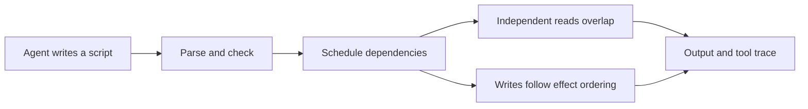

<div align="center">

# Weave

**Write a tool workflow. Run independent calls together.**

A Rust runtime for agent-written workflows, with a small Python-like language,
Python bindings, and an MCP proxy.

[](https://github.com/AtharvRaotole/weave/actions/workflows/ci.yml)
[](https://github.com/AtharvRaotole/weave/releases)
[](LICENSE)


[Quickstart](#quickstart) · [Agent integration](#give-your-agent-one-workflow-tool) · [MCP](#connect-mcp-servers) · [Benchmarks](#benchmarks) · [Execution boundaries](#execution-boundaries) · [Contributing](CONTRIBUTING.md)

</div>

Weave lets an agent express tool calls, dependencies, branches, and loops in one
script. The runtime runs independent reads concurrently and applies ordering
rules to tools that change state. You keep your existing Python functions or
stdio MCP servers.

Use it to fetch several records, combine their results, and make decisions in
code. Tasks that need fresh model reasoning after each result can still use
several model turns. Native function calling can also batch independent calls;
Weave adds local control flow and scheduling across a script.

> **Experimental release (not production-ready):** v0.1.0 is available as source and release wheels. Start with
> read-only tools in an isolated development environment. Review the
> [execution boundaries](#execution-boundaries) before connecting production systems.

## Quickstart

No model account or API key is needed for this example.

### Install

**Prebuilt wheels:** download the wheel matching your Python version, operating
system, and architecture from [v0.1.0](https://github.com/AtharvRaotole/weave/releases/tag/v0.1.0).
In a virtual environment, run `python -m pip install /path/to/downloaded.whl`,
replacing the path with the actual filename. The release includes CPython
3.9–3.13 wheels for Linux x86_64/aarch64, macOS Intel/Apple Silicon, and Windows
x64. Wheels do not require Rust.

**From source — macOS/Linux:** install [Rust via rustup](https://rustup.rs/) and
Python 3.9–3.13 first. The checkout pins Rust 1.99.1; the declared minimum is 1.97.

```bash
git clone https://github.com/AtharvRaotole/weave.git
cd weave
python3 -m venv .venv
source .venv/bin/activate
python -m pip install "maturin>=1.8,<2"
maturin develop --release --locked
```

<details>
<summary>From source — Windows PowerShell</summary>

Install Rust via rustup, its required C++ build tools, and Python 3.9–3.13, then:

```powershell
git clone https://github.com/AtharvRaotole/weave.git
cd weave
py -m venv .venv
.\.venv\Scripts\python -m pip install "maturin>=1.8,<2"
.\.venv\Scripts\maturin build --release --locked --out dist
.\.venv\Scripts\python -m pip install --no-index --find-links dist weave
```

Run the example below with `.\.venv\Scripts\python`.

</details>

**Package name:** this project is not published on PyPI. `pip install weave`
installs [Weights & Biases Weave](https://github.com/wandb/weave), a different
project. Both use the import name `weave`; use a separate virtual environment.

### Run your first workflow

Save this as `demo.py` and run `python demo.py`:

```python
import time
from weave import Engine

def stock(product: str) -> int:
    time.sleep(0.1)  # Stand-in for an I/O-bound API call.
    return {"keyboard": 8, "mouse": 12}[product]

engine = Engine()
engine.tool("stock", stock, effect="read", arity=1, timeout_ms=1000)

source = """
keyboards = stock("keyboard")
mice = stock("mouse")
print(keyboards + mice)
"""

result = engine.run(source)
print(result.stdout, end="")  # 20

# Replay uses recorded results; it does not call stock again.
replayed = engine.replay(source, result.trace_json())
assert replayed.stdout == result.stdout
```

The two `stock` calls can overlap; `print` waits for both results. Run
`python examples/speedup.py` from a checkout for a timed comparison and replay check.

## How execution works



- **Local control flow:** branches, loops, and result processing run in the runtime.
- **Concurrent I/O:** independent `pure` and `read` tool calls can run together.
- **Effect ordering:** tools declare how they interact with external state.
- **Recorded calls:** JSON traces capture arguments, results, and handled tool errors.
- **Streaming:** `Session.push()` accepts incremental source; irreversible calls wait for `finish()`.

The restricted language is implemented in Rust. Scripts are not evaluated with
Python's `eval` or `exec`. Registered host tools provide external access.

## Give your agent one workflow tool

`WeaveTool` exposes your Python functions through one function-calling tool:

```python
import weave

@weave.declare(effect="read", arity=1)
def order_total(order_id):
    """Return an order's integer total."""
    return {"o1": 12, "o2": 30}[order_id]

tool = weave.WeaveTool([order_total])
tools = [tool.chat_tool()]
# Pass `tools` to Chat Completions.
# For a returned tool call: messages.append(tool.handle(call))
```

Use `tool.responses_tool()` for a Responses definition, or `tool.agents_tool()`
with the optional `openai-agents` package.
[`examples/run_weave_tool.py`](examples/run_weave_tool.py) contains a complete
loop and an offline smoke test. The wrapper returns printed output or repairable
errors; successful output is truncated to 20,000 characters by default.

In v0.1.0, call registered Python tools positionally from scripts and use
synchronous functions. Current source also accepts signature-bound keyword arguments; v0.1.0 does not. Rust hosts also have async tool registration.

## Connect MCP servers

`weave-mcp` proxies local **stdio** MCP servers. Build it separately from the Python wheel:

```bash
cargo build --release --locked -p weave-mcp
```

Save this as `upstreams.json`, replacing `/absolute/path/to/data` with an existing
directory you intend to expose. This example requires Node.js/npx:

```json
{
  "upstreams": [
    {
      "name": "filesystem",
      "command": "npx",
      "args": ["-y", "@modelcontextprotocol/server-filesystem", "/absolute/path/to/data"],
      "prefix": "fs_",
      "results": {"list_directory": "lines"}
    }
  ]
}
```

Configure your MCP client to launch the binary with absolute paths:

```json
{
  "mcpServers": {
    "weave": {
      "command": "/absolute/path/to/weave/target/release/weave-mcp",
      "args": ["--config", "/absolute/path/to/upstreams.json"]
    }
  }
}
```

On Windows, use `weave-mcp.exe` and Windows paths. Use a unique prefix for each
upstream and review its tools and directory permissions before connecting it.

The proxy exposes `weave_check`, `weave_run`, and `weave_replay`, **plus upstream
tools**. To give a model only the script interface, filter the tool list in your
host. Current source returns only stdout/status by default. Explicit `debug: true`
returns bindings and a full trace, which may contain sensitive intermediate data.
The v0.1.0 build returns full bindings/trace by default. Error diagnostics may
also expose arguments; this is not a complete redaction/privacy boundary.

Optional settings include `effects`, text-result shaping with `results` (`text`, `lines`
or `json`), and `examples` that make sample read calls at startup. Without an
override, `readOnlyHint` maps to `read`; other tools default to `irreversible`.
Treat annotations as declarations from the server, not verified permissions.

Run `python examples/real_mcp_upstream.py` for a filesystem smoke test using
temporary data. See [MCP reference](docs/mcp.html) for configuration details.

## Effects and language

| Effect | Scheduling rule |
| --- | --- |
| `pure` | Runs when arguments are ready; promises no observable external effects. |
| `read` | Waits for earlier writes; independent reads can overlap. |
| `reversible` | Waits for earlier observable calls; can run while source is still streaming. |
| `irreversible` | Also waits until the complete script has arrived. This is the default. |

Effects control scheduling, not permissions, transactions, or automatic rollback.
The host is responsible for compensating `reversible` operations. Resource
footprints guide speculative cache invalidation; they do not parallelize writes.

The language supports assignment, `if`/`elif`/`else`, `for`, `break`, `continue`,
`try`/`except ToolError`, lists, dictionaries, f-strings, and selected builtins and
methods. Imports, user-defined functions, classes, `while`, comprehensions, and
`await` are rejected. This is a Python-like subset with its own value semantics.
See the [language reference](docs/language.html).

## Benchmarks

Committed evaluations cover 16 tasks across filesystem, fetch, git, and memory
MCP servers, with three repeats per model and mode on 2026-11-08.

| Model | Weave: script generation + execution | Native: tool loop + final model answer | Passes, Weave / native |
| --- | ---: | ---: | ---: |
| `gpt-5.4-mini` | 0.849 s median | 3.108 s median | 48/48 / 48/48 |
| `gpt-6.1-sol` | 1.833 s median | 4.923 s median | 48/48 / 48/48 |

These are **different completion boundaries**: Weave's printed result is graded
directly, while native mode makes a final model response. The native harness
also executes calls within a turn sequentially. These results do not establish a
general speedup over tuned parallel native calling or an equivalent end-to-end
agent loop.

Raw results: [gpt-5.4-mini](bench/results/real-20261108T175251Z.json) and
[gpt-6.1-sol](bench/results/real-20261108T175500Z.json).
[Methodology and history](docs/benchmarks.md) includes unsuccessful runs, mock
baselines, streaming, and speculation. The Gemini smoke test is too small to
establish cross-provider results.

## Execution boundaries

The audit-fix checkout differs from the v0.1.0 wheel/tag. Read the
[17-finding verification ledger](docs/audit-status.md) for reproduced cases,
acceptance evidence, partial fixes, and deferred work. No blanket safety claim
is made. v0.1.0 downloads have **not** been rebuilt.

The **unchanged v0.1.0 downloads** remain experimental with these known defects:

- **Permissions and writes:** host tools control external access. Completing a
  script is not human approval. Errors do not roll back effects, and known
  exception-ordering cases can allow a later independent write after an earlier
  expression fails. Keep production writes out of initial trials.
- **Resource control:** step, wall-clock, value-size, and depth controls exist,
  but value-limit coverage has gaps and there is no total memory or output budget.
  Use process isolation for untrusted workloads.
- **Cancellation and retries:** synchronous tools can outlive timeouts. Worker
  processes support hard deadlines, with known pool-saturation edge cases in
  this release. Retrying a tool can repeat side effects.
- **Replay and data:** replay makes no live calls, but repeated identical reads
  returning different values can replay in the wrong order. Traces contain tool
  arguments and results; review them before sharing.
- **MCP compatibility:** stdio text results are the current focus. Remote HTTP,
  paginated discovery, cancellation forwarding, and full structured/multimodal
  result preservation need further work.

Current source includes targeted error/replay/worker/routing fixes and nested
exception differential coverage; see the ledger, not the old downloads.
[Aggregate source/stdout/trace and MCP-frame budgets](docs/budgets.md) are byte
accounting, **not a process memory cap**. [Cancellation/retry semantics](docs/cancellation-and-retries.md)
include best-effort upstream forwarding and default no-retry writes unless the
host explicitly attests real idempotency support. Already-started effects may
continue; debug/traces and host errors can expose sensitive data. No production
readiness, hard real-time deadline or exactly-once claim is made.

See [runtime reference](docs/runtime.html) for API details and
[SECURITY.md](SECURITY.md) for private vulnerability reporting.

**Benchmark remediation:** [controlled v3 protocol](docs/benchmark-protocol-v3.md)
now has deterministic offline mechanics tests, not new model-performance evidence.
Corrected live runs remain pending. Public candidate held-out fixtures are not
claimed unseen or statistically independent; no new speedup headline is derived.

## Documentation and development

The reference pages are static HTML. Serve them from a checkout:

```bash
python -m http.server 8000 --bind 127.0.0.1 --directory docs
```

Open [the local documentation](http://127.0.0.1:8000). References:
[language](docs/language.html), [runtime](docs/runtime.html), [CLI](docs/cli.html),
[MCP](docs/mcp.html), and [release process](docs/releasing.md).

Core code is in `crates/weave`; Python bindings in `crates/weave-py` and
`python/weave`; the proxy and CLI in `crates/weave-mcp` and `crates/weave-cli`.

```bash
cargo test --workspace --locked
cargo clippy --workspace --all-targets --locked -- -D warnings
python tests/python/test_agent_tool.py
```

The Rust suite includes differential tests against an independent interpreter
across sequential, parallel, streamed, speculative, and replayed execution.
See [CONTRIBUTING.md](CONTRIBUTING.md) for setup and longer runs. Small bug
reproductions are welcome; check traces for sensitive data before attaching them.

## License and research

[MIT](LICENSE). The speculative cache draws on Nichols et al.,
[Optimizing Agentic Language Model Inference via Speculative Tool Calls](https://arxiv.org/abs/2512.15834).
