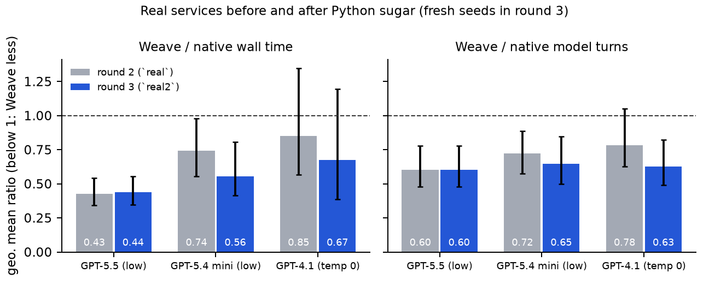
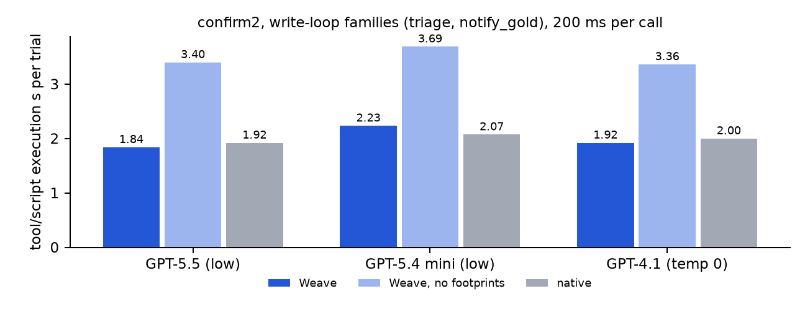
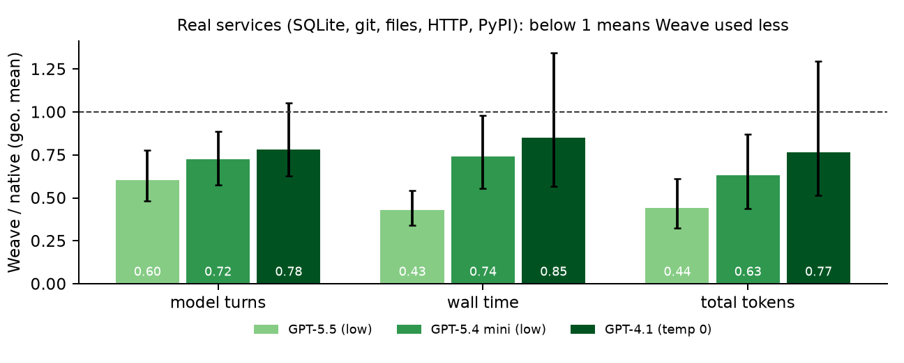
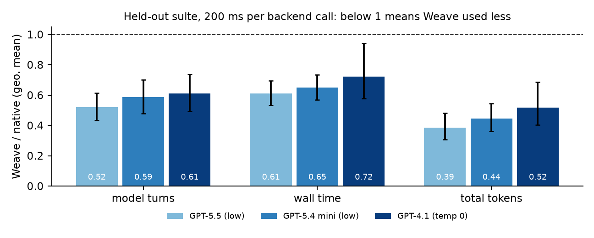
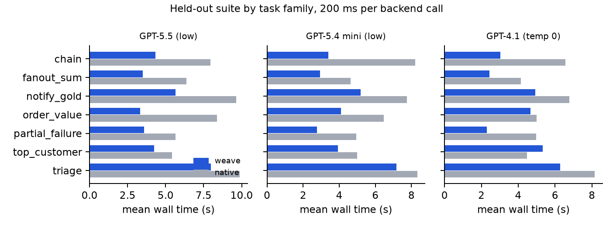
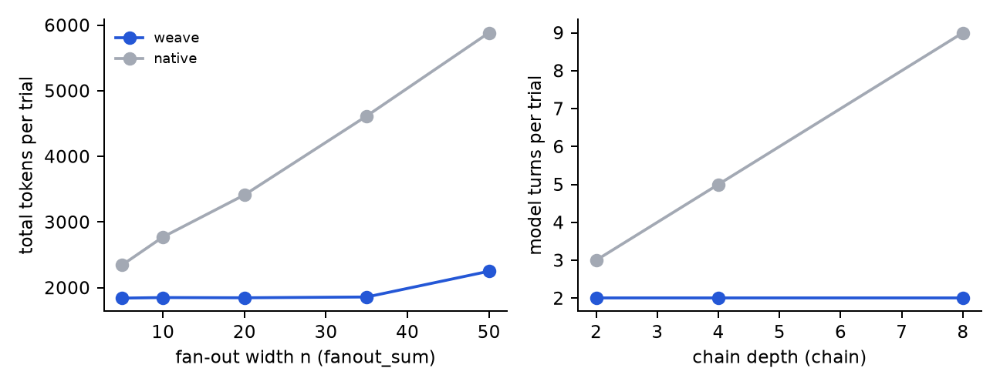
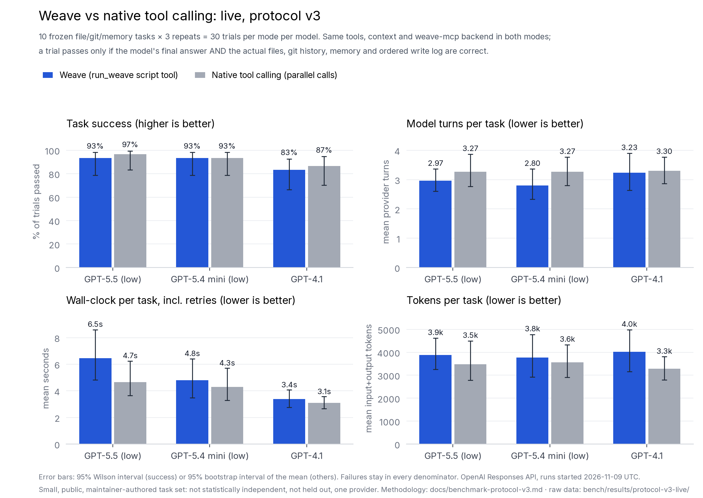
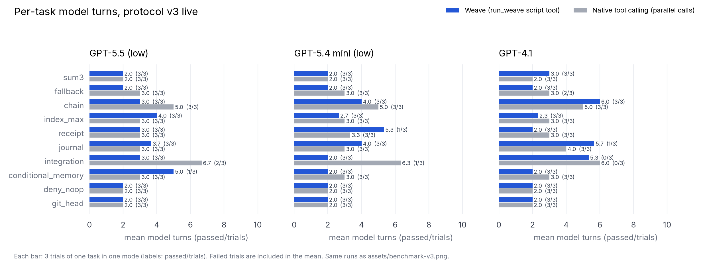

# Benchmarks

## Round 7: a larger tau-bench retail rerun (2026-11-12)

Pre-registered in Addendum 7 (`retail_test12r7`, hash `7aba309eb345598b`; 12 test tasks disjoint from rounds 5 and 6,
1 repeat, both arms `parallel_tool_calls: true`). The Weave arm is round 6's with return shapes cached. No dev runs.

| model | pass W / N | Δ agent calls [95% CI] | Δ wall s [95% CI] | token ratio [95% CI] | $ ratio [95% CI] | $ W / N |
|---|---|---|---|---|---|---|
| GPT-4.1 (temp 0) | 9/12 / 7/12 | −1.58 [−3.83, +0.58] | +2.13 [−1.25, +5.40] | 1.06 [0.87, 1.29] | 1.05 [0.89, 1.24] | 0.85 / 0.80 |
| GPT-5.4 mini (low) | 8/12 / 7/12 | −0.42 [−2.17, +1.58] | +2.32 [−2.56, +8.11] | 1.15 [0.98, 1.36] | 1.11 [0.92, 1.34] | 0.37 / 0.33 |
| pooled | 17/24 / 14/24 | −1.00 [−2.42, +0.46] | +2.22 [−0.75, +5.55] | 1.10 [0.97, 1.26] | 1.08 [0.95, 1.23] | 1.22 / 1.13 |

No difference is significant. Host time (wall minus metered model time): Weave minus native is −0.02 s pooled, so the
round-6 overhead is gone. Spend: 3.44M tokens, $2.35 at list prices; about 17.7M tokens over all rounds.

## Round 6: tau-bench retail on fresh tasks (2026-11-10)

Pre-registered in Addendum 6 (`retail_test10r6`, hash `5d4fdabdbbd74701`; 10 test tasks, 1 repeat, both arms
`parallel_tool_calls: true`; Weave arm `conversational=True`, `persist_variables=True`, sampled return shapes).
Everything was tuned on the train split only (dev runs A–C, 1.01M tokens).

| model | pass W / N | agent calls W / N | Δ agent calls [95% CI] | Δ wall s [95% CI] | token ratio [95% CI] |
|---|---|---|---|---|---|
| GPT-4.1 (temp 0) | 6/10 / 7/10 | 10.6 / 15.0 | −4.40 [−7.50, −1.50] | −0.60 [−6.33, +5.13] | 0.78 [0.60, 1.02] |
| GPT-5.4 mini (low) | 8/10 / 6/10 | 12.8 / 13.3 | −0.50 [−2.20, +1.30] | **+4.76 [+0.47, +9.52]** | 1.11 [0.95, 1.32] |
| pooled | 14/20 / 13/20 | 11.7 / 14.2 | −2.45 [−4.45, −0.50] | +2.08 [−1.73, +6.05] | 0.93 [0.78, 1.11] |

Weave script errors per trial: GPT-4.1 0.20 (3.43 in round 5), GPT-5.4 mini 0.30 (0.29). The mini wall-time loss
includes about 2.2 s per trial of return-shape sampling in our adapter, since cached. Airline was not run.
Spend: 3.90M tokens, under the 5.0M cap; about 14.3M over all rounds.

## Round 5: tau-bench retail and equal settings (2026-11-10)

Pre-registered in Addendum 5. tau-bench retail (`retail_test7`, hash `eaf9d60846f82626`; 7 test tasks, 1 repeat):

| model | pass W / N | agent calls W / N | Δ wall s [95% CI] | token ratio [95% CI] |
|---|---|---|---|---|
| GPT-4.1 (temp 0) | 4/7 / 3/7 | 17.1 / 17.1 | +2.97 [+0.26, +5.77] | 1.19 [0.90, 1.55] |
| GPT-5.4 mini (low) | 2/7 / 4/7 | 12.9 / 15.1 | −3.35 [−11.40, +4.52] | 0.98 [0.63, 1.45] |

`confirm5` ablation (hash `28f7774434ab8d21`). With `parallel_tool_calls` on in both arms, Weave against native:
GPT-4.1 10/10 vs 6/10, Δ wall −1.76 [−2.96, −0.46], tokens 0.59 [0.42, 0.83]; GPT-5.4 mini 10/10 vs 8/10, −4.63
[−7.96, −2.30], 0.45 [0.36, 0.58]. Native with parallel calls off: 2/10 and 3/10, at the 16-turn cap. All four
combinations are in `docs/paper/results-tables.md`.

Spend: 3.78M tokens, over the 2.5M round budget; about 10.4M over all rounds.

## Round 4: one script per turn (2026-11-10)

Pre-registered in Addendum 4 (`confirm4`, hash `c3ae4a6c9fe95a31`: the `real` recipe with seeds + 200 plus two
`git_review` tasks). The Weave arm sends `parallel_tool_calls: false` (`WeaveTool.request_options`); native unchanged.

| model | pass W / N | turns W / N | Δ wall s [95% CI] | token ratio [95% CI] | git_review pass W / N |
|---|---|---|---|---|---|
| GPT-5.4 mini (low) | 30/30 / 25/30 | 2.10 / 3.40 | −3.83 [−5.98, −1.74] | 0.54 [0.41, 0.72] | 12/12 / 8/12 |
| GPT-4.1 (temp 0) | 30/30 / 18/30 | 2.00 / 3.40 | −2.50 [−3.36, −1.64] | 0.51 [0.40, 0.66] | 12/12 / 9/12 |

No trial ended `incomplete`. GPT-5.4 mini's `pypi_major` was slower with Weave (4.98 vs 4.07 s). Gemini (HTTP 429)
and GLM (timeout) failed their smoke requests and were not run. Diagnosis: `bench/results/v7/diag-turn1/NOTES.md`;
full tables: `docs/paper/results-tables.md`.

## Round 3: the Python models write (2026-11-10)

Pre-registered in Addendum 3 of [the pre-registration](paper/preregistration.md) (commit `915488e`), before any run
on `confirm3` or `real2`. Discussion in Section 5.11 of the [paper](paper/weave.md); tables in
[results-tables.md](paper/results-tables.md), including every static-check failure by message (S1). Rows are in
`bench/results/v6/`.



- `confirm3` and `real2` (in `bench/v4/tasks.py` and `bench/v4/real.py`) are the round-2 recipes with fresh seeds.
- Provider errors count as failures. Two GPT-4.1 Weave trials on `real2` stopped at `max_output_tokens` on the
  first turn; the harness records 0 tokens for such a trial although the provider bills its output.

## Round 2: footprints, echo, real services (2026-11-10)

Pre-registered in Addendum 2 of [the pre-registration](paper/preregistration.md) (commit `a887e3a`), before any run
on `confirm2` or `real`. The full tables are in [results-tables.md](paper/results-tables.md), and the discussion is
in Section 5.10 of the [paper](paper/weave.md). Rows are in `bench/results/v5/`.





- `bench/v4/real.py` is the real-services backend. Each trial gets a fresh SQLite database, a git repository with real
  commits, JSON files on disk, an `http.server` on 127.0.0.1, and live calls to `pypi.org`. There is no injected
  latency, and grading reads the real end state.
- The `weave_nofp` arm runs the same engine without footprint declarations.
- `--min-interval-s` paces requests for free tiers. Pacing time is recorded in `retry_wait_s`.

## Benchmark v4: pre-registered, held-out (2026-11-10)

The paper is [docs/paper/weave.md](paper/weave.md) ([PDF](paper/weave.pdf)). The pre-registration is
[docs/paper/preregistration.md](paper/preregistration.md), committed at `8dae373` before any held-out trial. Every
table is generated in [docs/paper/results-tables.md](paper/results-tables.md) by `bench/v4/charts.py` from the rows
in `bench/results/v4/`.







**Harness.** `bench/v4/`:

- `world.py` is a deterministic simulated backend: 9 reads and 2 writes, seeded latency of mean × U(0.5, 1.5), at most
  8 calls in flight.
- `tasks.py` defines 7 task families and the frozen dev, held_out, scaling, confirm and confirm2 suites with
  manifest hashes. `real.py` adds 4 real-services families (`real_dev`, `real`).
- `agent.py` holds both arms, with the same system prompt, contracts and settings. Native reads in one turn run
  concurrently.
- `providers.py` covers OpenAI through the Responses API and Gemini, NVIDIA and Z.ai through Chat Completions. It
  records every HTTP attempt.
- `stats.py` provides Wilson intervals, cluster bootstrap and exact McNemar.
- `run.py` requires both `--allow-live` and `WEAVE_BENCH_LIVE=1`, a token budget, a clean tree, and the pre-registered
  hash for any suite other than dev.
- `mock.py` has oracle agents for the offline mode that runs in CI.

**Protocol v3 rerun after the fixes (strict mode, 2026-11-10, harness at `29f7057`).** This is the same frozen
10-task set on the real `weave-mcp` binary, at 30 trials per mode per model. It was the diagnosis set for the fixes,
so it is a before/after comparison, not held-out.

| model | Weave first try (before → after) | Weave pass | native pass | Weave turns | native turns | Weave / native tokens |
|---|---|---|---|---|---|---|
| `gpt-5.5-2026-04-23` (low) | 11/30 → 30/30 | 28 → 30 | 29 → 28 | 2.97 → 2.00 | 3.27 → 3.27 | 3,034 / 4,072 |
| `gpt-5.4-mini-2026-03-17` (low) | 26/30 → 30/30 | 28 → 30 | 28 → 28 | 2.80 → 2.03 | 3.27 → 3.30 | 3,160 / 4,375 |
| `gpt-4.1-2025-04-14` (temp 0) | 20/30 → 26/30 | 25 → 28 | 26 → 24 | 3.23 → 2.37 | 3.30 → 3.30 | 3,592 / 3,799 |

The rows are in `bench/results/protocol-v3-live/20261111T020113Z-*`. Native token counts also moved between the two
runs (for example, GPT-5.5 went from 3,474 to 4,072) with no change to the native arm, which shows the run-to-run
variance.


## Live results: protocol v3 (2026-11-09, before the v4 fixes)





**Setup.** [Protocol v3](benchmark-protocol-v3.md), live, OpenAI Responses API,
three pinned model snapshots: `gpt-5.5-2026-04-23` and `gpt-5.4-mini-2026-03-17`
at reasoning effort `low` (temperature not sent), and `gpt-4.1-2025-04-14` at
temperature 0. `max_output_tokens` 4096, at most 10 model turns, 3 final answers
and 2 transport retries per trial, 240 s trial deadline. Ten frozen tasks
([`bench/protocol_v3/live_tasks.py`](../bench/protocol_v3/live_tasks.py), manifest
hash recorded in every `run.json`) × 2 modes × 3 repeats = 60 trials per model,
in a seeded interleaved order with the mode order randomised per task and
repeat. Every trial gets a fresh disposable directory, git repository and memory
store behind the real `weave-mcp` binary, used by **both** modes; native calls
in one turn run in parallel (cap 4). A trial passes only if the final answer,
the files, the git head and tracked files, the memory contents, and the ordered
successful **and attempted** write logs all match. Timing includes model calls,
tool execution, retries and fixture startup.

**Weave mode** gives the model one `run_weave` tool (the shipped
`WeaveTool` definition); **native mode** gives it the six fixture tools
directly. Both see the same tool contracts in the first message.

### Run B (headline, harness at `2ae6959`)

| Model (run) | Mode | Passed | 95% CI | First try | Mean turns | p50 / p95 wall | Mean tokens / trial | Failures |
| --- | --- | ---: | ---: | ---: | ---: | ---: | ---: | --- |
| `gpt-5.5-2026-04-23` (low) | weave | 28/30 | 79%–98% | 11/30 | 2.97 | 5.5s / 23.8s | 3,882 | wrong_answer_or_state 2 |
| `gpt-5.5-2026-04-23` (low) | native | 29/30 | 83%–99% | 29/30 | 3.27 | 3.9s / 6.9s | 3,474 | turn_limit 1 |
| `gpt-5.4-mini-2026-03-17` (low) | weave | 28/30 | 79%–98% | 26/30 | 2.80 | 3.0s / 16.4s | 3,766 | wrong_answer_or_state 2 |
| `gpt-5.4-mini-2026-03-17` (low) | native | 28/30 | 79%–98% | 27/30 | 3.27 | 3.3s / 15.3s | 3,556 | wrong_answer_or_state 2 |
| `gpt-4.1-2025-04-14` (temp 0) | weave | 25/30 | 66%–93% | 20/30 | 3.23 | 2.5s / 7.2s | 4,023 | wrong_answer_or_state 5 |
| `gpt-4.1-2025-04-14` (temp 0) | native | 26/30 | 70%–95% | 26/30 | 3.30 | 2.9s / 6.1s | 3,282 | wrong_answer_or_state 4 |

| Model | Run id | Started (UTC) | Source commit | HTTP requests | Input / output / cached tokens (both modes) |
| --- | --- | --- | --- | ---: | --- |
| `gpt-5.5-2026-04-23` | [`20261109T210204Z-gpt-5.5-2026-04-23`](../bench/results/protocol-v3-live/20261109T210204Z-gpt-5.5-2026-04-23/summary.json) | 2026-11-09T21:02:04Z | `2ae6959` | 187 | 210,049 / 10,644 / 1,536 |
| `gpt-5.4-mini-2026-03-17` | [`20261109T210204Z-gpt-5.4-mini-2026-03-17`](../bench/results/protocol-v3-live/20261109T210204Z-gpt-5.4-mini-2026-03-17/summary.json) | 2026-11-09T21:02:04Z | `2ae6959` | 182 | 204,962 / 14,700 / 36,864 |
| `gpt-4.1-2025-04-14` | [`20261109T210204Z-gpt-4.1-2025-04-14`](../bench/results/protocol-v3-live/20261109T210204Z-gpt-4.1-2025-04-14/summary.json) | 2026-11-09T21:02:04Z | `2ae6959` | 196 | 213,531 / 5,596 / 58,880 |

### Run A (harness defect, kept for the record)

Run A used the same tasks, models, seed and schedule at harness commit
`e09b33a`. Models often answered with two or more `run_weave` calls in one turn
(parallel tool calls). That harness treated such a turn as an invalid shape and
sent the generic repair message, so Weave lost turns and trials to the harness,
not to the runtime; any ordinary agent loop runs each call. Commit `e4b274d`
runs those scripts in call order and gives each call its own observations (up
to 8 per turn). Run B was started at `2ae6959`, which adds only examples on
top of that change; tasks, models, seed and schedule are identical. Run A's ledgers are unchanged.

| Model (run) | Mode | Passed | 95% CI | First try | Mean turns | p50 / p95 wall | Mean tokens / trial | Failures |
| --- | --- | ---: | ---: | ---: | ---: | ---: | ---: | --- |
| `gpt-5.5-2026-04-23` (low) | weave | 28/30 | 79%–98% | 10/30 | 3.13 | 5.8s / 24.8s | 4,223 | wrong_answer_or_state 2 |
| `gpt-5.5-2026-04-23` (low) | native | 29/30 | 83%–99% | 29/30 | 3.23 | 3.8s / 6.7s | 3,424 | wrong_answer_or_state 1 |
| `gpt-5.4-mini-2026-03-17` (low) | weave | 28/30 | 79%–98% | 20/30 | 3.33 | 3.5s / 9.4s | 4,604 | wrong_answer_or_state 2 |
| `gpt-5.4-mini-2026-03-17` (low) | native | 29/30 | 83%–99% | 28/30 | 3.13 | 3.5s / 6.6s | 3,358 | wrong_answer_or_state 1 |
| `gpt-4.1-2025-04-14` (temp 0) | weave | 20/30 | 49%–81% | 14/30 | 4.63 | 2.6s / 14.2s | 7,007 | turn_limit 2, wrong_answer_or_state 8 |
| `gpt-4.1-2025-04-14` (temp 0) | native | 26/30 | 70%–95% | 26/30 | 3.30 | 3.0s / 6.2s | 3,283 | wrong_answer_or_state 4 |

| Model | Run id | Started (UTC) | Source commit | HTTP requests | Input / output / cached tokens (both modes) |
| --- | --- | --- | --- | ---: | --- |
| `gpt-5.5-2026-04-23` | [`20261109T205255Z-gpt-5.5-2026-04-23`](../bench/results/protocol-v3-live/20261109T205255Z-gpt-5.5-2026-04-23/summary.json) | 2026-11-09T20:52:55Z | `e09b33a` | 191 | 217,309 / 12,093 / 4,608 |
| `gpt-5.4-mini-2026-03-17` | [`20261109T205255Z-gpt-5.4-mini-2026-03-17`](../bench/results/protocol-v3-live/20261109T205255Z-gpt-5.4-mini-2026-03-17/summary.json) | 2026-11-09T20:52:55Z | `e09b33a` | 194 | 225,155 / 13,702 / 51,712 |
| `gpt-4.1-2025-04-14` | [`20261109T205255Z-gpt-4.1-2025-04-14`](../bench/results/protocol-v3-live/20261109T205255Z-gpt-4.1-2025-04-14/summary.json) | 2026-11-09T20:52:55Z | `e09b33a` | 238 | 298,396 / 10,307 / 112,256 |

### Reading these numbers

- **Success:** no detectable difference between modes for any model.
- **Turns:** Weave averaged slightly fewer turns in run B (2.80–3.23 vs
  3.27–3.30), mostly on multi-step write tasks; intervals overlap and some
  tasks went the other way (see the per-task chart).
- **Latency and tokens:** Weave was not faster. Mean wall-clock was similar for
  GPT-5.4 mini and GPT-4.1 and higher for GPT-5.5; Weave used 6–23% more tokens
  per trial. **No speedup is claimed.**
- **First try:** GPT-5.5 passed on the first try in only 11/30 Weave trials,
  versus 29/30 native, because its first scripts often failed (for example by
  treating a `{"value": ...}` result as a string). Protocol v3 replaces
  Weave's error message and hint with one generic line, so the model repairs
  blind; the shipped `WeaveTool` returns the error text and a hint.

### What this does not prove

- Not a speedup claim, and not evidence about Weave's shipped compact-output
  mode: to equalise observations, both modes receive the full tool results and
  Weave's own error text is withheld.
- One provider (OpenAI). Gemini was not run: protocol v3 has only an OpenAI
  Responses adapter (a Gemini adapter with the same offline test coverage was
  out of scope here), and the available Gemini key may be on a free-tier quota
  of about 20 requests per day, far below the ~190 requests one model needs. No Anthropic key was available.
- Ten small, public, maintainer-authored tasks, related to one another; not
  held out, not secret, not statistically independent. Repeats are not new
  workloads. One task wording (the memory step of `integration`) was clarified
  after a 4-trial smoke run and before either recorded run.
- The local MCP fixture is a pinned subset over real files, git and JSON
  memory, not the reference servers or a network service.
- Token counts are as reported by the API; USD cost is not computed. No
  billing attestation, provider-side determinism or remote model-weight pin is
  implied by the declared snapshot names.

### Reproduce

```bash
cargo build -p weave-mcp
maturin develop --release        # or install the matching wheel
export OPENAI_API_KEY=...        # read only by the runner; never written to results
python -m bench.protocol_v3.live --allow-live --model gpt-5.4-mini-2026-03-17:low --repeats 3
python -m bench.protocol_v3.report bench/results/protocol-v3-live/<run>
python bench/make_v3_charts.py   # reads bench/results/protocol-v3-live/chart-runs.json
```

The runner refuses to start from a dirty checkout (results pin a clean source
commit) and caps HTTP requests (`--max-requests`, default 400). Each run
directory holds `run.json` (config and pins), `trials.jsonl` (append-only,
hash-chained ledger with every request body and response; no headers or keys),
`rows.jsonl` (one graded row per trial) and `summary.json`.

# History: earlier benchmarks with unequal endpoints

**Do not interpret the historical Weave/native timings below as apples-to-apples
speedups.** Weave stopped at script stdout; native included a final model answer
and ran calls serially within a turn. They are kept unchanged as a record. The
live protocol-v3 results above supersede them.

Every number in this history section comes from a JSON file in [`bench/results/`](../bench/results/). The README chart is drawn from two of them by [`bench/make_charts.py`](../bench/make_charts.py). Times in tables are UTC, as recorded in the files.

## Mock tools (no model)

Mock tools sleep for a configurable base latency (40 ms in this run, three
repeats, median wall clock). Raw samples, machine info, and the round-trip
definition are in [`bench/results/mock-20261108T021733Z.json`](../bench/results/mock-20261108T021733Z.json)
([`mock-latest.json`](../bench/results/mock-latest.json) is the same file).
Rounds are waves observed from start/end timestamps, not a planned schedule.
Every runner below was correct on every repeat.

| Task | Runner | Median wall (s) | Rounds | Tool calls |
| --- | --- | ---: | ---: | ---: |
| research_brief | sequential | 0.180959 | 5 | 5 |
| research_brief | asyncio.gather | 0.063764 | 2 | 5 |
| research_brief | DAG | 0.063927 | 2 | 5 |
| research_brief | Weave | 0.062249 | 2 | 5 |
| research_brief | Monty | 0.185408 | 5 | 5 |
| trip_plan | sequential | 0.220662 | 6 | 6 |
| trip_plan | asyncio.gather | 0.143810 | 4 | 6 |
| trip_plan | DAG | 0.103826 | 3 | 6 |
| trip_plan | Weave | 0.102194 | 3 | 6 |
| trip_plan | Monty | 0.225473 | 6 | 6 |
| support_ticket | sequential | 0.180494 | 5 | 5 |
| support_ticket | asyncio.gather | 0.143868 | 4 | 5 |
| support_ticket | DAG | 0.143551 | 4 | 5 |
| support_ticket | Weave | 0.142729 | 4 | 5 |
| support_ticket | Monty | 0.185144 | 5 | 5 |

Machine: Linux 6.12.113+ x86_64, 4 CPUs, Python 3.12.3, hostname `cursor`.
Pydantic Monty 1.5.0 executed the same Python calls one at a time inside a warm worker.
The hand-written `asyncio.gather` for `trip_plan` waits for weather before flights and hotels; the DAG runner and Weave overlap those three calls.

## Real-model eval (OpenAI `gpt-5.4-mini` and `gpt-6.1-sol`)

Measured 2026-11-08 with `OPENAI_MODELS=gpt-5.4-mini,gpt-6.1-sol python bench/llm_eval.py`: 16 tasks × 3 modes × 3 repeats × 2 models = 288 graded runs, every tool call sleeping 40 ms in every mode. Raw rows: [`bench/results/llm-20261108T151237Z.json`](../bench/results/llm-20261108T151237Z.json).

The tasks ([`bench/dataset.py`](../bench/dataset.py)) cover parallel reads (2), chained dependencies (2), branching on a result (3), loops over a list result (3), tool failures that must be caught (2), and write ordering (4). Each run gets fresh tool state. Write tasks pass only if the printed answer matches and the log of write calls matches exactly, in order, with nothing extra. For example, `reserve_if_in_stock` fails if `reserve` is called at all.

- `weave`: the model writes one Weave script using the prompt pack and few-shot examples, and Weave runs it.
- `native_tools`: standard OpenAI function calling through the Responses API. Each turn is one model round trip, and the requested tools run one after another. A failing tool returns `ERROR: ...` to the model.
- `json_tool_calls`: the model writes one ordered JSON list of literal calls, using its own prompt. It has no variables, so it cannot pass a result into a later call or branch on one. It is a lower bound, not a fair competitor.

Weave and JSON get up to 3 attempts. A retry after a wrong answer shows the model what its own run printed, never the expected answer or the expected writes. (The earlier version leaked the expected answer.) `gpt-6.1-sol` ran at `reasoning_effort=low` in every mode. Chat Completions rejects function tools while that model reasons, which is why native mode uses the Responses API for both models.

| Model | Mode | Passed | First try | Median latency (s) | Median model turns | Input tokens | Output tokens |
| --- | --- | ---: | ---: | ---: | ---: | ---: | ---: |
| gpt-5.4-mini | json_tool_calls | 11/48 | 3/48 | 2.120 | 3 | 40,397 | 5,546 |
| gpt-5.4-mini | native_tools | 48/48 | 48/48 | 3.176 | 3 | 29,643 | 3,870 |
| gpt-5.4-mini | weave | 48/48 | 48/48 | 0.719 | 1 | 29,940 | 1,985 |
| gpt-6.1-sol | json_tool_calls | 22/48 | 0/48 | 6.626 | 3 | 36,988 | 10,263 |
| gpt-6.1-sol | native_tools | 48/48 | 48/48 | 4.332 | 3 | 29,643 | 3,870 |
| gpt-6.1-sol | weave | 48/48 | 48/48 | 1.563 | 1 | 29,940 | 2,125 |

Pass counts and median latency by category:

| Model | Mode | parallel | chain | branch | loop | tool_error | write_order |
| --- | --- | ---: | ---: | ---: | ---: | ---: | ---: |
| gpt-5.4-mini | weave | 6/6, 0.71s | 6/6, 0.63s | 9/9, 0.71s | 9/9, 1.00s | 6/6, 0.75s | 12/12, 0.73s |
| gpt-5.4-mini | native_tools | 6/6, 3.17s | 6/6, 3.67s | 9/9, 2.94s | 9/9, 3.23s | 6/6, 2.15s | 12/12, 3.34s |
| gpt-5.4-mini | json_tool_calls | 0/6, 2.62s | 1/6, 2.11s | 3/9, 2.00s | 0/9, 2.12s | 3/6, 1.65s | 4/12, 2.16s |
| gpt-6.1-sol | weave | 6/6, 1.53s | 6/6, 1.42s | 9/9, 1.49s | 9/9, 1.83s | 6/6, 1.64s | 12/12, 1.53s |
| gpt-6.1-sol | native_tools | 6/6, 4.17s | 6/6, 4.34s | 9/9, 4.08s | 9/9, 5.00s | 6/6, 3.37s | 12/12, 4.81s |
| gpt-6.1-sol | json_tool_calls | 5/6, 7.71s | 6/6, 5.51s | 3/9, 6.55s | 0/9, 9.53s | 3/6, 4.78s | 5/12, 7.22s |

What this shows:

- **Accuracy:** Weave and native function calling both passed 96/96, all on the first attempt.
- **Latency:** Weave's median latency was 4.4× lower than native on `gpt-5.4-mini` (0.719 s vs 3.176 s) and 2.8× lower on `gpt-6.1-sol` (1.563 s vs 4.332 s). The input-token cost was about the same: native's per-turn prompts are short here, and there are only 4–6 tools.
- **JSON baseline:** it passed 33/96. Most failures were placeholders such as `$1`, `{"ref": 0}`, or `<result of geo>` where a dependent value belonged, plus calls to a nonexistent `print` tool. Some passes came only on a retry: after seeing its own printed output, the model guessed the literal value (for example `geo:Paris`). That is why it has 3/48 and 0/48 first-try passes.
- **Scope:** these are mock tools with deterministic results, two models, and one machine (Linux x86_64, 8 CPUs, Python 3.13.5). They measure round trips and control flow, not open-ended task accuracy.

Weaknesses the eval exposed and fixed:

- **Missing list methods:** the model used `xs.append(v)`, which Weave rejected (`list has no method append`). Weave now rewrites `xs.append(v)` and `xs.extend(ys)` on a name to `xs += ...`, with tests.
- **Gaps in the prompt:** the prompt did not mention `try/except ToolError` or list results, so `price_fallback` failed on its first attempt. The prompt now covers both, plus the builtins, with a loop-plus-try few-shot example.
- **Before and after:** before these fixes, a one-repeat `gpt-5.4-mini` Weave run passed 16/16, but only 13/16 on the first attempt ([`llm-20261108T144107Z.json`](../bench/results/llm-20261108T144107Z.json)). After them, Weave passed 48/48 on the first attempt.
- **Harness bugs:** the JSON baseline had been sent Weave few-shot examples, and native mode for `gpt-6.1-sol` returned HTTP 400 on every call. A run made with those bugs is kept in [`bench/results/discarded/`](../bench/results/discarded/) and is not reported above.

Spend: the recorded run cost about $0.48 at list prices ($0.75 / $0.075 cached / $4.50 per 1M tokens for `gpt-5.4-mini`, and $2.00 / $0.10 / $10.00 for `gpt-6.1-sol`, checked 2026-11-08). Including the probes and discarded runs, the milestone cost about $1.20.

Historical invocation (not the corrected v3 protocol; do not use for new comparative claims):

```bash
export OPENAI_API_KEY=...   # or ANTHROPIC_API_KEY, or GEMINI_API_KEY
# optional: OPENAI_MODELS (comma-separated), WEAVE_EVAL_BUDGET (USD, default 2), WEAVE_EVAL_TASKS, WEAVE_EVAL_MODES, ANTHROPIC_MODEL, GEMINI_MODEL, WEAVE_EVAL_REPEATS, WEAVE_EVAL_TOOL_DELAY
python bench/llm_eval.py
```

Re-run the mock suite with `python bench/run_mock.py`. `BENCH_LATENCY_MS` and `BENCH_REPEATS` change the sleep and the number of repeats. `pydantic-monty` is optional; without it the Monty column is recorded as skipped.

## Real MCP servers (`bench/real_tools_eval.py`)

Six tasks against two real MCP servers, `@modelcontextprotocol/server-filesystem`
and `mcp-server-fetch`, proxied through `weave-mcp` `upstreams`. Model
`gpt-5.4-mini`, 3 repeats, up to 3 attempts per run. Native mode gives the model
the same tools as function tools. All rows are measured on one Linux box on
2026-11-08; raw JSON is in `bench/results/real-*.json`.

| run (UTC) | change | Weave passed (first try) | Weave median | native passed | native median | cost |
|---|---|---|---|---|---|---|
| 15:33:44 | M8 baseline | 17/18 (14) | 0.877 s | 18/18 | 2.912 s | $0.0430 |
| 16:26:57 | + `break`/`continue`, `split(sep, maxsplit)` | 16/18 (16) | 0.980 s | 18/18 | 3.751 s | $0.0599 |
| 16:29:45 | + prompt: `for x in text` loops over characters | 16/18 (14) | 1.206 s | 18/18 | 3.575 s | $0.0653 |
| 16:32:39 | + `split(sep=, maxsplit=)` keywords | 15/18 (14) | 1.120 s | 18/18 | 3.500 s | $0.0637 |
| 16:36:28 | + hint when a tool fails on a 1-character argument | 15/18 (14) | 0.935 s | 18/18 | 3.624 s | $0.0635 |

The M9 runs spent $0.2524 in total. Weave did not get better on this suite:
the 15 to 17 out of 18 spread is within run-to-run noise for 18 runs. The
failures are not missing language features any more:

- `count_urgent` (1/3 Weave in the last run, 3/3 native): the model joins a
  bare file name from `fs_list_directory` onto the wrong directory, or loops
  over the newline-separated text that `fs_search_files` returns as if it
  were a list. After the first error it wraps the read in `try/except
  ToolError: pass` and prints 0.
- `example_heading` (2/3 in the last run): one run took the first line of the
  fetched page (`Contents of https://example.com/:`) as the heading.

Native function calling stays correct at 18/18. Weave takes 1 model turn on
the median against 2 to 5 for native. Its per-task median wall time in the last
run ranged from 0.95x of native (`example_heading`, slightly slower) to 6.9x
faster (`write_version`); overall median 0.935 s against 3.624 s.

## Closing the gap with native (M10)

A Weave script has to parse tool outputs that the model has never seen, while
native function calling sees each output before it acts. M10 tried four fixes,
each one measured alone with `WEAVE_EVAL_MODES=weave`. Model `gpt-5.4-mini`,
18 runs per row; first try means passed in one model turn. Every row is a
measured run with its JSON in `bench/results/`.

| run (UTC) | variant | Weave passed (first try) | median wall | mean turns | cost |
|---|---|---|---|---|---|
| 17:11:27 | none (baseline) | 14/18 (13) | 1.318 s | 1.50 | $0.0391 |
| 17:12:30 | (a) examples, first version | 18/18 (8) | 1.604 s | 1.56 | $0.0434 |
| 17:13:13 | (b) structured listings | 17/18 (16) | 1.060 s | 1.17 | $0.0172 |
| 17:13:56 | (c) hybrid `# continue` | 16/18 (16) | 0.871 s | 1.22 | $0.0359 |
| 17:14:44 | (d) caught-error lint | 15/18 (13) | 1.094 s | 1.44 | $0.0382 |
| 17:16:07 | (a) examples, fixed | 17/18 (16) | 1.003 s | 1.17 | $0.0366 |
| 17:17:02 | (a) + (b) | 18/18 (16) | 0.922 s | 1.17 | $0.0384 |
| 17:19:54 | (a) + (b), with native | **18/18 (17)** | 1.020 s | 1.06 | $0.0656 |

The native mode in the last run also passed 18/18, with a median of 3.700 s
and 2.89 mean turns (Weave: 1 median turn, 1.06 mean). The M10 runs cost
$0.3144 in total.

- **(a) Example outputs (kept).** MCP `outputSchema` does not help here.
  `server-filesystem` declares `{content: string}` for every tool, and
  `structuredContent` only wraps the same text. `mcp-server-fetch` declares
  nothing. Instead, `weave-mcp` takes per-upstream `examples`
  (`{"tool": {args}}`), calls each listed read-only tool once at startup, and
  adds the truncated output to the script tool listing. The first version
  printed the sample call with a JSON dict argument, and the model copied that
  form (`fs_read_text_file({"path": ...})`), which failed validation. That is
  why only 8 runs passed on the first try. Writing the sample as a Weave call
  with keyword arguments fixed it. The samples use paths and a page
  (`example.org`) that no task asks about.
- **(b) Structured results (kept).** A per-upstream `results` map
  (`lines` or `json`) turns `list_directory`, `search_files` and
  `list_allowed_directories` into lists of lines, and the listing says
  `returns: list of str`. This removes the "loop over a text listing
  character by character" failure.
- **(c) Hybrid (dropped).** The model could end a script with `# continue`
  to see its output and then write another one. In 18 runs it never did, so the
  result is just the baseline plus noise.
- **(d) Lint for swallowed errors (dropped).** On a wrong answer, the feedback
  listed the tool errors that the script had caught. It did not raise the pass
  rate (15/18), so it was removed.

With 18 runs per row, a difference of one or two passes is within noise. The
combined variant passed 18/18 in both of its runs (36 of 36), against 14 to 16
of 18 without it. Config example:

```json
{"name": "fs", "command": "npx", "args": ["-y", "@modelcontextprotocol/server-filesystem", "/data"],
 "prefix": "fs_", "results": {"list_directory": "lines"},
 "examples": {"list_directory": {"path": "/data"}}}
```

## Does it generalize? (M11: 16 tasks, 4 servers, 2 models)

The real-tools eval now has 16 tasks across four reference MCP servers:
`server-filesystem`, `mcp-server-fetch`, `mcp-server-git`, and
`server-memory`. Five of them write, and the harness checks the real result
after each run: file contents, the git commit (`git log`), and the memory
graph's JSONL file. The task categories are parallel reads, loops, write
ordering, tool errors, fetch, git reads, a git commit, memory reads, memory
writes, and one cross-server task (config file to memory entity). Each run uses
the M10 defaults (`examples,structured`) and 3 repeats, which gives 48 runs per
model and mode. Example outputs come from a scratch git repo and queries that no
task asks about.

| run (UTC) | model | code | Weave passed (first try) | Weave median | Weave mean turns | native passed | native median | native mean turns | cost |
|---|---|---|---|---|---|---|---|---|---|
| 17:37:35 | gpt-5.4-mini | M10 | 45/48 (33) | 1.159 s | 1.46 | 48/48 | 3.556 s | 2.69 | $0.2383 |
| 17:52:51 | gpt-5.4-mini | + fixes 1-2 | **48/48 (44)** | 0.849 s | 1.10 | 48/48 | 3.108 s | 2.65 | $0.2215 |
| 17:55:00 | gpt-6.1-sol | + fixes 1-2 | **48/48 (42)** | 1.833 s | 1.15 | 48/48 | 4.923 s | 2.75 | $0.4944 |
| 18:00:40 | both, Weave only | + fix 3 | mini 37/37 (36), sol 32/32 (32) | 0.786 s / 1.877 s | 1.03 / 1.00 | — | — | — | $0.3504 |

The last run hit its $0.35 cap after 69 of 96 planned runs (`stopped_early`
in the JSON), so it covers repeats 0 and 1 of both models and part of repeat 2.
M11 spent $1.3046 in total.

What failed in the first run, and the fixes:

1. **Runtime bug.** A parallel `for` loop dropped a conditional assignment
   when a later iteration skipped the `if`. For example, in
   `for obs in obs_list: if "lives in" in obs: city = ...`, `city` came out as
   its pre-loop value. That caused all three `mem_lookup` failures. Now the
   value comes from the last iteration that assigned it, as in Python. The
   differential fuzzer generates this pattern, and it fails on the old code.
2. **Structured parameters.** The listing showed only parameter names, so
   scripts guessed `type` for `entityType` and `observations` for `contents`.
   Native function calling sees the JSON schema. The listing now spells out
   object parameters, e.g.
   `entities: list[{name: str, entityType: str, observations: list[str]}]`.
3. **Missing string methods** that gpt-6.1-sol used: `strip`/`rstrip` with a
   character set, and `isalnum`.

After fixes 1 and 2, both models passed 48/48 in Weave and in native mode.
Per task, Weave's median wall time was 1.6x to 6.7x lower than native on
gpt-5.4-mini. On gpt-6.1-sol it was 0.9x to 4.0x lower: `count_urgent` and
`mem_lookup` took a retry on gpt-6.1-sol because of the missing methods in fix 3,
which made them about as slow as native. In the partial run after fix 3,
gpt-6.1-sol passed every task on the first try.

## Streaming into a live session

`bench/streaming.py` turns OpenAI chat chunks (`choices[0].delta.content`) and Anthropic events (`content_block_delta` / `delta.text`) into text and pushes each piece into `Session.push`. Safe calls start once their statement is complete, before the rest of the script arrives.

A deterministic demo sleeps 12 ms between 4-character chunks and 80 ms inside each `slow` tool. Three repeats, medians, from [`bench/results/stream-20261108T022244Z.json`](../bench/results/stream-20261108T022244Z.json):

| Mode | Median time to first tool (s) | Median total (s) |
| --- | ---: | ---: |
| streaming `Session.push` | 0.049319 | 0.166217 |
| `Engine.run` after the same gaps | 0.146334 | 0.227328 |

`bench/prompts.py` is the system prompt and few-shot examples. `bench/llm_eval.py` uses them, plus `repair_message`, on the tasks in `bench/dataset.py`. Weave, an ordered JSON tool-call baseline, and (for OpenAI) native function calling are graded on the same tasks. Without an API key the eval writes a skip record and no pass rate.

## Speculative pre-execution

An optional predictor pre-runs pure and read calls and stores each result under the tool name plus canonical arguments, the tool cache from Nichols et al., [arXiv 2512.15834](https://arxiv.org/abs/2512.15834). Reversible and irreversible calls are rejected. Before a write runs, cached reads whose `reads` footprint overlaps the write's `writes` footprint are dropped and re-run live; footprints default to every resource and can name call arguments, e.g. `reads=["user:{user_id}"]`, so a write to one key drops only that key's cached reads. Scripts also have a wall-clock limit (default 30 s, `set_limits(max_wall_time_ms=...)`). Data-dependent calls are not guessed. One unused prediction per task is included so wasted work is measured. Generation is an 80 ms sleep; the predictor returns after 10 ms; tool sleep is 40 ms. Three repeats, medians, from [`bench/results/spec-20261108T023548Z.json`](../bench/results/spec-20261108T023548Z.json):

| Task | After generate (s) | Speculative (s) | Hits | Misses | Wasted | Hit rate |
| --- | ---: | ---: | ---: | ---: | ---: | ---: |
| research_brief | 0.142365 | 0.101583 | 4 | 1 | 1 | 0.800 |
| trip_plan | 0.182730 | 0.142256 | 2 | 4 | 1 | 0.333 |
| support_ticket | 0.223358 | 0.182742 | 2 | 3 | 1 | 0.400 |

Hit rate is `hits / (hits + misses)` over the pure and read calls the program made. Every repeat was correct. Machine: Linux 6.12.113+ x86_64, 4 CPUs, Python 3.12.3, hostname `cursor`.


## Gemini (attempted, not completed)

`bench/real_tools_eval.py` can now run Gemini models (`OPENAI_MODELS=gemini-2.5-flash`
with `GEMINI_API_KEY`). Weave mode uses `generateContent`; native mode uses Gemini
function calling with each tool's JSON schema. Output tokens include thinking
tokens, priced at $0.30 / $2.50 per 1M input / output (paid tier). HTTP 429 waits
are subtracted from wall time and recorded per row as `rate_limit_wait_s`.

A 3-repeat run on 2026-11-08 could not finish: the API key is on the free
tier, which allows 20 `gemini-2.5-flash` requests per day, and the full eval
needs a few hundred. The only completed record is a 4-run smoke test,
[`real-20261108T182543Z.json`](../bench/results/real-20261108T182543Z.json):
`sum_notes` and `mem_relate`, one repeat each. All four runs passed. Weave took
1 model turn per task; native took 2 and 3. That is too few runs to compare
the two, so no Gemini numbers appear in the README. A second attempt ran 10 runs: 8 passed, and the
last 2 (both native) failed only because the daily limit was hit. It was
stopped before it wrote a results file, so it is not counted here.
