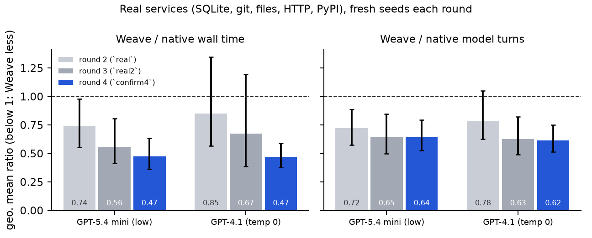
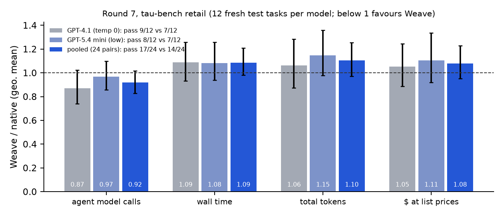
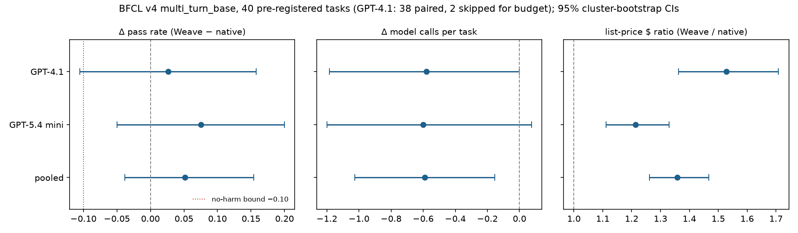

<!-- DRAFT. Not published. Every number links to committed rows; re-check before posting. -->

# Weave: one script instead of twenty tool turns, and where that does not help

*Draft blog post. Charts are from `assets/` in the repository; every number below is from a pre-registered run whose
rows are committed.*

Function-calling agents pay for every round of tool calls with a full model round trip, and every raw result goes back
through the model's context. When an answer needs the same lookup over forty packages, or a chain of lookups where
each feeds the next, that is a lot of turns and a lot of tokens spent shuttling data the model only needs to filter.

Weave is a small runtime for that kind of work. The model gets one tool, `run_weave`, and sends a short Python-like
script instead of a sequence of calls:

```python
rows = []
for line in requirements:
    name = line.split("==")[0]
    pinned = line.split("==")[1]
    latest = latest_version(name)
    ids = advisories(name, pinned)
    if ids or latest != pinned:
        rows.append([name, pinned, latest, ids])
print(rows)
```

The runtime is written in Rust. It runs independent reads at the same time, holds back state-changing calls until the
reads they depend on have finished (each tool declares an effect: `pure`, `read`, `reversible`, `irreversible`), and
returns only what the script prints. Your tools stay ordinary Python functions or stdio MCP servers.

## What we measured

We wrote the protocol down before running anything: hypotheses, task subsets (seeded), stop rules and spending caps
are in [`docs/paper/preregistration.md`](../paper/preregistration.md), with an addendum per round committed before
its evidence runs. Both arms always use the same model, prompt, tool contracts and endpoint.

**Where Weave wins: real services with fan-out and chains.** On SQLite, git, local files, an HTTP server and the live
PyPI API (round 4, 30 trials per arm):

| model | pass Weave / native | wall per task | tokens Weave/native |
|---|---|---|---|
| GPT-4.1 | 30/30 vs 18/30 | 2.1 s vs 4.6 s (Δ −2.5 s, 95% CI [−3.4, −1.6]) | 0.51× |
| GPT-5.4 mini | 30/30 vs 25/30 | Δ −3.8 s [−6.0, −1.7] | 0.54× |



On our held-out simulated suite (200 ms per call), Weave used 39–52 % of native's tokens on GPT-5.5, GPT-5.4 mini and
GPT-4.1, with equal or higher success.

**Where it is a draw: conversations.** On [tau-bench](https://github.com/sierra-research/tau-bench) retail, where a
simulated customer replies between steps, our largest pre-registered round (12 fresh tasks per model) gave 17/24 vs
14/24 passes (p = 0.45), with no significant difference in time, tokens or cost. Each step waits for the person, so
there is little to batch.



**Where it loses: short chains on a public benchmark.** We added a Weave arm to the
[Berkeley Function Calling Leaderboard](https://github.com/ShishirPatil/gorilla) v4 `multi_turn_base` without
changing its tasks, backends or grader (40 seeded tasks, GPT-4.1 and GPT-5.4 mini):

| model | pass Weave / native | Δ model calls per task | tokens W/N | list-price $ W/N |
|---|---|---|---|---|
| GPT-4.1 (38 pairs) | 19/38 vs 18/38 | −0.58 [−1.18, +0.00] | 1.24× [1.15, 1.33] | **1.53× [1.36, 1.71]** |
| GPT-5.4 mini | 20/40 vs 17/40 | −0.60 [−1.20, +0.07] | 1.20× [1.10, 1.31] | **1.21× [1.11, 1.33]** |
| pooled | 39/78 vs 35/78 (p = 0.42) | −0.59 [−1.03, −0.15] | 1.22× [1.15, 1.29] | **1.36× [1.26, 1.47]** |



Success was equal within noise and Weave saved about 0.6 model calls per task, but it cost more: BFCL turns average
about 1.6 tool calls per script, so there is little to batch, and each request carried more input (likely the longer tool description). For
GPT-4.1 the pre-registered no-harm bound (−0.10) was narrowly missed (−0.105).

## When to use it, and when not to

Use Weave when one answer needs **fan-out** (the same lookup over many items), **chains** (lookups that feed each
other), or **local logic** on results (filter, sort, aggregate) before the model sees them. Skip it for tasks of one or
two tool calls, for chat flows where every step waits for a person, and when the model must reason freshly about each
result.

## Try it

- Python: `weave.WeaveTool([fn, ...])` gives one tool for Chat Completions or Responses, `tool.agents_tool()` for the
  OpenAI Agents SDK, `tool.langchain_tool()` for LangChain and LangGraph.
- Claude Desktop or Cursor: `weave mcp-config --client claude --config upstreams.json --write`.
- Demo apps: a dependency auditor (PyPI + OSV.dev) and a multi-repo git scan, in `examples/apps/`.
- Install: `curl -fsSL https://raw.githubusercontent.com/AtharvRaotole/weave/main/scripts/install.sh | sh`.

The paper ([`docs/paper/weave.md`](../paper/weave.md)) lists every round, including the losses and a harness defect
we kept for the record. MIT licensed.
