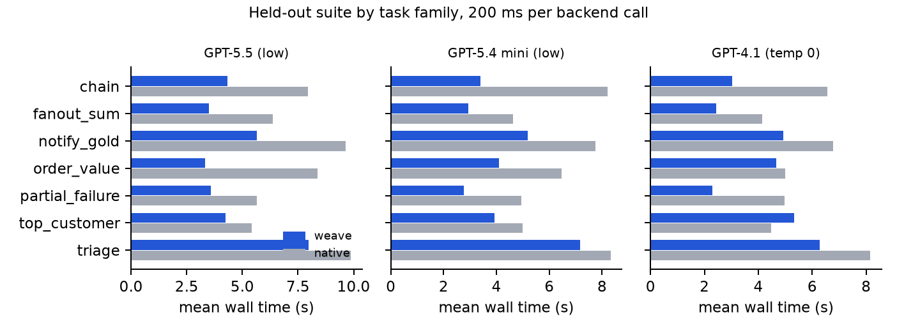
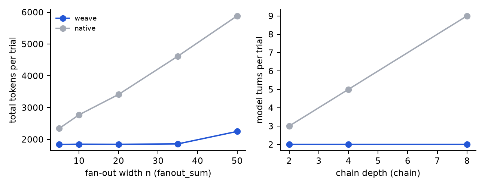
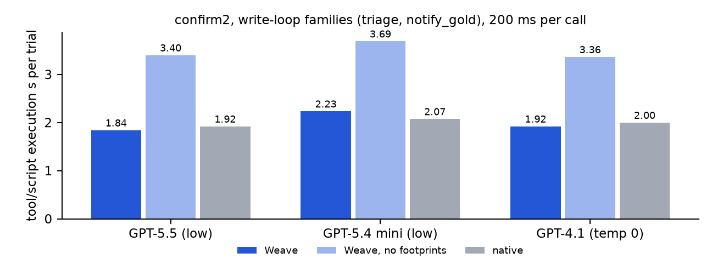
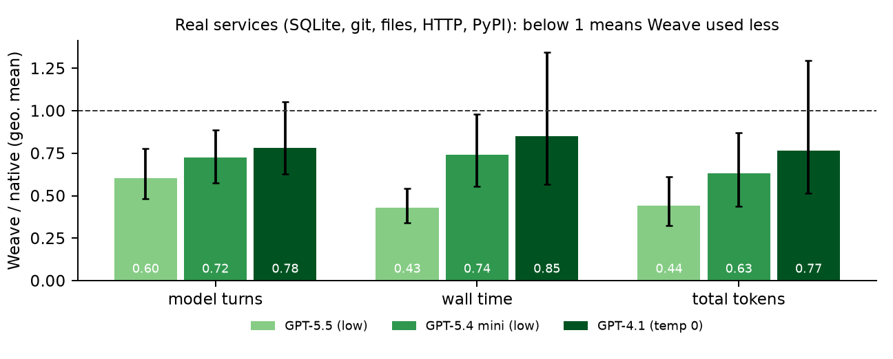

## Abstract

Agents built on function-calling models pay one model round trip for every round of tool calls, and the result of
each call goes back through the model's context. Weave is a small Python-like scripting runtime written in Rust that lets
the model send one script instead. The script can call tools, loop over results, branch and aggregate. The runtime
runs independent reads at the same time, holds back writes until the reads they depend on have finished, and returns
only what the script prints. We compare Weave with **native parallel function calling** on a pre-registered,
held-out suite of 10 tool-use tasks in 7 families, against a simulated backend with seeded per-call latency. Both arms
use the same model, system prompt, tool contracts and endpoint, and grading checks the backend's write log. On three
OpenAI models (GPT-5.5, GPT-5.4 mini and GPT-4.1; 120 trials each), Weave used **39–52 %** of native's tokens
(geometric-mean ratio; every 95 % CI is below 0.70) and **1.6–2.0 fewer model turns** per task. At 200 ms per backend
call it was **1.4–2.9 s faster** per task, with every CI below zero. Success was the same for the two GPT-5 models
(30/30 vs 30/30) and higher for GPT-4.1 (28/30 vs 23/30, McNemar p = 0.125, not significant). On the
pre-registered scaling suite, native token use grows by about 78 tokens per fanned-out item and native turns grow by one
per hop of a dependent chain. Weave's tokens and turns stay flat. We also report two places where Weave loses. A
script that writes inside a loop runs that loop's backend calls about 2× slower than native (because of the read/write
ordering rule). And when the backend latency is 0 ms, the time saved is almost the same as at 200 ms: in this setup the
speedup comes from fewer model round trips, not from the runtime's concurrency. A second, separately pre-registered
round fixes the first loss: with **footprint-aware ordering** (a read waits only for writes whose declared footprint
overlaps it), Weave's backend time on write-in-loop tasks fell to 0.96–1.07× native's, from about 2×, with no loss of
correctness. The same round confirmed the headline on fresh seeds and ran a **real-services** suite against SQLite, git,
the filesystem, a local HTTP server and the public PyPI API. Weave used 0.44–0.77× native's tokens there and passed at
least as often (GPT-4.1: 21/23 vs 12/24, p = 0.004). Its turn and wall-time gains held for the two GPT-5 models and
not for GPT-4.1, which kept writing Python that Weave does not accept (`def`, comprehensions, `lambda`). Code, data,
both pre-registrations and a one-command reproduction are in the repository.

## 1. Introduction

Function calling is now the default way to connect a language model to tools. A turn is: the model emits one or more
calls, the host runs them, and every result is appended to the context before the next turn. Parallel function
calling [OpenAI-FC] lets the model ask for several independent calls in one turn, but it does not help when one call's
arguments depend on another's result, when the next step depends on a condition, or when the model only needs a sum
of fifty values rather than the fifty values themselves.

Code as the action space addresses this. CodeAct [CodeAct] showed that executable Python actions beat JSON tool
calls on several agent benchmarks, and industry practice has since moved the same way: Cloudflare's "Code Mode" turns
MCP tools into a TypeScript API that the model writes against [CF-CodeMode], and Anthropic describes running MCP
tools from code to cut context usage [Anthropic-MCP-Code]. Planning-then-executing systems such as ReWOO [ReWOO] and
LLMCompiler [LLMCompiler] cut model calls and run tools in parallel by having the model write a plan or DAG up front.

Weave sits between these. The model writes a short script in a restricted Python subset (no imports, no `def`, no
`while`), the runtime statically checks it against the registered tools, and the scheduler derives a dataflow graph
from it. That graph covers straight-line code and, as of this work, loops (Section 2.2). Each tool declares an effect
(pure, read, reversible, irreversible), and the runtime uses those effects to decide what may run concurrently and
what must wait.

The contribution of this paper is not a new idea of "code instead of JSON". It is a **fair, pre-registered measurement**
of what that idea buys over a strong native baseline, together with the engineering needed to make it hold up:

1. A benchmark harness (`bench/v4`) with equal tool contracts, parallel native calls, seeded backend latency, state
   validation of every write, retry-inclusive token accounting, a dev/held-out split and a pre-registration that was
   committed before the held-out runs (commit `8dae373`).
2. Runtime changes that the measurement showed were needed: pipelined loops, return types in the tool listing,
   error messages a model can repair from, and running several scripts of one turn concurrently (Section 2.3).
3. Results on three OpenAI models, including negative results and a breakdown of where the time goes.

## 2. System

### 2.1 Language and effects

A Weave script is Python syntax limited to assignment, calls, `if`/`else`, `for` with `break`/`continue`,
`try`/`except ToolError`, lists, dicts, f-strings, methods and a small set of builtins. A static check rejects unknown
tools, wrong arity and names used before they are assigned. Each host tool is registered with an effect:

- `pure` calls run as soon as their arguments are ready.
- A `read` waits for the preceding writes whose declared footprint overlaps its own (all preceding writes if either
  side declares nothing; Section 2.4).
- A `reversible` write waits for all earlier observable calls.
- An `irreversible` write also waits for the whole script to finish checking and running its reads.

So a script fails before it sends an email, not after. Every run is recorded as a trace that can be replayed exactly.

### 2.2 Scheduling loops

Before this work, Weave ran a loop in parallel only if no iteration depended on a value carried from the previous one.
A loop that accumulates, such as `total += get_price(sku)`, ran one call at a time, and that is the most common shape a
model writes. The runtime now pipelines read-only loops. It launches up to 64 iterations at a time and threads the
environment from one iteration to the next as futures, the same way it handles straight-line code. A tool call in
iteration *i* starts as soon as its own arguments are ready, even while the accumulator from iteration *i − 1* is still
pending. `break` and conditionally guarded calls are never issued early. Writes keep their order, and replay stays
exact. The CI tests are in `crates/weave/tests/loop_pipeline.rs`. The ablation in Section 5.5 measures the effect.

### 2.3 Fixes driven by traces

We diagnosed the earlier live protocol-v3 traces [Weave-v3], where GPT-5.5 passed on the first try in only 11 of 30 Weave
trials, and then iterated on the dev split. That produced these changes:

- **Return types in the listing.** The tool listing shows `name(params) -> type, effect E`. Without it, models treated
  MCP `{"value": ...}` envelopes as strings.
- **Repairable errors.** Examples:
  - "cannot add str and dict with keys 'value'"
  - "bad call: missing a required argument 'path'; call it as fs_read(path=...)"
  - "`functions.get_order` is not defined; tools are plain names"
  - a `while` hint that names `for _ in range(100): ... break`
  - a `key=` hint that names the loop to write
- **Python semantics restored.** Names assigned in a loop are usable after it, and an unbound name is a runtime error
  instead of silent empty output.
- **A silent data-loss bug fixed.** `d[k] = v` inside a parallel loop used to drop every key.
- **Concurrent scripts.** Several `run_weave` calls in one turn run concurrently when they are read-only.
- **REPL echo.** A final bare expression is printed, REPL style.
- **Prompt guidance.** The rules ask for few scripts and printing only what is needed.

The dev split was used for all of these. The `key=` hint and lists that compare lexicographically came from held-out
traces and were evaluated only on a fresh `confirm` suite (Section 5.6). The REPL echo came from `confirm` traces and
was evaluated on the round-2 `confirm2` suite (Section 5.10).

### 2.4 Footprint-aware ordering (round 2)

Tools can declare what they read and write as templates over their arguments, for example
`declare(effect="read", reads=["ticket:{ticket_id}"])` and
`declare(effect="irreversible", writes=["ticket:{ticket_id}", "tickets"])`. Weave used to use footprints only to
invalidate speculative reads. Now the scheduler keeps a log of pending writes, each with a future for its resolved
footprint, and a read walks that log and waits only for writes whose footprint overlaps its own. A write still waits
for every earlier observable call, so writes keep their order. An `if` or `for` that may write enters the log with a
footprint computed from its arguments where they are already bound (or, failing that, from what its body actually
wrote), so a later read need not wait for the condition. Loops whose bodies write are now pipelined too. Calls behind a
condition or a `break` are still never issued early. A tool with no declaration has footprint "everything", so
undeclared hosts see exactly the old order. Tests are in `crates/weave/tests/footprint_order.rs`: overlap and
non-overlap, read-your-write in straight-line code and in pipelined loops, failure propagation, `break`, replay, and a
20 000-write history.

This only helps hosts that declare footprints, and the benchmark tools do (`FOOTPRINTS` in `bench/v4/world.py` and
`bench/v4/real.py`). Native function calling has no use for them. The `weave_nofp` arm is the same engine with the
declarations removed.

## 3. Related work

**Code as action.** CodeAct [CodeAct] has the model act by writing Python and reports higher success and fewer
turns than JSON or text actions. Weave restricts the language so it can be statically checked, scheduled by effect and
replayed, rather than sandboxing general Python.

**Plan-then-execute.** ReWOO [ReWOO] separates planning from observation to save tokens. LLMCompiler [LLMCompiler]
has the model emit a task DAG that is run with parallel function calls, and reports both latency and cost gains. A
Weave script is a plan that also contains control flow and aggregation, so the model does not have to see the
intermediate results.

**Tool use and reasoning.** ReAct [ReAct] interleaves reasoning with one action per step, which is the baseline loop
both our arms build on. Toolformer [Toolformer] teaches a model when to call tools.

**Protocols and practice.** The Model Context Protocol [MCP] standardises how tools are exposed. Weave ships a
`weave-mcp` proxy that turns any stdio MCP servers into one script tool. Cloudflare's Code Mode [CF-CodeMode] and
Anthropic's code-execution-with-MCP write-up [Anthropic-MCP-Code] argue for the same change of interface. We did not find
a published, pre-registered comparison against native parallel calls with state validation, and that gap is what this
work tries to fill.

## 4. Method

### 4.1 Arms

**native.** One JSON tool per backend function. Each description includes the effect and the return type, so the
contract is the same as Weave's listing. The model may emit parallel calls. The harness runs the reads of one turn
concurrently and the writes in order, as a well-built agent loop would.

**weave.** One tool, `run_weave(source)`. Its description is Weave's rules plus the same function list. Several calls
in one turn run concurrently if they are read-only.

Both arms share:

- the system prompt, model, generation settings and endpoint
- a cap of 16 model turns
- reasoning effort `low` for GPT-5.x and temperature 0 for GPT-4.1
- Responses API with `store=false`, with reasoning items replayed

### 4.2 Backend and tasks

`bench/v4/world.py` simulates an operations backend with 9 reads and 2 writes. Each call takes the mean latency ×
U(0.5, 1.5), drawn from a seeded RNG, with at most 8 calls in flight. Tasks are generated deterministically from (family,
size, seed). There are seven families:

| family | shape |
|---|---|
| `fanout_sum` | list, then N lookups, then a sum |
| `partial_failure` | the same, with some lookups failing (`try`/`except`) |
| `order_value` | two-level dependent fan-out with arithmetic |
| `chain` | follow `next` links until null (a dependent chain) |
| `triage` | N reads, then conditional writes |
| `notify_gold` | conditional fan-out, deduplication, irreversible sends |
| `top_customer` | fan-out, then an argmax and a name lookup |

A trial passes only if the final answer matches exactly **and** the write log matches the expected multiset, with
nothing missing, extra or duplicated.

### 4.3 Splits and pre-registration

- **dev** (5 tasks) was used for all tuning.
- **held_out** (10 tasks, including two families never run during development) was frozen. Its manifest hash, the
  hypotheses, models, repeats, latencies, budget and stopping rules were committed in
  `docs/paper/preregistration.md` before any held-out trial, and the runner refuses a held-out run unless the hash
  is in that file.
- **scaling** (fan-out n ∈ {5, 10, 20, 35, 50}; chain depth ∈ {2, 4, 8}) was frozen the same way.
- **confirm** (the held-out recipe with new seeds) was pre-registered in an addendum after the held-out runs.

One process note: the first pre-registration commit (`7285676`) recorded hashes that depended on `PYTHONHASHSEED`, and
the runner's guard refused every live run because of it. The fix (sort before shuffling, with a test) is commit
`8dae373`, and no held-out trial ran before it.

### 4.4 Metrics and statistics

- **Turns.** Model requests per trial.
- **Wall time.** Includes model latency, tool execution and retries.
- **Tokens.** Input plus output over every HTTP attempt.
- **Pass rates.** Reported with Wilson 95 % intervals and compared with an exact McNemar test on paired outcomes.
- **Paired comparisons.** For each task we average the Weave − native difference over repeats, and report the mean
  across tasks with a 95 % cluster bootstrap over tasks (4000 resamples). Ratios are geometric means of per-trial
  Weave/native, also cluster-bootstrapped.
- **Run design.** Each held-out configuration ran once, with 3 repeats at each of 200 ms and 0 ms mean backend latency.
  Trials ran in a seeded interleaved order, and the mode order was randomised per task, latency and repeat.

## 5. Results

All numbers below are generated from committed rows by `bench/v4/charts.py` and are listed in full in
[`results-tables.md`](results-tables.md).

### 5.1 Headline (held-out, 200 ms)


| model | pass W | pass N | turns W / N | Δ wall s [95 % CI] | token ratio W/N [95 % CI] |
|---|---|---|---|---|---|
| GPT-5.5 (low) | 30/30 | 30/30 | 2.00 / 4.00 | −2.88 [−3.75, −2.06] | 0.39 [0.31, 0.48] |
| GPT-5.4 mini (low) | 30/30 | 30/30 | 2.30 / 4.00 | −2.11 [−2.84, −1.50] | 0.44 [0.36, 0.54] |
| GPT-4.1 (t = 0) | 28/30 | 23/30 | 2.43 / 4.03 | −1.38 [−2.38, −0.10] | 0.52 [0.40, 0.69] |

Pre-registered hypotheses:

- **H1 (fewer turns): supported** for all three models. Every turn-difference CI is below 0.
- **H2 (lower wall time at 200 ms): supported** for all three. The GPT-4.1 interval is only just below 0.
- **H3 (no more tokens): supported**, at roughly half the tokens. Native carries every tool result in its context and
  pays for it again on every later turn. Weave returns only what the script prints. This holds even though Weave's
  rules and listing are sent on every request.
- **H4 (success non-inferior): supported.** The GPT-4.1 advantage (28 vs 23) is not significant (p = 0.125). Every
  native GPT-4.1 failure was an arithmetic error: it summed 20 values (`fanout_sum`) or 10 products (`order_value`) in
  its head, or picked the wrong argmax. Weave does that arithmetic in code.

### 5.2 By family



Weave's wall time is lower in every family except `top_customer` on GPT-4.1, where four Weave trials hit the
`max(key=lambda ...)` dead end (Section 5.6). The largest turn savings are on `chain` (2 vs 7 turns) and
`notify_gold` (2–2.8 vs 5).

### 5.3 Negative result: writes inside loops (H5, supported; fixed in round 2, Section 5.10)

On `triage` the time spent running backend calls is about **2× higher** for Weave (5.0 vs 2.6 s for GPT-5.5, and
similar for the other two models). The cause is the scheduling rule: in a loop that contains a write, each read waits
for the previous write. The native arm sends all reads in one turn and all writes in the next, so its calls overlap.
Weave still wins end-to-end on `triage` (7.96 vs 9.88 s for GPT-5.5) because it saves two model turns. With faster
models or slower backends, though, the trade-off could reverse. Tools already declare read/write footprints, which
Weave used only to invalidate speculative reads. Round 2 uses them for scheduling (Section 2.4), and Section 5.10
measures the result.

### 5.4 Where the time goes: 0 ms latency (H7)

At 0 ms backend latency the wall-time saving is almost unchanged: −2.84 s for GPT-5.5, −2.13 s for GPT-5.4 mini and
−1.88 s for GPT-4.1. Against a native baseline that already calls tools in parallel, **the saving comes from fewer model
round trips and shorter contexts, not from the runtime's concurrency.** Weave's concurrency matters when compared with
a naive sequential script (Section 5.5) and on dependent chains, where native has to make one model round trip per hop.

### 5.5 Ablation: loop pipelining (GPT-5.4 mini, 1 repeat)

The ablation turns pipelining off and keeps everything else the same:

- Backend execution time on `fanout_sum` goes from 0.75 to 3.49 s.
- On `order_value` it goes from 0.81 to 3.92 s.
- Wall time over the held-out suite goes from 4.04 to 6.35 s.

Without pipelining, Weave's wall-time advantage over native at 200 ms would mostly disappear. Turns and tokens do not
depend on it.

### 5.6 Confirm suite: fixes found on held-out

Every GPT-4.1 Weave failure on held-out had the same cause. The model wrote `max(pairs, key=lambda p: p[1])`, the check
rejected it with an unhelpful hint, and the model then guessed a name. We improved the hint, made lists compare
lexicographically, and ran the pre-registered `confirm` suite once (GPT-4.1, 3 repeats, 200 ms):

- Weave passed 28/30 and native 21/30 (McNemar p = 0.039).
- Turns were 2.70 vs 4.13.
- The token ratio was 0.55 [0.44, 0.72].
- Δ wall time was −2.28 s [−3.83, −0.79].

Five Weave trials hit the `key=` error again, and four of them recovered using the new hint. **C1** is therefore only
partly met. The pass rate matched held-out, but one of the two failures began at the same dead end. Both failures ended
the same new way: the model looked up names with scripts that were a bare `get_customer(cid)` expression, got "the
script printed nothing", and then guessed a name. Weave now echoes a script's final bare expression, the way a REPL
does. Section 5.10 evaluates this fix.

### 5.7 Scaling (H8, supported)



- On `fanout_sum` with GPT-5.4 mini at 0 ms, native tokens grow by about **78 tokens per item**, from 2.3 k at n = 5 to
  5.9 k at n = 50. Weave stays at about 1.85 k (a slope of 0.4).
- Native wall time grows from 3.0 to 6.6 s, while Weave stays between 1.8 and 2.1 s.
- On `chain`, native turns equal the depth plus one (3, 5, 9). Weave uses 2 at every depth.
- Native also failed 3 of 3 trials on `fanout_sum` n = 20 at 200 ms (arithmetic errors), but none of the identical
  trials at 0 ms. This is model sampling noise on the same data, and a reminder that n = 3 per cell is small.

### 5.8 Protocol v3 rerun (before and after the fixes)

The earlier protocol-v3 suite (10 file/git/memory tasks over the real `weave-mcp` binary, strict grading) was the
diagnosis set, so this is a before-and-after comparison on tuned data, not a held-out result. Protocol v3 is the
*strict* arm. It replaces Weave's error hints with one generic message and sends both arms the full tool results, so
the improvement below comes from the typed listing, the rules and the runtime fixes, not from the error messages.
Benchmark v4 is the *product* arm, which shows Weave's real output and errors.

| model | Weave first-try, before → after | Weave pass | native pass | Weave turns | native turns |
|---|---|---|---|---|---|
| GPT-5.5 | 11/30 → 30/30 | 28 → 30 | 29 → 28 | 2.97 → 2.00 | 3.27 → 3.27 |
| GPT-5.4 mini | 26/30 → 30/30 | 28 → 30 | 28 → 28 | 2.80 → 2.03 | 3.27 → 3.30 |
| GPT-4.1 | 20/30 → 26/30 | 25 → 28 | 26 → 24 | 3.23 → 2.37 | 3.30 → 3.30 |

### 5.9 Other providers

- **Gemini 3.5 Flash (free tier).** The run ran into the per-minute rate limit. Of 20 planned trials, 4 completed
  (3 Weave and 1 native, all passed), and 16 ended with `rate_limit` errors. Per the pre-registration we report this
  and do not pool it. It shows the adapter works and nothing more.
- **GLM (z-ai/glm-5.3-flash via NVIDIA build).** The key is valid (`/v1/models` answers and lists the model), but every
  chat request to this model timed out on 2026-11-10: after 45–60 s at 20:49, 20:58 and 21:18 ET; after 35 s at 21:42
  and 21:54 ET; and with a 120 s streaming request at 21:55 ET. Other models on the same endpoint answered at once
  (with HTTP 410, retired). Not run.
- **Gemini, round 2.** The paced `real` run (1 worker, 12 s between requests) started at 21:48 ET and finished no
  trial. The free tier allows 20 requests a day and that day's quota was already used. A complete run needs about 40–50
  requests, more than one day's free quota. The empty run directory is kept with a note.
- **Anthropic.** No key was available. Not run.

### 5.10 Round 2: footprints, the echo fix, and real services

Everything in this section was pre-registered in Addendum 2 of `preregistration.md` (commit `a887e3a`) before any
run on its suites. Each configuration ran once.

**confirm2** is the held-out recipe with seeds + 200, plus three extra write-in-loop tasks (13 tasks, 200 ms). Three
arms: Weave, native, and Weave without footprint declarations (`weave_nofp`).

| model | pass W | pass N | turns W / N | Δ wall s [95 % CI] | token ratio W/N [95 % CI] |
|---|---|---|---|---|---|
| GPT-5.5 (low, 1 repeat) | 13/13 | 13/13 | 2.00 / 4.08 | −3.93 [−5.06, −2.81] | 0.36 [0.30, 0.43] |
| GPT-5.4 mini (low) | 39/39 | 37/39 | 2.08 / 4.05 | −2.60 [−3.16, −2.05] | 0.38 [0.32, 0.46] |
| GPT-4.1 (t = 0) | 37/39 | 30/39 (p = 0.065) | 2.36 / 4.21 | −2.19 [−3.11, −1.33] | 0.46 [0.40, 0.54] |



Backend execution time on the write-in-loop tasks (`triage`, `notify_gold`), as paired geometric-mean ratios:

| model | exec s W / native / W-no-footprints | W / native [95 % CI] | W / W-no-footprints [95 % CI] |
|---|---|---|---|
| GPT-5.5 (low) | 1.84 / 1.92 / 3.40 | 0.97 [0.93, 1.01] | 0.65 [0.48, 0.89] |
| GPT-5.4 mini (low) | 2.23 / 2.07 / 3.69 | 1.07 [0.94, 1.24] | 0.66 [0.49, 0.91] |
| GPT-4.1 (t = 0) | 1.92 / 2.00 / 3.36 | 0.96 [0.92, 0.99] | 0.66 [0.48, 0.89] |

- **F1 (gap closed): supported.** Weave/native is 0.96–1.07, inside the ≤ 1.2 bound, down from about 2× in round 1.
- **F2 (it was the ordering): supported.** Removing the declarations makes the same engine about 1.5× slower on these
  tasks (ratio CIs below 1 for all three models).
- **F3 (no correctness cost): supported.** Weave and `weave_nofp` passed 13/13 and 13/13, 39/39 and 39/39, and
  37/39 and 38/39. No failure involved a stale read. GPT-4.1's two Weave failures were both `top_customer`: the model
  wrote `max(..., key=lambda ...)`, got the static error, and then guessed a name.
- **E1 (echo): supported.** GPT-4.1 ended 71 of its 185 Weave scripts with a bare expression. All 71 got the value
  echoed back, and none got "the script printed nothing". GPT-4.1's Weave pass rate was 37/39 (95 %).
- **C3: supported.** Turns, tokens and wall time are lower for every model, with every CI excluding zero (or one), and
  the pass rate is non-inferior. Every native failure was again an answer error (arithmetic or argmax), not a write
  error.



**real** runs the same agent loop against real systems: a SQLite database, a git repository built with real commits,
JSON files on disk, a real HTTP server on 127.0.0.1 that reads stock from SQLite, and the public PyPI JSON API (8 tasks
in 4 families, no injected latency). Grading inspects the real end state: database rows, git tags and their target
commits, and file contents. PyPI ground truth is fetched live at the start of each trial.

| model | pass W | pass N | turns W / N | Δ turns [95 % CI] | Δ wall s [95 % CI] | token ratio W/N [95 % CI] |
|---|---|---|---|---|---|---|
| GPT-5.5 (low, 1 repeat) | 8/8 | 8/8 | 2.00 / 3.50 | −1.50 [−2.25, −0.75] | −4.89 [−6.43, −3.33] | 0.44 [0.32, 0.61] |
| GPT-5.4 mini (low) | 22/24 | 21/24 | 2.50 / 3.50 | −1.00 [−1.71, −0.33] | −1.16 [−2.35, −0.04] | 0.63 [0.44, 0.87] |
| GPT-4.1 (t = 0) | 21/23 | 12/24 (p = 0.004) | 2.78 / 3.50 | −0.71 [−1.46, +0.08] | +0.06 [−1.66, +2.03] | 0.77 [0.51, 1.30] |

- **R1: supported for GPT-5.5 and GPT-5.4 mini, partly for GPT-4.1.** For GPT-4.1, pass rate and tokens meet the
  criteria, but the turn difference CI includes 0 and wall time is unchanged. In 6 of its 69 Weave scripts GPT-4.1
  wrote `def` or list comprehensions, got a static error and spent another turn. On `pypi_major` it was 2.4× slower
  than native (7.5 vs 3.1 s). Native GPT-4.1 failed every `pypi_major` trial by adding up 10–16 version numbers in
  its head.
- **Wall time by family** matches the prediction only in part. `sqlite_triage` (1.8–2.9 vs 4.9–9.6 s) and
  `warehouse_shortfall` were faster with Weave for every model. `git_review` was clearly faster only for GPT-5.5 (GPT-5.4 mini was slower with Weave, 4.8 vs 4.1 s). On
  `pypi_major`, where we predicted no difference, GPT-5.5 was faster with Weave and GPT-4.1 was slower.
- On real local services every call takes milliseconds, so the wall-time gain there is entirely saved model turns.
- **Run incident.** The GPT-4.1 `real` run crashed on its last trial, when the harness's own PyPI ground-truth fetch
  timed out before the model was called. We kept the 47 finished trials and did not rerun. The harness now retries
  that fetch (a change made after the runs). The analysis commit `8be21fe` (charts only) came after the
  pre-registration and before the `real` runs.

**Dev measurements** used while building round 2 (GPT-5.4 mini, `dev` and `real_dev`) are in `bench/results/v5/` and
are listed in the runs table, but they are not evidence.

## 6. Threats to validity

- **Simulated backend.** In the main suites latency is synthetic (uniform around a mean, with a concurrency cap of
  8), and the tools are small and well documented. Real APIs have heavier tails, rate limits and messier schemas. The
  `real` suite (Section 5.10) uses real systems, but it is small (8 tasks), only PyPI is remote, and the families
  were written by us.
- **Footprints are host work.** The round-2 ordering gain requires the host to declare footprints correctly. A
  wrong declaration (a write that changes something its footprint does not name) can let a read see stale data. Native
  tool calling needs no such declarations.
- **Task count.** There are 10 held-out tasks from one generator family. The cluster bootstrap over 10 clusters is
  coarse, and the families were designed by the authors of the system under test. Two held-out families were never seen
  in development, but their shapes, fan-out and conditional writes, are the kind of workload Weave targets.
  Conversational tasks, tasks that need judgement between steps, and very long horizons are not covered.
- **Models.** Only OpenAI models were run in full. Gemini is anecdotal (round 1) or missing (round 2, quota), and GLM
  and Anthropic are missing.
- **Prompt.** Weave's tool description was tuned on dev, while the native arm uses plain JSON tool definitions with
  the same contracts. A stronger native prompt, for example one asking the model to batch all calls, might narrow the
  turn gap. We gave native parallel calls and return types but did not tune its prompt.
- **One run per configuration.** Repeats measure model sampling noise within a run, not drift between days.
- **Tokens, not dollars.** Cached-input discounts differ by provider, and native's long contexts may cache well.

## 7. Reproduction

```bash
git clone https://github.com/AtharvRaotole/weave && cd weave
make bench-mock                    # offline: oracle agents, no network, no key
WEAVE_BENCH_LIVE=1 make bench-live MODEL=gpt-5.4-mini-2026-03-17 EFFORT=low   # spends tokens
python bench/v4/charts.py          # figures and tables from bench/results/v4/ and v5/
python -m bench.v4.run --mock --suite real --latency-ms 0   # real SQLite, git, files, HTTP; PyPI over the network
```

A live run needs both `WEAVE_BENCH_LIVE=1` and `--allow-live`. It refuses an uncommitted tree, and it refuses a
non-dev suite whose manifest hash is not in the pre-registration. Every run directory records the source commit,
model, settings, the task manifest and every HTTP attempt's usage. The live spend for this paper was about **3.0 M
tokens**:

- 0.22 M on dev
- 2.12 M on held-out, scaling, ablation, confirm and Gemini
- 0.66 M on the protocol-v3 rerun

Round 2 spent about **1.57 M** more: 0.11 M on dev and real_dev, 0.96 M on confirm2 and 0.46 M on real. Gemini
used none, because every request was refused.

## 8. Conclusion

When an agent's work is fan-out, aggregation, dependent lookups or conditional writes over tools, writing the
workflow as one checked script roughly halves tokens and removes 1.5–2 model round trips per task compared with native
parallel function calling. Success stays the same or improves. The gain comes mostly from not sending intermediate
results back through the model, rather than from runtime concurrency. Concurrency still matters for loops (without
pipelining, the latency gain disappears). With footprint declarations, writes inside loops no longer cost extra
backend time. On real services the token and success gains hold. The turn and latency gains depend on the model
writing Weave's Python subset the first time: GPT-5.x does, and GPT-4.1 still reaches for `def`, comprehensions and
`lambda`. Supporting those forms, or teaching them away, is the clearest next step.

## References

- [CodeAct] X. Wang, Y. Chen, L. Yuan, Y. Zhang, Y. Li, H. Peng, H. Ji. *Executable Code Actions Elicit Better LLM
  Agents.* ICML 2024. arXiv:2402.01030.
- [LLMCompiler] S. Kim, S. Moon, R. Tabrizi, N. Lee, M. W. Mahoney, K. Keutzer, A. Gholami. *An LLM Compiler for
  Parallel Function Calling.* ICML 2024. arXiv:2312.04511.
- [ReWOO] B. Xu, Z. Peng, B. Lei, S. Mukherjee, Y. Liu, D. Xu. *ReWOO: Decoupling Reasoning from Observations for
  Efficient Augmented Language Models.* arXiv:2305.18323, 2023.
- [ReAct] S. Yao, J. Zhao, D. Yu, N. Du, I. Shafran, K. Narasimhan, Y. Cao. *ReAct: Synergizing Reasoning and Acting in
  Language Models.* ICLR 2023. arXiv:2210.03629.
- [Toolformer] T. Schick, J. Dwivedi-Yu, R. Dessì, R. Raileanu, M. Lomeli, L. Zettlemoyer, N. Cancedda, T. Scialom.
  *Toolformer: Language Models Can Teach Themselves to Use Tools.* NeurIPS 2023. arXiv:2302.04761.
- [MCP] Model Context Protocol specification, version 2025-06-18. https://modelcontextprotocol.io/specification/2025-06-18
- [OpenAI-FC] OpenAI. *Function calling* (API guide, including parallel function calling).
  https://platform.openai.com/docs/guides/function-calling
- [CF-CodeMode] Cloudflare. *Code Mode: the better way to use MCP.* Cloudflare Blog, 26 September 2025.
  https://blog.cloudflare.com/code-mode/
- [Anthropic-MCP-Code] Anthropic. *Code execution with MCP for efficient agents.* Anthropic Engineering, 4
  November 2025. https://www.anthropic.com/engineering/code-execution-with-mcp
- [Wilson] E. B. Wilson. Probable inference, the law of succession, and statistical inference. *JASA* 22(158), 1927.
- [McNemar] Q. McNemar. Note on the sampling error of the difference between correlated proportions or percentages.
  *Psychometrika* 12(2), 1947.
- [Efron] B. Efron. Bootstrap methods: another look at the jackknife. *Annals of Statistics* 7(1), 1979.
- [Weave-v3] This repository, `docs/benchmark-protocol-v3.md` and `bench/results/protocol-v3-live/`.
