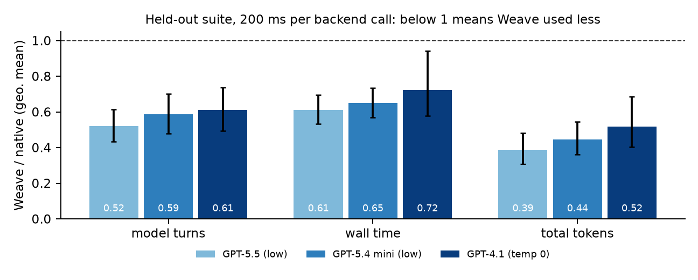
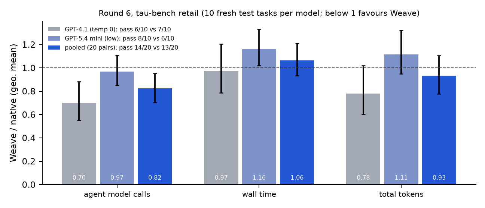
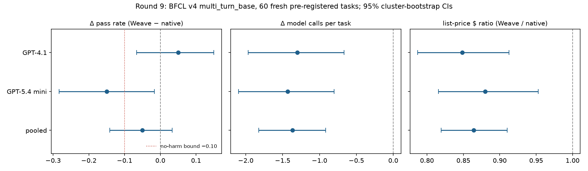

## Abstract

**Summary.** Weave is a runtime for fan-out and chained tool work. On our pre-registered suites, it cut tokens and
model turns substantially, and the real-services suites confirmed those gains. On tau-bench, an external conversational
benchmark paced by a simulated customer, it was a draw in our latest, larger round. On BFCL multi-turn (round 8, public tasks and grader), success was
equal within noise and Weave saved about 0.6 model calls per task, but it used 1.22× the tokens and cost 1.36× at list
prices. In round 9 a compact description, learned result types and a cache key made Weave cheaper on 60 fresh BFCL
tasks (0.86× pooled list-price cost, 25 % fewer tokens), with +3 tasks for GPT-4.1 but **−9 tasks for GPT-5.4 mini, a
significant loss**; on a real-services fan-out reconfirm it passed 40/40 against native's 27/40 at about half the cost. In round 10
an opt-in write gate brought GPT-5.4 mini to 30/105 against 24/105 on two BFCL categories never run before (not
significant, no-harm met) at equal cost; GPT-4.1 had 3/16 against 5/16.
The rest of this abstract gives
the details by round.

Agents built on function-calling models pay one model round trip for every round of tool calls, and the result of
each call goes back through the model's context. Weave is a small Python-like scripting runtime written in Rust that lets
the model send one script instead. The script can call tools, loop over results, branch and aggregate. The runtime
runs independent reads at the same time, holds back writes until the reads they depend on have finished, and returns
only what the script prints. We compare Weave with **native parallel function calling** on a pre-registered,
held-out suite of 10 tool-use tasks in 7 families, against a simulated backend with seeded per-call latency. Both arms
use the same model, system prompt, tool contracts and endpoint, and grading checks the backend's write log. On three
OpenAI models (GPT-5.5, GPT-5.4 mini and GPT-4.1; 120 trials each), Weave used **39–52 %** of native's tokens
(geometric-mean ratio; every 95 % CI is below 0.70) and **1.6–2.0 fewer model turns** per task. At 200 ms per backend
call it was **1.4–2.9 s faster** per task, with every CI below zero. Success was the same for the two GPT-5 models
(30/30 vs 30/30) and higher for GPT-4.1 (28/30 vs 23/30, McNemar p = 0.125, not significant). On the
pre-registered scaling suite, native token use grows by about 78 tokens per fanned-out item and native turns grow by one
per hop of a dependent chain. Weave's tokens and turns stay flat. We also report two places where Weave loses. A
script that writes inside a loop runs that loop's backend calls about 2× slower than native (because of the read/write
ordering rule). And when the backend latency is 0 ms, the time saved is almost the same as at 200 ms: in this setup the
speedup comes from fewer model round trips, not from the runtime's concurrency. A second, separately pre-registered
round fixes the first loss: with **footprint-aware ordering** (a read waits only for writes whose declared footprint
overlaps it), Weave's backend time on write-in-loop tasks fell to 0.96–1.07× native's, from about 2×, with no loss of
correctness. The same round confirmed the headline on fresh seeds and ran a **real-services** suite against SQLite, git,
the filesystem, a local HTTP server and the public PyPI API. Weave used 0.44–0.77× native's tokens there and passed at
least as often (GPT-4.1: 21/23 vs 12/24, p = 0.004). Its turn and wall-time gains held for the two GPT-5 models and
not for GPT-4.1, which kept writing Python that Weave did not accept (`def`, comprehensions, `lambda`). A third
pre-registered round adds those forms: comprehensions, generator expressions, `key=` lambdas, `map`/`filter`, sets and
inlined `def` helpers, all lowered to the loops Weave already schedules. On fresh seeds, no Weave script was rejected
for them (92 of 269 scripts used them), and GPT-4.1 passed 39/39 against native's 27/39 on `confirm3` (p < 0.001) and
21/24 against 13/24 on real services, with 1.3 fewer turns and 0.60× the tokens. Its real-services wall time went
from +0.1 s to −1.4 s per task, but that CI still included zero, because two GPT-4.1 Weave trials ran out of output
tokens on their first turn. A fourth pre-registered round traced those failures to the model splitting the work across
two parallel calls of the Weave tool and then running away to the output-token limit (6 of 64 dev samples), and fixed
the harness so such billed-but-failed responses count their tokens. With the tool's recommended `parallel_tool_calls:
false` in the Weave arm (declared before the run; native unchanged), a fresh real-services suite gave GPT-4.1 **30/30
against 18/30**, **−2.5 s per task [−3.4, −1.6]** and **0.51×** the tokens, and GPT-5.4 mini 30/30 against 25/30,
−3.8 s [−6.0, −1.7] and 0.54×; no Weave trial hit the limit. A fifth round tested the two biggest remaining threats. On an **external
benchmark, tau-bench retail** (Sierra, MIT; its tasks, user simulator and grader unchanged; 7 pre-registered test
tasks), **Weave showed no gain**: GPT-4.1 passed 4/7 against 3/7 but was 3.0 s slower per task (CI [0.3, 5.8]) and used
1.19× the tokens; GPT-5.4 mini passed **2/7 against 4/7**. These tasks are paced by a conversation with the user, and
Weave scripts failed when the model guessed the shape of data it had not yet seen, or used Python Weave lacked
(iterating a dict, `except Exception`). With
`parallel_tool_calls` set the same in both arms, our real-services result held (both on: GPT-4.1 −1.8 s [−3.0, −0.5]
and 0.59× the tokens; GPT-5.4 mini −4.6 s and 0.45×). Round 5 also overspent its token budget (Section 7). A sixth round
added the Python those scripts tripped on (dict iteration, exception classes, `raise`, `isinstance`, format specs and
more, checked against CPython on 663 programs, which also found and fixed two arithmetic bugs) and three agent-tool
options for conversations: rules to fetch everything the next reply needs in one script, notebook-style variables
that persist between scripts, and return shapes sampled from real results. On 10 fresh pre-registered tau-bench test
tasks per model, with `parallel_tool_calls` on in both arms, **Weave used fewer agent model calls (pooled −2.5 per
task, CI [−4.5, −0.5]; GPT-4.1 −4.4 [−7.5, −1.5])** and passed 14/20 against 13/20, with script errors down from 3.4
to 0.2 per GPT-4.1 trial. Tokens and wall time did not improve significantly (pooled 0.93× and +2.1 s, both CIs span no
change), and **GPT-5.4 mini was slower with Weave (+4.8 s per task, CI [+0.5, +9.5])**, about 2.5 s of it host
overhead in our adapter that we found and removed after the run. A seventh, pre-registered round reran
tau-bench on 12 more fresh tasks per model with that overhead removed. The host-time gap closed (pooled −0.02 s), but
**the call saving did not replicate significantly** (GPT-4.1 −1.6, CI [−3.8, +0.6]). Weave passed 17/24 against
14/24 (p = 0.45) and was, without significance, slower (+2.2 s) and costlier at list prices (1.08×). Code, data, all seven pre-registrations and a one-command reproduction are in the repository.

## 1. Introduction

Function calling is now the default way to connect a language model to tools. A turn is: the model emits one or more
calls, the host runs them, and every result is appended to the context before the next turn. Parallel function
calling [OpenAI-FC] lets the model ask for several independent calls in one turn, but it does not help when one call's
arguments depend on another's result, when the next step depends on a condition, or when the model only needs a sum
of fifty values rather than the fifty values themselves.

Code as the action space addresses this. CodeAct [CodeAct] showed that executable Python actions beat JSON tool
calls on several agent benchmarks, and industry practice has since moved the same way: Cloudflare's "Code Mode" turns
MCP tools into a TypeScript API that the model writes against [CF-CodeMode], and Anthropic describes running MCP
tools from code to cut context usage [Anthropic-MCP-Code]. Planning-then-executing systems such as ReWOO [ReWOO] and
LLMCompiler [LLMCompiler] cut model calls and run tools in parallel by having the model write a plan or DAG up front.

Weave sits between these. The model writes a short script in a restricted Python subset (no imports, no `def`, no
`while`), the runtime statically checks it against the registered tools, and the scheduler derives a dataflow graph
from it. That graph covers straight-line code and, as of this work, loops (Section 2.2). Each tool declares an effect
(pure, read, reversible, irreversible), and the runtime uses those effects to decide what may run concurrently and
what must wait.

The contribution of this paper is not a new idea of "code instead of JSON". It is a **fair, pre-registered measurement**
of what that idea buys over a strong native baseline, together with the engineering needed to make it hold up:

1. A benchmark harness (`bench/v4`) with equal tool contracts, parallel native calls, seeded backend latency, state
   validation of every write, retry-inclusive token accounting, a dev/held-out split and a pre-registration that was
   committed before the held-out runs (commit `8dae373`).
2. Runtime changes that the measurement showed were needed: pipelined loops, return types in the tool listing,
   error messages a model can repair from, and running several scripts of one turn concurrently (Section 2.3).
3. Results on three OpenAI models, including negative results and a breakdown of where the time goes.

## 2. System

### 2.1 Language and effects

A Weave script is Python syntax limited to assignment, calls, `if`/`else`, `for` with `break`/`continue`,
`try`/`except ToolError`, lists, dicts, f-strings, methods and a small set of builtins. A static check rejects unknown
tools, wrong arity and names used before they are assigned. Each host tool is registered with an effect:

- `pure` calls run as soon as their arguments are ready.
- A `read` waits for the preceding writes whose declared footprint overlaps its own (all preceding writes if either
  side declares nothing; Section 2.4).
- A `reversible` write waits for all earlier observable calls.
- An `irreversible` write also waits for the whole script to finish checking and running its reads.

So a script fails before it sends an email, not after. Every run is recorded as a trace that can be replayed exactly.

### 2.2 Scheduling loops

Before this work, Weave ran a loop in parallel only if no iteration depended on a value carried from the previous one.
A loop that accumulates, such as `total += get_price(sku)`, ran one call at a time, and that is the most common shape a
model writes. The runtime now pipelines read-only loops. It launches up to 64 iterations at a time and threads the
environment from one iteration to the next as futures, the same way it handles straight-line code. A tool call in
iteration *i* starts as soon as its own arguments are ready, even while the accumulator from iteration *i − 1* is still
pending. `break` and conditionally guarded calls are never issued early. Writes keep their order, and replay stays
exact. The CI tests are in `crates/weave/tests/loop_pipeline.rs`. The ablation in Section 5.5 measures the effect.

### 2.3 Fixes driven by traces

We diagnosed the earlier live protocol-v3 traces [Weave-v3], where GPT-5.5 passed on the first try in only 11 of 30 Weave
trials, and then iterated on the dev split. That produced these changes:

- **Return types in the listing.** The tool listing shows `name(params) -> type, effect E`. Without it, models treated
  MCP `{"value": ...}` envelopes as strings.
- **Repairable errors.** Examples:
  - "cannot add str and dict with keys 'value'"
  - "bad call: missing a required argument 'path'; call it as fs_read(path=...)"
  - "`functions.get_order` is not defined; tools are plain names"
  - a `while` hint that names `for _ in range(100): ... break`
  - a `key=` hint that names the loop to write
- **Python semantics restored.** Names assigned in a loop are usable after it, and an unbound name is a runtime error
  instead of silent empty output.
- **A silent data-loss bug fixed.** `d[k] = v` inside a parallel loop used to drop every key.
- **Concurrent scripts.** Several `run_weave` calls in one turn run concurrently when they are read-only.
- **REPL echo.** A final bare expression is printed, REPL style.
- **Prompt guidance.** The rules ask for few scripts and printing only what is needed.

The dev split was used for all of these. The `key=` hint and lists that compare lexicographically came from held-out
traces and were evaluated only on a fresh `confirm` suite (Section 5.6). The REPL echo came from `confirm` traces and
was evaluated on the round-2 `confirm2` suite (Section 5.10).

### 2.4 Footprint-aware ordering (round 2)

Tools can declare what they read and write as templates over their arguments, for example
`declare(effect="read", reads=["ticket:{ticket_id}"])` and
`declare(effect="irreversible", writes=["ticket:{ticket_id}", "tickets"])`. Weave used to use footprints only to
invalidate speculative reads. Now the scheduler keeps a log of pending writes, each with a future for its resolved
footprint, and a read walks that log and waits only for writes whose footprint overlaps its own. A write still waits
for every earlier observable call, so writes keep their order. An `if` or `for` that may write enters the log with a
footprint computed from its arguments where they are already bound (or, failing that, from what its body actually
wrote), so a later read need not wait for the condition. Loops whose bodies write are now pipelined too. Calls behind a
condition or a `break` are still never issued early. A tool with no declaration has footprint "everything", so
undeclared hosts see exactly the old order. Tests are in `crates/weave/tests/footprint_order.rs`: overlap and
non-overlap, read-your-write in straight-line code and in pipelined loops, failure propagation, `break`, replay, and a
20 000-write history.

This only helps hosts that declare footprints, and the benchmark tools do (`FOOTPRINTS` in `bench/v4/world.py` and
`bench/v4/real.py`). Native function calling has no use for them. The `weave_nofp` arm is the same engine with the
declarations removed.

### 2.5 The Python models write (round 3)

Rounds 1 and 2 rejected `def`, `lambda` and comprehensions with a hint, and the prompt said not to use them. GPT-4.1
used them anyway: 46 logged Weave scripts from those rounds failed the static check for these forms or for
`list.sort`, and each cost a turn. Round 3 accepts them. The lowering is syntactic and happens in the parser
(`crates/weave/src/parse/sugar.rs`), so it produces only statements Weave already had:

- A comprehension becomes an accumulator loop, `r = []` then `for x in xs: if c: r += [e]`. Loop variables are
  renamed so they do not leak, and the first iterable is evaluated outside, as in Python. Dict comprehensions collect
  `[key, value]` pairs (key first, as in Python 3.8+), so the loop stays an accumulator and its calls stay parallel.
  `any`/`all` over a generator become a loop that breaks at the first decisive item, so later calls are never made.
- `key=` on `sorted`/`min`/`max`/`list.sort` becomes a loop that computes the keys (in parallel, if they call tools),
  then a builtin that sorts stably or picks the first extreme item, as CPython does. `map`/`filter` become
  comprehensions.
- A top-level `def` is stored as source and inlined at each call with its parameters and locals renamed. A helper's
  free names are therefore the script's globals at the time of the call, as in Python. A helper that returns early
  becomes a one-iteration loop; `return` sets the result and the break flag of every enclosing loop, and the existing
  break desugaring guards the rest. Recursion, nested `def`, `*args`, non-literal defaults, use before the `def`,
  and changing an argument in place are rejected with a hint, since Weave values are not shared between caller and
  helper.
- Sets are lists without duplicates in first-seen order. Length, membership, sorting and iteration count match
  Python; printing a set does not.

A placement pass (`crates/weave/src/anf.rs`) moves each lowered construct in front of the statement that uses it, in
Python evaluation order: anything evaluated before it in the same expression is saved first, and a construct in a
branch Python may skip (`a if c else [..]`, `x and any(..)`) becomes an `if`. Effects, dependency scheduling, replay
and the limits therefore treat the result like code the model wrote by hand. Tests: generated programs against
CPython in batch, streamed and replayed form (`tests/audit/test_python_sugar.py`, 625 programs in CI and 1 525 in a
longer local run), and the Rust differential fuzzer now generates comprehensions, a helper with an early `return` and
a write, `key=` lambdas and short-circuit `any`, which must agree across sequential, parallel, streaming, speculative
and replayed execution (2 000 seeds locally).

### 2.6 One script per turn (round 4)

Round 3's two GPT-4.1 `max_output_tokens` failures recorded no output, so we replayed the exact first-turn request of
two dev `git_review` tasks (`bench/results/v7/diag-turn1/`). GPT-4.1 at temperature 0 almost always answered with
**two parallel `run_weave` calls**: a first script that only read and printed, and a second that did the whole task.
In 6 of 64 samples it then kept generating after the second call until the 4 096-token limit, and the API returned
nothing beyond the two completed calls. The round-3 trial that "printed the tags instead of creating them" had the
same shape: the work was split across scripts that do not share variables, and the model re-typed 40-character hashes
from one printout into the next script. Turning `parallel_tool_calls` off made every sample (28 of 28) a single script
with no runaway; a sentence in the tool rules alone ("call this tool once per turn ... scripts do not share
variables") cut the runaways from 5 of 28 to 1 of 28 but did not stop the split. `WeaveTool.request_options` now
returns `{"parallel_tool_calls": false}` for hosts to pass with the tool, and the rules carry the sentence. Native
tool calling needs parallel calls to batch, so the native arm keeps them; this is the one setting in which the arms
differ, and Addendum 4 declares it.

The harness also stopped recording 0 tokens for such responses: an `incomplete` Responses result is billed in full,
and its usage is now added to the trial (`billed_on_error`, with an excerpt of the output for diagnosis).

## 3. Related work

**Code as action.** CodeAct [CodeAct] has the model act by writing Python and reports higher success and fewer
turns than JSON or text actions. Weave restricts the language so it can be statically checked, scheduled by effect and
replayed, rather than sandboxing general Python.

**Plan-then-execute.** ReWOO [ReWOO] separates planning from observation to save tokens. LLMCompiler [LLMCompiler]
has the model emit a task DAG that is run with parallel function calls, and reports both latency and cost gains. A
Weave script is a plan that also contains control flow and aggregation, so the model does not have to see the
intermediate results.

**Tool use and reasoning.** ReAct [ReAct] interleaves reasoning with one action per step, which is the baseline loop
both our arms build on. Toolformer [Toolformer] teaches a model when to call tools.

**Protocols and practice.** The Model Context Protocol [MCP] standardises how tools are exposed. Weave ships a
`weave-mcp` proxy that turns any stdio MCP servers into one script tool. Cloudflare's Code Mode [CF-CodeMode] and
Anthropic's code-execution-with-MCP write-up [Anthropic-MCP-Code] argue for the same change of interface. We did not find
a published, pre-registered comparison against native parallel calls with state validation, and that gap is what this
work tries to fill.

## 4. Method

### 4.1 Arms

**native.** One JSON tool per backend function. Each description includes the effect and the return type, so the
contract is the same as Weave's listing. The model may emit parallel calls. The harness runs the reads of one turn
concurrently and the writes in order, as a well-built agent loop would.

**weave.** One tool, `run_weave(source)`. Its description is Weave's rules plus the same function list. Several calls
in one turn run concurrently if they are read-only.

Both arms share:

- the system prompt, model, generation settings and endpoint
- a cap of 16 model turns
- reasoning effort `low` for GPT-5.x and temperature 0 for GPT-4.1
- Responses API with `store=false`, with reasoning items replayed

### 4.2 Backend and tasks

`bench/v4/world.py` simulates an operations backend with 9 reads and 2 writes. Each call takes the mean latency ×
U(0.5, 1.5), drawn from a seeded RNG, with at most 8 calls in flight. Tasks are generated deterministically from (family,
size, seed). There are seven families:

| family | shape |
|---|---|
| `fanout_sum` | list, then N lookups, then a sum |
| `partial_failure` | the same, with some lookups failing (`try`/`except`) |
| `order_value` | two-level dependent fan-out with arithmetic |
| `chain` | follow `next` links until null (a dependent chain) |
| `triage` | N reads, then conditional writes |
| `notify_gold` | conditional fan-out, deduplication, irreversible sends |
| `top_customer` | fan-out, then an argmax and a name lookup |

A trial passes only if the final answer matches exactly **and** the write log matches the expected multiset, with
nothing missing, extra or duplicated.

### 4.3 Splits and pre-registration

- **dev** (5 tasks) was used for all tuning.
- **held_out** (10 tasks, including two families never run during development) was frozen. Its manifest hash, the
  hypotheses, models, repeats, latencies, budget and stopping rules were committed in
  `docs/paper/preregistration.md` before any held-out trial, and the runner refuses a held-out run unless the hash
  is in that file.
- **scaling** (fan-out n ∈ {5, 10, 20, 35, 50}; chain depth ∈ {2, 4, 8}) was frozen the same way.
- **confirm** (the held-out recipe with new seeds) was pre-registered in an addendum after the held-out runs.

One process note: the first pre-registration commit (`7285676`) recorded hashes that depended on `PYTHONHASHSEED`, and
the runner's guard refused every live run because of it. The fix (sort before shuffling, with a test) is commit
`8dae373`, and no held-out trial ran before it.

### 4.4 Metrics and statistics

- **Turns.** Model requests per trial.
- **Wall time.** Includes model latency, tool execution and retries.
- **Tokens.** Input plus output over every HTTP attempt.
- **Pass rates.** Reported with Wilson 95 % intervals and compared with an exact McNemar test on paired outcomes.
- **Paired comparisons.** For each task we average the Weave − native difference over repeats, and report the mean
  across tasks with a 95 % cluster bootstrap over tasks (4000 resamples). Ratios are geometric means of per-trial
  Weave/native, also cluster-bootstrapped.
- **Run design.** Each held-out configuration ran once, with 3 repeats at each of 200 ms and 0 ms mean backend latency.
  Trials ran in a seeded interleaved order, and the mode order was randomised per task, latency and repeat.

## 5. Results

All numbers below are generated from committed rows by `bench/v4/charts.py` and are listed in full in
[`results-tables.md`](results-tables.md).

### 5.1 Headline (held-out, 200 ms)



| model | pass W | pass N | turns W / N | Δ wall s [95 % CI] | token ratio W/N [95 % CI] |
|---|---|---|---|---|---|
| GPT-5.5 (low) | 30/30 | 30/30 | 2.00 / 4.00 | −2.88 [−3.75, −2.06] | 0.39 [0.31, 0.48] |
| GPT-5.4 mini (low) | 30/30 | 30/30 | 2.30 / 4.00 | −2.11 [−2.84, −1.50] | 0.44 [0.36, 0.54] |
| GPT-4.1 (t = 0) | 28/30 | 23/30 | 2.43 / 4.03 | −1.38 [−2.38, −0.10] | 0.52 [0.40, 0.69] |

Pre-registered hypotheses:

- **H1 (fewer turns): supported** for all three models. Every turn-difference CI is below 0.
- **H2 (lower wall time at 200 ms): supported** for all three. The GPT-4.1 interval is only just below 0.
- **H3 (no more tokens): supported**, at roughly half the tokens. Native carries every tool result in its context and
  pays for it again on every later turn. Weave returns only what the script prints. This holds even though Weave's
  rules and listing are sent on every request.
- **H4 (success non-inferior): supported.** The GPT-4.1 advantage (28 vs 23) is not significant (p = 0.125). Every
  native GPT-4.1 failure was an arithmetic error: it summed 20 values (`fanout_sum`) or 10 products (`order_value`) in
  its head, or picked the wrong argmax. Weave does that arithmetic in code.

### 5.2 By family


Weave's wall time is lower in every family except `top_customer` on GPT-4.1, where four Weave trials hit the
`max(key=lambda ...)` dead end (Section 5.6). The largest turn savings are on `chain` (2 vs 7 turns) and
`notify_gold` (2–2.8 vs 5).

### 5.3 Negative result: writes inside loops (H5, supported; fixed in round 2, Section 5.10)

On `triage` the time spent running backend calls is about **2× higher** for Weave (5.0 vs 2.6 s for GPT-5.5, and
similar for the other two models). The cause is the scheduling rule: in a loop that contains a write, each read waits
for the previous write. The native arm sends all reads in one turn and all writes in the next, so its calls overlap.
Weave still wins end-to-end on `triage` (7.96 vs 9.88 s for GPT-5.5) because it saves two model turns. With faster
models or slower backends, though, the trade-off could reverse. Tools already declare read/write footprints, which
Weave used only to invalidate speculative reads. Round 2 uses them for scheduling (Section 2.4), and Section 5.10
measures the result.

### 5.4 Where the time goes: 0 ms latency (H7)

At 0 ms backend latency the wall-time saving is almost unchanged: −2.84 s for GPT-5.5, −2.13 s for GPT-5.4 mini and
−1.88 s for GPT-4.1. Against a native baseline that already calls tools in parallel, **the saving comes from fewer model
round trips and shorter contexts, not from the runtime's concurrency.** Weave's concurrency matters when compared with
a naive sequential script (Section 5.5) and on dependent chains, where native has to make one model round trip per hop.

### 5.5 Ablation: loop pipelining (GPT-5.4 mini, 1 repeat)

The ablation turns pipelining off and keeps everything else the same:

- Backend execution time on `fanout_sum` goes from 0.75 to 3.49 s.
- On `order_value` it goes from 0.81 to 3.92 s.
- Wall time over the held-out suite goes from 4.04 to 6.35 s.

Without pipelining, Weave's wall-time advantage over native at 200 ms would mostly disappear. Turns and tokens do not
depend on it.

### 5.6 Confirm suite: fixes found on held-out

Every GPT-4.1 Weave failure on held-out had the same cause. The model wrote `max(pairs, key=lambda p: p[1])`, the check
rejected it with an unhelpful hint, and the model then guessed a name. We improved the hint, made lists compare
lexicographically, and ran the pre-registered `confirm` suite once (GPT-4.1, 3 repeats, 200 ms):

- Weave passed 28/30 and native 21/30 (McNemar p = 0.039).
- Turns were 2.70 vs 4.13.
- The token ratio was 0.55 [0.44, 0.72].
- Δ wall time was −2.28 s [−3.83, −0.79].

Five Weave trials hit the `key=` error again, and four of them recovered using the new hint. **C1** is therefore only
partly met. The pass rate matched held-out, but one of the two failures began at the same dead end. Both failures ended
the same new way: the model looked up names with scripts that were a bare `get_customer(cid)` expression, got "the
script printed nothing", and then guessed a name. Weave now echoes a script's final bare expression, the way a REPL
does. Section 5.10 evaluates this fix.

### 5.7 Scaling (H8, supported)


- On `fanout_sum` with GPT-5.4 mini at 0 ms, native tokens grow by about **78 tokens per item**, from 2.3 k at n = 5 to
  5.9 k at n = 50. Weave stays at about 1.85 k (a slope of 0.4).
- Native wall time grows from 3.0 to 6.6 s, while Weave stays between 1.8 and 2.1 s.
- On `chain`, native turns equal the depth plus one (3, 5, 9). Weave uses 2 at every depth.
- Native also failed 3 of 3 trials on `fanout_sum` n = 20 at 200 ms (arithmetic errors), but none of the identical
  trials at 0 ms. This is model sampling noise on the same data, and a reminder that n = 3 per cell is small.

### 5.8 Protocol v3 rerun (before and after the fixes)

The earlier protocol-v3 suite (10 file/git/memory tasks over the real `weave-mcp` binary, strict grading) was the
diagnosis set, so this is a before-and-after comparison on tuned data, not a held-out result. Protocol v3 is the
*strict* arm. It replaces Weave's error hints with one generic message and sends both arms the full tool results, so
the improvement below comes from the typed listing, the rules and the runtime fixes, not from the error messages.
Benchmark v4 is the *product* arm, which shows Weave's real output and errors.

| model | Weave first-try, before → after | Weave pass | native pass | Weave turns | native turns |
|---|---|---|---|---|---|
| GPT-5.5 | 11/30 → 30/30 | 28 → 30 | 29 → 28 | 2.97 → 2.00 | 3.27 → 3.27 |
| GPT-5.4 mini | 26/30 → 30/30 | 28 → 30 | 28 → 28 | 2.80 → 2.03 | 3.27 → 3.30 |
| GPT-4.1 | 20/30 → 26/30 | 25 → 28 | 26 → 24 | 3.23 → 2.37 | 3.30 → 3.30 |

### 5.9 Other providers

- **Gemini 3.5 Flash (free tier).** The run ran into the per-minute rate limit. Of 20 planned trials, 4 completed
  (3 Weave and 1 native, all passed), and 16 ended with `rate_limit` errors. Per the pre-registration we report this
  and do not pool it. It shows the adapter works and nothing more.
- **GLM (z-ai/glm-5.3-flash via NVIDIA build).** The key is valid (`/v1/models` answers and lists the model), but every
  chat request to this model timed out on 2026-11-10: after 45–60 s at 20:49, 20:58 and 21:18 ET; after 35 s at 21:42
  and 21:54 ET; and with a 120 s streaming request at 21:55 ET. Other models on the same endpoint answered at once
  (with HTTP 410, retired). Not run.
- **Gemini, round 2.** The paced `real` run (1 worker, 12 s between requests) started at 21:48 ET and finished no
  trial. The free tier allows 20 requests a day and that day's quota was already used. A complete run needs about 40–50
  requests, more than one day's free quota. The empty run directory is kept with a note.
- **Gemini, round 3.** A smoke request answered at 22:39 ET, so the paced `real2` run (1 worker, 12 s between
  requests) started. One trial finished (native `sqlite_triage`, passed); the other 15 ended with HTTP 429 "exceeded
  your current quota". Not pooled; `confirm3` was not attempted.
- **GLM, round 3.** `/v1/models` lists `z-ai/glm-5.3-flash`, but 35 s smoke requests timed out at 22:39, 22:44 and
  22:51 ET. Not run.
- **Anthropic.** No key was available. Not run.

### 5.10 Round 2: footprints, the echo fix, and real services

Everything in this section was pre-registered in Addendum 2 of `preregistration.md` (commit `a887e3a`) before any
run on its suites. Each configuration ran once.

**confirm2** is the held-out recipe with seeds + 200, plus three extra write-in-loop tasks (13 tasks, 200 ms). Three
arms: Weave, native, and Weave without footprint declarations (`weave_nofp`).

| model | pass W | pass N | turns W / N | Δ wall s [95 % CI] | token ratio W/N [95 % CI] |
|---|---|---|---|---|---|
| GPT-5.5 (low, 1 repeat) | 13/13 | 13/13 | 2.00 / 4.08 | −3.93 [−5.06, −2.81] | 0.36 [0.30, 0.43] |
| GPT-5.4 mini (low) | 39/39 | 37/39 | 2.08 / 4.05 | −2.60 [−3.16, −2.05] | 0.38 [0.32, 0.46] |
| GPT-4.1 (t = 0) | 37/39 | 30/39 (p = 0.065) | 2.36 / 4.21 | −2.19 [−3.11, −1.33] | 0.46 [0.40, 0.54] |


Backend execution time on the write-in-loop tasks (`triage`, `notify_gold`), as paired geometric-mean ratios:

| model | exec s W / native / W-no-footprints | W / native [95 % CI] | W / W-no-footprints [95 % CI] |
|---|---|---|---|
| GPT-5.5 (low) | 1.84 / 1.92 / 3.40 | 0.97 [0.93, 1.01] | 0.65 [0.48, 0.89] |
| GPT-5.4 mini (low) | 2.23 / 2.07 / 3.69 | 1.07 [0.94, 1.24] | 0.66 [0.49, 0.91] |
| GPT-4.1 (t = 0) | 1.92 / 2.00 / 3.36 | 0.96 [0.92, 0.99] | 0.66 [0.48, 0.89] |

- **F1 (gap closed): supported.** Weave/native is 0.96–1.07, inside the ≤ 1.2 bound, down from about 2× in round 1.
- **F2 (it was the ordering): supported.** Removing the declarations makes the same engine about 1.5× slower on these
  tasks (ratio CIs below 1 for all three models).
- **F3 (no correctness cost): supported.** Weave and `weave_nofp` passed 13/13 and 13/13, 39/39 and 39/39, and
  37/39 and 38/39. No failure involved a stale read. GPT-4.1's two Weave failures were both `top_customer`: the model
  wrote `max(..., key=lambda ...)`, got the static error, and then guessed a name.
- **E1 (echo): supported.** GPT-4.1 ended 71 of its 185 Weave scripts with a bare expression. All 71 got the value
  echoed back, and none got "the script printed nothing". GPT-4.1's Weave pass rate was 37/39 (95 %).
- **C3: supported.** Turns, tokens and wall time are lower for every model, with every CI excluding zero (or one), and
  the pass rate is non-inferior. Every native failure was again an answer error (arithmetic or argmax), not a write
  error.


**real** runs the same agent loop against real systems: a SQLite database, a git repository built with real commits,
JSON files on disk, a real HTTP server on 127.0.0.1 that reads stock from SQLite, and the public PyPI JSON API (8 tasks
in 4 families, no injected latency). Grading inspects the real end state: database rows, git tags and their target
commits, and file contents. PyPI ground truth is fetched live at the start of each trial.

| model | pass W | pass N | turns W / N | Δ turns [95 % CI] | Δ wall s [95 % CI] | token ratio W/N [95 % CI] |
|---|---|---|---|---|---|---|
| GPT-5.5 (low, 1 repeat) | 8/8 | 8/8 | 2.00 / 3.50 | −1.50 [−2.25, −0.75] | −4.89 [−6.43, −3.33] | 0.44 [0.32, 0.61] |
| GPT-5.4 mini (low) | 22/24 | 21/24 | 2.50 / 3.50 | −1.00 [−1.71, −0.33] | −1.16 [−2.35, −0.04] | 0.63 [0.44, 0.87] |
| GPT-4.1 (t = 0) | 21/23 | 12/24 (p = 0.004) | 2.78 / 3.50 | −0.71 [−1.46, +0.08] | +0.06 [−1.66, +2.03] | 0.77 [0.51, 1.30] |

- **R1: supported for GPT-5.5 and GPT-5.4 mini, partly for GPT-4.1.** For GPT-4.1, pass rate and tokens meet the
  criteria, but the turn difference CI includes 0 and wall time is unchanged. In 6 of its 69 Weave scripts GPT-4.1
  wrote `def` or list comprehensions, got a static error and spent another turn. On `pypi_major` it was 2.4× slower
  than native (7.5 vs 3.1 s). Native GPT-4.1 failed every `pypi_major` trial by adding up 10–16 version numbers in
  its head.
- **Wall time by family** matches the prediction only in part. `sqlite_triage` (1.8–2.9 vs 4.9–9.6 s) and
  `warehouse_shortfall` were faster with Weave for every model. `git_review` was clearly faster only for GPT-5.5 (GPT-5.4 mini was slower with Weave, 4.8 vs 4.1 s). On
  `pypi_major`, where we predicted no difference, GPT-5.5 was faster with Weave and GPT-4.1 was slower.
- On real local services every call takes milliseconds, so the wall-time gain there is entirely saved model turns.
- **Run incident.** The GPT-4.1 `real` run crashed on its last trial, when the harness's own PyPI ground-truth fetch
  timed out before the model was called. We kept the 47 finished trials and did not rerun. The harness now retries
  that fetch (a change made after the runs). The analysis commit `8be21fe` (charts only) came after the
  pre-registration and before the `real` runs.

**Dev measurements** used while building round 2 (GPT-5.4 mini, `dev` and `real_dev`) are in `bench/results/v5/` and
are listed in the runs table, but they are not evidence.

### 5.11 Round 3: the Python models write

Everything here was pre-registered in Addendum 3 (commit `915488e`) before any run on its suites, with fresh seeds:
`confirm3` is the `confirm2` recipe with seeds + 100 more (13 tasks, 200 ms), and `real2` is the `real` recipe with
seeds + 100 (8 tasks: summing major versions from the live PyPI API, SQLite triage, creating real git tags, and the
warehouse service). Two arms, Weave and native. The only change since round 2 is Section 2.5 and the matching line
in Weave's tool description. One dev run preceded the addendum (GPT-4.1 on `real_dev`, 2 repeats; listed in the runs
table, not evidence).

| suite | model | pass W | pass N | turns W / N | Δ turns [95 % CI] | Δ wall s [95 % CI] | token ratio W/N [95 % CI] |
|---|---|---|---|---|---|---|---|
| confirm3 | GPT-5.5 (low, 1 repeat) | 13/13 | 13/13 | 2.00 / 4.08 | −2.08 [−2.77, −1.54] | −5.04 [−8.12, −2.82] | 0.38 [0.32, 0.46] |
| confirm3 | GPT-5.4 mini (low) | 39/39 | 37/39 | 2.10 / 4.08 | −1.97 [−2.69, −1.38] | −4.58 [−6.39, −2.98] | 0.40 [0.34, 0.49] |
| confirm3 | GPT-4.1 (t = 0) | 39/39 | 27/39 (p < 0.001) | 2.21 / 4.10 | −1.90 [−2.56, −1.28] | −3.95 [−8.28, −1.09] | 0.46 [0.38, 0.56] |
| real2 | GPT-5.5 (low, 1 repeat) | 8/8 | 8/8 | 2.00 / 3.50 | −1.50 [−2.25, −0.75] | −4.66 [−6.37, −3.08] | 0.47 [0.34, 0.64] |
| real2 | GPT-5.4 mini (low) | 23/24 | 22/24 | 2.25 / 3.58 | −1.33 [−2.17, −0.46] | −2.88 [−4.99, −0.07] | 0.55 [0.36, 0.83] |
| real2 | GPT-4.1 (t = 0) | 21/24 | 13/24 (p = 0.057) | 2.17 / 3.50 | −1.33 [−2.17, −0.50] | −1.43 [−4.95, +2.31] | 0.60 [0.40, 1.04] |


- **S1 (the rejections are gone): supported.** No Weave script on either suite failed the static check because of
  `def`, `lambda`, a comprehension or `list.sort`. 92 of the 269 Weave scripts used at least one of these forms
  (GPT-4.1: 29 of 97 on `confirm3`, 25 of 43 on `real2`, including 6 with a `def`), and every one was accepted. The
  only two static rejections were a `while` loop (GPT-4.1) and a stray non-ASCII character (GPT-5.4 mini). No Weave
  script hit a runtime error caused by the new forms; the only runtime errors were two PyPI TLS timeouts.
- **S2 (GPT-4.1's real-services loss is removed): partly supported.** Turns (−1.33, CI below 0), pass rate (21/24 vs
  13/24) and tokens (ratio 0.60) meet the criteria. Wall time does not: the mean moved from +0.06 s in round 2 to
  −1.43 s, but its CI is [−4.95, +2.31]. The loss moved to `git_review` (Weave 3/6 and 9.8 s against native 6/6 and
  3.7 s). Two of those Weave trials ended on the first turn with the provider's `max_output_tokens` stop (16 and 21 s),
  and the pre-registered rules count them as failures (Section 2.6 has the cause). A third printed the tags it meant to create and answered
  without creating them. Excluding the two provider-error pairs, which the rules do not allow and we report only as
  a sensitivity check, gives −2.71 s [−5.56, −0.02]. Those two trials record 0 tokens, although the provider billed
  4 096 output tokens plus the input for each; the token ratio is therefore slightly understated (Section 5.12).
- **S3 (PyPI): supported.** On `pypi_major` GPT-4.1 Weave took 3.49 s against native's 3.61 s (round 2: 7.5 vs 3.1 s),
  and passed 6/6 against 0/6. GPT-4.1 now writes the comprehension it wrote in round 2, and it runs.
- **R2: supported** for GPT-5.5 and GPT-5.4 mini: pass rate non-inferior, turns and tokens lower, and wall time lower
  with CIs below 0. GPT-5.4 mini's `pypi_major` times (9.2 vs 9.1 s) include PyPI TLS timeouts that hit both arms.
- **C4: supported.** On `confirm3` every model has fewer turns, fewer tokens and lower wall time, with every CI
  excluding 0 (or 1), and the pass rate is non-inferior. GPT-4.1's `top_customer` tasks, which failed in round 2
  because `max(..., key=lambda ...)` was rejected, passed 6/6.
- **By family on `real2` (GPT-4.1).** `sqlite_triage` 1.8 vs 8.5 s, `warehouse_shortfall` 2.9 vs 8.6 s (6/6 vs 1/6),
  `pypi_major` 3.5 vs 3.6 s, `git_review` 9.8 vs 3.7 s.

### 5.12 Round 4: one script per turn, and honest accounting

Pre-registered in Addendum 4 (commit `e35e9d0`) before any run on `confirm4`: the `real` recipe with seeds + 200
plus two more `git_review` tasks (n10 s303, n18 s304), 10 tasks, 3 repeats, GPT-4.1 and GPT-5.4 mini. The changes
since round 3 are Section 2.6. Dev runs preceded the addendum (`real_dev_git` and `real_dev`; runs table, not
evidence): GPT-4.1 Weave on `real_dev_git` went from 22/24, 2.92 turns and 4 960 tokens per trial (round-3 product,
both failures `incomplete`) to 24/24, 2.00 and 2 233.

| suite | model | pass W | pass N | turns W / N | Δ turns [95 % CI] | Δ wall s [95 % CI] | token ratio W/N [95 % CI] |
|---|---|---|---|---|---|---|---|
| confirm4 | GPT-5.4 mini (low) | 30/30 | 25/30 (p = 0.062) | 2.10 / 3.40 | −1.30 [−1.97, −0.63] | −3.83 [−5.98, −1.74] | 0.54 [0.41, 0.72] |
| confirm4 | GPT-4.1 (t = 0) | 30/30 | 18/30 (p < 0.001) | 2.00 / 3.40 | −1.40 [−2.00, −0.80] | −2.50 [−3.36, −1.64] | 0.51 [0.40, 0.66] |


- **G1 (no runaway): supported.** No trial in either arm ended `incomplete`; every one of the 120 trials answered.
- **G2 (git_review): supported.** GPT-4.1 Weave 12/12 against native 9/12, 2.10 s against 4.04 s (Δ −1.95 s
  [−2.66, −1.11]); GPT-5.4 mini 12/12 against 8/12, 2.95 against 7.82 s.
- **G3 (the S2 wall-time gap closes): supported.** GPT-4.1: Δ wall −2.50 s with the CI below 0, Δ turns CI below 0,
  token ratio upper bound 0.66, pass 30/30 against 18/30.
- **G4: supported** for GPT-5.4 mini on all four criteria.
- **A1 (accounting): supported, weakly tested.** No `confirm4` row had a provider error, so the rule was not exercised
  there; on the dev run with the round-3 product the two `incomplete` rows recorded their 5 033 billed tokens each.
  Rounds 2 and 3 have three `incomplete` OpenAI rows (one in `real`, two in `real2`, all GPT-4.1) whose ledgers did not
  keep the usage, so their tables are not re-derived; they undercount at least 3 × 4 096 output tokens.
- **What still loses.** GPT-5.4 mini's `pypi_major` Weave time was 4.98 s against native's 4.07 s (6 trials per arm;
  its script time was 2.6 s against 1.0 s, consistent with the PyPI TLS slowdowns seen in round 3). Native GPT-4.1 still
  fails every `pypi_major` task by adding version numbers in its head, which inflates its pass-rate gap.
- **The deviation matters for interpretation.** Round 4 measures Weave as we now recommend shipping it (one script per
  turn), not the round-3 configuration. Native keeps parallel calls, which it needs; we did not run a native arm with
  them off.
- **Other providers.** Gemini answered its smoke request with HTTP 429 (quota) and GLM timed out after 35 s
  (`bench/results/v7/smoke-best-effort.md`); per the addendum, neither was run.

### 5.13 Round 5: an external benchmark, and equal settings

Pre-registered in Addendum 5 (commit `6b767ce`) before any evidence run.

**tau-bench retail.** [tau-bench](https://github.com/sierra-research/tau-bench) (Sierra, MIT license, commit
`59a200c`) is a public tool-use benchmark in which an agent serves a simulated customer under a written policy, with
tools over a retail database; the grader compares the final database with the ground truth and checks required
outputs. We installed it unmodified. The native arm is tau-bench's own `ToolCallingAgent`. The Weave arm
(`bench/taubench/weave_agent.py`) is the same loop with one `run_weave` tool, whose scripts call the same tau-bench tools
through `env.step`, so the environment and grader see the same actions. The user simulator is tau-bench's (GPT-4.1,
default sampling) in both arms, and both send `parallel_tool_calls: false`. The subset is 7 test-split tasks chosen by a
seeded sample (18, 22, 45, 52, 56, 76, 105), one repeat, sized to the budget.

| model | pass W / N | agent calls W / N | Δ agent calls [95 % CI] | wall s W / N | Δ wall s [95 % CI] | token ratio W/N [95 % CI] |
|---|---|---|---|---|---|---|
| GPT-4.1 (t = 0) | 4/7 / 3/7 (p = 1.0) | 17.1 / 17.1 | +0.00 [−3.57, +3.43] | 25.2 / 22.3 | **+2.97 [+0.26, +5.77]** | 1.19 [0.90, 1.55] |
| GPT-5.4 mini (low) | **2/7 / 4/7** (p = 0.5) | 12.9 / 15.1 | −2.29 [−6.57, +1.57] | 28.1 / 31.5 | −3.35 [−11.40, +4.52] | 0.98 [0.63, 1.45] |


- **T1 (no harm): supported for GPT-4.1, not for GPT-5.4 mini** (2/7 against 4/7, below the margin of one task). With
  seven pairs neither pass difference is significant, in either direction.
- **T2 (agent calls): no difference.** These tasks are paced by the conversation: the policy requires the user's
  explicit confirmation before every write, and each step needs the user's next message. Most Weave scripts made one or
  two tool calls, which is what native does in a step.
- **T3 (tokens): no saving.** GPT-4.1 used 1.19× (CI includes 1), GPT-5.4 mini 0.98×. Weave's tool description (the
  rules plus every tau-bench tool with its arguments) is longer than tau-bench's JSON schemas, and it is sent on every
  call.
- **GPT-4.1 was slower with Weave** (+3.0 s per task, CI excludes 0), the one significant difference here, and a loss.
- **Why scripts failed.** 26 Weave script results were errors. The largest group (10) was a model guessing a data
  shape it had not seen: tau-bench's user record lists order ids, and the script indexed each id as if it were an order
  (`string index must be int`). Native calling shows the model each JSON result before it writes the next call; a
  script is written before it sees any. (Correction, round 6: an earlier draft said a bare `except:` did not help because
  Weave's `except` catches only tool errors. That was wrong. A bare `except` already caught runtime errors; in the
  trace, the failing access, `for item in order['items']`, was outside the `try`.) The rest were Python Weave does not support: iterating a
  dict (5), `str.get` (2), `except Exception` (2), `isinstance` (1), plus missing keys and tool errors. Each cost a turn.
  We did not fix these in this round: tuning on the evidence subset is not allowed, and the budget was spent.

**Equal settings on our real-services suite (`confirm5`, fresh seeds, 1 repeat, 40 trials per model).**

| model | comparison | pass A / B | turns A / B | Δ wall s [95 % CI] | token ratio [95 % CI] | incomplete A / B |
|---|---|---|---|---|---|---|
| GPT-4.1 | P1: native off vs on | 2/10 / 6/10 | 15.2 / 3.4 | +8.37 [+6.76, +10.48] | 3.66 [3.00, 4.52] | 0 / 0 |
| GPT-4.1 | P2: Weave on vs off | 10/10 / 10/10 | 2.2 / 2.0 | +0.60 [−0.16, +1.47] | 1.17 [1.00, 1.47] | 0 / 0 |
| GPT-4.1 | P3: Weave vs native, both on | 10/10 / 6/10 | 2.2 / 3.4 | −1.76 [−2.96, −0.46] | 0.59 [0.42, 0.83] | 0 / 0 |
| GPT-4.1 | P3: Weave vs native, both off | 10/10 / 2/10 | 2.0 / 15.2 | −10.73 [−12.15, −9.61] | 0.14 [0.13, 0.16] | 0 / 0 |
| GPT-5.4 mini | P1: native off vs on | 3/10 / 8/10 | 15.2 / 3.5 | +9.22 [+7.08, +10.88] | 3.75 [3.18, 4.38] | 0 / 0 |
| GPT-5.4 mini | P2: Weave on vs off | 10/10 / 10/10 | 2.0 / 2.1 | −0.18 [−0.75, +0.34] | 0.89 [0.78, 0.97] | 0 / 0 |
| GPT-5.4 mini | P3: Weave vs native, both on | 10/10 / 8/10 | 2.0 / 3.5 | −4.63 [−7.96, −2.30] | 0.45 [0.36, 0.58] | 0 / 0 |
| GPT-5.4 mini | P3: Weave vs native, both off | 10/10 / 3/10 | 2.1 / 15.2 | −13.67 [−15.57, −11.70] | 0.14 [0.12, 0.17] | 0 / 0 |

- **P1.** Native tool calling needs parallel calls: with them off it makes one call per turn, and on these 8–18-item
  tasks it reaches the 16-turn cap (pass 2/10 and 3/10). The "both off" comparison is therefore dominated by that cap and
  we do not use it as evidence for Weave.
- **P2.** Weave with parallel calls on passed 10/10 for both models and did not run away in these 10 trials (round 4
  saw the runaway in 6 of 64 first-turn samples, so 10 trials can easily miss it). GPT-4.1 used 1.17× the tokens with
  them on.
- **P3, both on (the equal-settings test of round 4): supported for both models.** Δ wall and Δ turns CIs are below 0,
  token ratio CIs are below 1, and the pass rate is not lower. The round-4 result does not depend on the arms' different
  settings.
- **Other providers.** Gemini (HTTP 429, quota) and GLM (timeout) failed their smoke requests again; not run.

### 5.14 Round 6: Python for conversations, and tau-bench on fresh tasks

Pre-registered in Addendum 6 (commit `6b3024a`) before any evidence run. OpenAI models only. Every change was tuned on
tau-bench's train split and our dev suites.

**Language.** Section 5.13 listed the Python that tau-bench scripts tripped on. Weave now accepts:

- iterating a dict (`for k in d`, `sorted(d)`, comprehensions);
- `except Exception`, builtin exception classes and tuples of them, each catching only its own kind (a missing key is
  a `KeyError`, a tool failure a `ToolError`);
- `raise` and `assert`, with no irreversible call issued after a raise;
- `isinstance`, `round`, `dict()`, and `json.dumps` without an import;
- f-string format specs, `str.format`, and `%` formatting;
- `d.update`/`d.pop`/`xs.pop` as statements;
- names assigned in an `else` or `try` whose other branch ends in `continue`, `break`, `return` or `raise`. The
  round-5 static check rejected these, and one tau-bench script hit it.

A new CPython differential suite runs each program in batch mode, streamed and replayed: 63 fixtures plus 600
generated programs. It found two old bugs, now fixed. `//` and `%` used Euclidean division for negative operands
(`7 // -2` gave −3, not −4), and floats printed without scientific notation (`1e20` as `100000000000000000000.0`).
Indexing a str or list with a key now names the value it got. Before, the error said only `string index must be int`.

**Agent tool.** `WeaveTool(conversational=True)` adds two rules. First, chain dependent lookups in one script and
print a compact summary. Second, never change state before the person confirms that exact change.
`persist_variables=True` keeps the variables of earlier scripts, like a notebook. They are passed as literal
assignments, so effects, scheduling and limits are unchanged. `shape_of_samples` derives a return shape from several
real results. The tau-bench adapter samples them with `Tool.invoke` on a copy of the database, so they never become
actions. A dev run showed why several samples matter: a shape built from one product listed that product's option
keys, and GPT-4.1 then searched backpacks for a `style` key that backpacks do not have.

**tau-bench, `retail_test10r6`** (10 fresh test tasks, 1 repeat, both arms `parallel_tool_calls: true`):

| model | pass W / N | agent calls W / N | Δ agent calls [95 % CI] | wall s W / N | Δ wall s [95 % CI] | token ratio W/N [95 % CI] |
|---|---|---|---|---|---|---|
| GPT-4.1 (t = 0) | 6/10 / 7/10 (p = 1.0) | 10.6 / 15.0 | **−4.40 [−7.50, −1.50]** | 27.4 / 28.0 | −0.60 [−6.33, +5.13] | 0.78 [0.60, 1.02] |
| GPT-5.4 mini (low) | 8/10 / 6/10 (p = 0.5) | 12.8 / 13.3 | −0.50 [−2.20, +1.30] | 36.9 / 32.2 | **+4.76 [+0.47, +9.52]** | 1.11 [0.95, 1.32] |
| pooled (20 pairs) | 14/20 / 13/20 (p = 1.0) | 11.7 / 14.2 | **−2.45 [−4.45, −0.50]** | 32.2 / 30.1 | +2.08 [−1.73, +6.05] | 0.93 [0.78, 1.11] |



- **U1 (no harm): supported for both models.** GPT-4.1 passed 6/10 against 7/10, inside the one-task margin. GPT-5.4
  mini passed 8/10 against 6/10. Neither difference is significant.
- **U2 (agent calls): supported for GPT-4.1 and pooled. Not supported for GPT-5.4 mini.** GPT-4.1's scripts made 2.35
  tool calls each, against round 5's one or two, and it needed 4.4 fewer model calls per task. GPT-5.4 mini's scripts
  made 1.66 calls each, and its call count barely moved.
- **U3 (tokens): no significant change.** GPT-4.1 used 0.78× the tokens, but the CI reaches 1.02. GPT-5.4 mini used
  1.11×, and the pooled ratio is 0.93×.
- **U4 (wall time): a loss for GPT-5.4 mini** (+4.8 s per task, CI excludes 0). GPT-4.1 and the pooled result show no
  significant difference. Part of the loss is our own host code. Wall time minus the metered LLM time (agent plus user)
  was 1.8–2.5 s for the Weave arm and −0.9 s for native. Most of that gap is the shape sampler: in the evidence run it
  deep-copied the database for every sample call, about 2.2 s per trial. It is now cached and takes 0.03 s. The
  metered LLM time alone differed by −3.3 s for GPT-4.1 (CI [−8.7, +2.3]) and +1.4 s for GPT-5.4 mini (CI
  [−2.7, +5.8]; paired bootstrap, 10,000 resamples). That comparison is exploratory, not pre-registered. We have not rerun the evidence with the fix.
- **U5 (script errors): down.** GPT-4.1 averaged 0.20 errors per trial (2 of 51 scripts), against 3.43 in round 5.
  GPT-5.4 mini averaged 0.30, against 0.29.

These are 10 tasks per model, one repeat, and a sampling user simulator, so only large effects show. The only
effects that clear zero are fewer agent calls (GPT-4.1 and pooled) and GPT-5.4 mini's slower wall time. Weave does
not yet win on tau-bench. It now matches native's success with fewer model calls for GPT-4.1, and it is slower for
GPT-5.4 mini.

### 5.15 Round 7: a larger rerun with the overhead removed

Pre-registered in Addendum 7 (commit `bc935fc`) before any evidence trial. The 12 test tasks (`retail_test12r7`:
0, 2, 7, 9, 50, 54, 70, 72, 73, 83, 94, 101) are seeded and disjoint from rounds 5 and 6. The Weave arm is round 6's,
except that return shapes are cached per environment. The agent, prompt and tool description are unchanged, there
were no dev runs, and both arms send `parallel_tool_calls: true`. All 48 trials ran.

| model | pass W / N (McNemar p) | agent calls W / N | Δ agent calls [95 % CI] | Δ wall s [95 % CI] | token ratio [95 % CI] | $ ratio [95 % CI] | Δ host s [95 % CI] |
|---|---|---|---|---|---|---|---|
| GPT-4.1 (t = 0) | 9/12 / 7/12 (0.63) | 11.7 / 13.3 | −1.58 [−3.83, +0.58] | +2.13 [−1.25, +5.40] | 1.06 [0.87, 1.29] | 1.05 [0.89, 1.24] | +0.08 [−0.00, +0.17] |
| GPT-5.4 mini (low) | 8/12 / 7/12 (1.0) | 12.5 / 12.9 | −0.42 [−2.17, +1.58] | +2.32 [−2.56, +8.11] | 1.15 [0.98, 1.36] | 1.11 [0.92, 1.34] | −0.12 [−0.48, +0.16] |
| pooled (24 pairs) | 17/24 / 14/24 (0.45) | 12.1 / 13.1 | −1.00 [−2.42, +0.46] | +2.22 [−0.75, +5.55] | 1.10 [0.97, 1.26] | 1.08 [0.95, 1.23] | −0.02 [−0.21, +0.13] |


**Cost at OpenAI list prices.** Per 1M tokens:

- GPT-4.1: $2.00 uncached input, $0.50 cached input, $8.00 output;
- GPT-5.4 mini: $0.75, $0.075 and $4.50;
- the user simulator is priced as GPT-4.1, and reasoning tokens count as output.

The round cost **$2.35**: GPT-4.1 $0.85 Weave and $0.80 native, GPT-5.4 mini $0.37 and $0.33. Per trial:

| model, arm | input | of which cached | output |
|---|---|---|---|
| GPT-4.1, Weave | 70.7k | 54.8k | 1,486 |
| GPT-4.1, native | 66.4k | 49.7k | 1,040 |
| GPT-5.4 mini, Weave | 76.6k | 63.1k | 1,974 |
| GPT-5.4 mini, native | 66.9k | 52.8k | 1,513 |

Weave writes more output tokens per trial (scripts) and, this round, read slightly more input. Round 6, priced the same
way, cost $1.91. There Weave cost 0.77× for GPT-4.1 (CI [0.59, 1.00]) and 1.04× for GPT-5.4 mini. Tokens are 3.44M
for the round (1.68M GPT-4.1, 1.76M GPT-5.4 mini).

- **V1 (no harm): supported.** Weave passed 9/12 against 7/12 and 8/12 against 7/12.
- **V2 (agent calls): not replicated.** Both point estimates favour Weave, but no CI excludes 0. GPT-4.1's scripts made
  2.02 tool calls each (2.35 in round 6).
- **V3 (wall time): no significant difference, but not a win.** GPT-5.4 mini's CI now includes 0, as predicted. Both
  point estimates are Weave slower, by about 2 s per task.
- **V4 (tokens) and V5 (cost): no significant difference.** Point estimates are 1.06–1.15× tokens and 1.05–1.11×
  dollars, Weave higher.
- **V6 (host time): supported.** The adapter's overhead is gone: the Weave-minus-native host time is within ±0.2 s.
  What remains of the wall-time gap is model time. In an exploratory comparison, metered model time was +2.1 s for
  GPT-4.1 and +2.4 s for GPT-5.4 mini, neither significant.
- **V7 (script errors).** 0.33 per trial for GPT-4.1 (0.20 in round 6) and 0.25 for GPT-5.4 mini (0.30).

**Rounds 6 and 7 together** (exploratory, 22 tasks per model; round 6's Weave wall time includes the uncached
sampling):

| | pass W / N | Δ agent calls [95 % CI] | Δ wall s [95 % CI] | token ratio [95 % CI] |
|---|---|---|---|---|
| GPT-4.1 | 15/22 / 14/22 | −2.86 [−4.77, −1.05] | +0.89 [−2.25, +4.19] | 0.92 [0.78, 1.11] |
| GPT-5.4 mini | 16/22 / 13/22 | −0.45 [−1.68, +0.95] | +3.43 [−0.10, +7.21] | **1.13 [1.01, 1.28]** (more tokens with Weave) |

So on conversational tau-bench tasks, Weave saves GPT-4.1 a few model calls. That saving does not show up in time or
cost, and with GPT-5.4 mini Weave uses more tokens. Success is the same within noise, with every point estimate
favouring Weave. We report this as a draw with a call saving, not a win.

### 5.16 Round 8: BFCL multi-turn, a public benchmark we did not write

Pre-registered in Addendum 8 (commits `568a737` and `64e9cd6`) before any evidence trial. The benchmark is the
Berkeley Function Calling Leaderboard v4, category `multi_turn_base` (`bfcl-eval==2026.3.23`, Apache-2.0, installed
unmodified). Tasks, backends and grader are BFCL's. The native arm is BFCL's own `OpenAICompletionsHandler` multi-turn
loop. The Weave arm (`bench/bfcl/weave_arm.py`) runs the same loop, but the model has one tool, `run_weave`, whose
functions are BFCL's; every call a script makes is executed through BFCL's `execute_multi_turn_func_call` and recorded
in BFCL's format, so the grader sees the same kind of trajectory from both arms. Six dev tasks were used for tuning
(the only change: no variable persistence across scripts); the 40 evidence tasks (`mtb40`, hash `3ab8f2865c012424`)
are seeded and disjoint from them. Each trial ran once.

Three GPT-4.1 trials (native 193, both arms of 41) did not fit the pre-registered $2.80 cap with its in-flight reserve
and were skipped; their pairs are dropped, leaving 38 GPT-4.1 pairs. All 80 GPT-5.4 mini trials ran.

| model | pairs | pass W / N (McNemar p) | Δ pass rate [95 % CI] | model calls W / N | Δ model calls [95 % CI] | Δ wall s [95 % CI] | token ratio [95 % CI] | $ ratio [95 % CI] | $ W / N |
|---|---|---|---|---|---|---|---|---|---|
| GPT-4.1 (t = 0.001) | 38 | 19/38 / 18/38 (1.00) | +0.026 [−0.105, +0.158] | 8.68 / 9.26 | −0.58 [−1.18, +0.00] | +0.49 [−0.07, +1.09] | **1.24 [1.15, 1.33]** | **1.53 [1.36, 1.71]** | 1.60 / 1.06 |
| GPT-5.4 mini (effort none) | 40 | 20/40 / 17/40 (0.45) | +0.075 [−0.050, +0.200] | 8.43 / 9.03 | −0.60 [−1.20, +0.07] | −0.02 [−0.56, +0.54] | **1.20 [1.10, 1.31]** | **1.21 [1.11, 1.33]** | 0.44 / 0.35 |
| pooled | 78 | 39/78 / 35/78 (0.42) | +0.051 [−0.038, +0.154] | 8.55 / 9.14 | **−0.59 [−1.03, −0.15]** | +0.23 [−0.17, +0.63] | **1.22 [1.15, 1.29]** | **1.36 [1.26, 1.47]** | 2.03 / 1.40 |


Per trial (paired trials only):

| model, arm | input | of which cached | output | $ |
|---|---|---|---|---|
| GPT-4.1, Weave | 33.4k | 19.6k | 579 | 0.042 |
| GPT-4.1, native | 27.2k | 19.8k | 388 | 0.028 |
| GPT-5.4 mini, Weave | 33.6k | 24.9k | 558 | 0.011 |
| GPT-5.4 mini, native | 27.4k | 19.9k | 355 | 0.009 |

- **B1 (no harm): supported for GPT-5.4 mini and pooled, not established for GPT-4.1.** Every point estimate favours
  Weave (+2.6, +7.5 and +5.1 points), but no difference is significant, and GPT-4.1's lower bound, −0.105, is just
  below the pre-registered −0.10.
- **B2 (fewer model calls): supported pooled, not per model.** Weave saved about 0.6 calls per task (−6 %); GPT-4.1's
  CI touches 0 and GPT-5.4 mini's crosses it. BFCL turns are short (about 1.4–1.8 tool calls per Weave script), so
  there is little to batch.
- **B3 (wall time): no difference.** The backends are in-memory.
- **B4 (tokens): a loss.** Weave used 1.20–1.24× the tokens. Input per trial was higher (33k against 27k), likely because
  the tool description (BFCL's function docs as Weave signatures plus the language rules) is longer than the native
  schemas, and scripts are longer than calls.
- **B5 (cost): a loss.** Weave cost 1.53× at list prices with GPT-4.1 and 1.21× with GPT-5.4 mini. GPT-4.1's
  uncached input was 13.8k against 7.4k tokens per trial: prompt caching hit less often for the Weave arm.
- **B6 (descriptive).** Weave wrote 206 scripts (GPT-4.1) and 196 (GPT-5.4 mini), with 27 and 41 script errors that
  the model then repaired or worked around. Failures are mostly BFCL `instance_state_mismatch` in both arms (Weave 28,
  native 26 pooled); native had more empty-turn failures (6 against 1).

The round cost **$4.15** at list prices and 5.69M tokens: $0.65 dev (0.83M tokens), $2.71 GPT-4.1 evidence (2.38M) and
$0.79 GPT-5.4 mini evidence (2.48M). On BFCL multi-turn, Weave matches native success within noise and saves a few
model calls, but costs more. That is a loss on cost, not a win.

### 5.17 Round 9: a cheaper BFCL arm, and where it still loses

Round 8 left Weave 1.36× as expensive as native on BFCL. Round 9 diagnosed why from the committed round-8 traces
(`bench/bfcl/diagnose.py`; notes and citations in `docs/research/round9-notes.md`) and changed the tool, not the
benchmark:

- The Weave description was billed about 850 tokens more per request than BFCL's native schemas (probes: 2,902 vs
  2,058 tokens on task 73, 4,106 vs 3,242 on task 4), and GPT-4.1's cached share was 57 % against native's 72 %.
- Most script errors came from response shapes that BFCL's docs state wrongly (33 on `get_order_history`, 8 on
  `check_tire_pressure`) and from results returned as Python-literal text (13).

Techniques (all opt-in; tuned only on train/dev tasks): a **compact description** (`WeaveTool(compact=True)`:
short rules, sentences repeated across docs factored into lettered notes, a shared effect printed once; dev20 mean
3,259 → 2,057 tokens); a **cache routing key** (`prompt_cache_key`, sent in both arms); **typed results learned from
the 140 train tasks' ground-truth executions** plus Python-literal parsing (BFCL adapter); a **call trace** after the
printed output; **checked arguments** (a call that breaks its declared simple type is refused once); `reply(text)`
(`WeaveTool(reply=True)`) to end a turn without the restating model call, with a **guard** that withholds it after an
error; and **hybrid routing** (`WeaveTool(listing=False)`: native schemas plus `run_weave`).

Dev ablation (40 train tasks, one run each; native with the cache key):

| config | GPT-4.1 pass, $ / task | GPT-5.4 mini pass, $ / task |
|---|---|---|
| native | 25/40, 0.0257 | 18/40, 0.0064 |
| **W3** = compact, learned shapes, trace, type check | 28/40, 0.0215 | 22/40, 0.0054 |
| W4 = W3 + reply (guarded) | 18/40, 0.0168 | 23/40, 0.0042 |
| W5 = hybrid | — | 19/40, 0.0064 |

`reply` was the cheapest but GPT-4.1 ended turns before making the requested change, so W3 was pre-registered
(Addendum 9) for 60 fresh, seeded tasks disjoint from train and from round 8 (`mtb60r9`, hash `dd3384a5132d2183`).
All 240 trials ran; none were skipped.

| model | pass W / N | Δ pass rate [95 % CI] | W-only / N-only (McNemar p) | Δ model calls [95 % CI] | token ratio [95 % CI] | $ ratio [95 % CI] | $ W / N |
|---|---|---|---|---|---|---|---|
| GPT-4.1 | 38/60 / 35/60 | +0.050 [−0.067, +0.150] | 7 / 4 (0.55) | −1.30 [−1.97, −0.67] | 0.76 [0.70, 0.82] | **0.85 [0.79, 0.91]** | 1.434 / 1.673 |
| GPT-5.4 mini (effort none) | 18/60 / 27/60 | **−0.150 [−0.283, −0.017]** | 4 / 13 (0.05) | −1.43 | 0.74 | **0.88 [0.82, 0.95]** | 0.365 / 0.407 |
| pooled | 56/120 / 62/120 | −0.050 [−0.142, +0.033] | 11 / 17 (0.34) | −1.37 [−1.82, −0.92] | 0.75 [0.71, 0.79] | **0.86 [0.82, 0.91]** | 1.798 / 2.081 |



- **C2 (cost): supported.** Weave is now cheaper on BFCL for both models (0.85× and 0.88×), where round 8 was 1.53×
  and 1.21× (different tasks).
- **C3, C4: supported.** About 25 % fewer tokens and 1.3–1.4 fewer model calls per task.
- **C1 (success): not supported, and a loss for GPT-5.4 mini.** GPT-4.1 gained 3 tasks (not significant). GPT-5.4
  mini lost 9 (18 vs 27), a significant difference whose CI crosses the −0.10 no-harm bound; pooled no-harm also
  fails (lower bound −0.142). Of mini's 13 Weave-only failures, 9 are `instance_state_mismatch`, 3 empty turns and 1
  execution response. The traces show scripts that batch state-changing calls on a wrong assumption (for example
  `mkdir` in the wrong directory, leaving extra state) and steps skipped after an error value. At effort `none`,
  the small model does worse when writes are batched blind than when it sees each result first. Dev did not show
  this (22 vs 18 on 40 train tasks), so it is either a dev/evidence gap or noise on dev; we report it as found.
- **C5:** wall time −0.22 s (GPT-4.1) and −0.70 s [−1.22, −0.22] (mini). **C6:** 22 and 19 script errors.

**Fan-out reconfirm (`confirm9`, F1/F2)**, 10 tasks × 2 repeats on real SQLite, git, files, HTTP and PyPI:

| model | mode | pass | mean wall s | mean tokens | Δ wall s vs native [95 % CI] | token ratio vs native [CI] | $ ratio vs native [CI] | $ total |
|---|---|---|---|---|---|---|---|---|
| GPT-4.1 | weave_compact | 20/20 | 2.06 | 1,596 | −2.25 [−3.09, −1.43] | 0.38 [0.29, 0.49] | 0.45 [0.34, 0.59] | 0.079 |
| GPT-4.1 | weave | 20/20 | 2.06 | 2,242 | −2.25 [−3.06, −1.46] | 0.53 [0.41, 0.69] | 0.59 [0.44, 0.78] | 0.103 |
| GPT-4.1 | native | 14/20 | 4.32 | 4,575 | | | | 0.190 |
| GPT-5.4 mini (low) | weave_compact | 20/20 | 2.68 | 2,589 | −1.57 [−2.69, −0.52] | 0.52 [0.35, 0.75] | 0.50 [0.36, 0.67] | 0.049 |
| GPT-5.4 mini (low) | weave | 20/20 | 2.32 | 2,576 | −1.93 [−2.91, −1.00] | 0.55 [0.42, 0.73] | 0.53 [0.42, 0.67] | 0.050 |
| GPT-5.4 mini (low) | native | 13/20 | 4.25 | 5,028 | | | | 0.100 |

McNemar p for Weave vs native is 0.03 (GPT-4.1) and 0.02 (mini). Native failed `pypi_major` (4) and
`warehouse_shortfall` (2) with GPT-4.1, and `git_review` (6) and `warehouse_shortfall` (1) with mini.
- **F1: supported** for both models: more passes, about half the time, half the cost or less.
- **F2: supported for GPT-4.1** (`weave_compact`/`weave` tokens 0.71 [0.70, 0.72]), **not for mini** (0.94 [0.79,
  1.15]).

**Release rule: not met.** On BFCL, pooled success is below native and GPT-5.4 mini's loss is significant, so we did
not release v1.1.0 or change the repository's visibility. The fan-out wins are clear, but the suite is ours and the
BFCL loss is real. The round cost **$10.52** at list prices and 15.44M tokens: $6.07 dev (8.74M), $3.88 BFCL evidence
(6.33M) and $0.57 `confirm9` (0.37M). Reproduce with `python bench/bfcl/report.py --round9` and
`python bench/v4/report_r9.py`.

### 5.18 Round 10: a write gate, on BFCL categories never run before

Round 9's GPT-5.4 mini loss came from scripts that batched writes on values the model never saw. Round 10 adds an
opt-in **write gate** (`WeaveTool(write_gate="choice")`, class `WriteGate`). Before a `reversible` or
`irreversible` call runs, the gate checks two things. First, value provenance: is an argument value (a scalar
leaf) one the script picked out of a list of two or more items the model has not seen? A value counts as seen when it
appears in the model's own script, in text the tool returned, or in text the host passes to `note_shown` (the
user's messages). Second, failures: did an earlier call of this script fail, by raising a ToolError the script
caught or by returning an error value? If either is true, the write and every later write of the script are refused
before they run, and the tool returns the results so far. Nothing is undone or run twice, the refusal is an ordinary
tool error (so traces and replay record it), and effect ordering guarantees that every earlier result has reached
the gate before a write does. BFCL's read/write classes come from differential execution of train ground truth (37
reads, 41 writes; `bench/bfcl/learn_effects.py`).

Dev (train ids, GPT-5.4 mini, one run each): on `dev40r9`, native 18/40, W3 22/40, W3 + `flow` (pause on any
unseen-derived value) 20/40, **W3 + `choice` 24/40** at $0.0048 per task against W3's $0.0054. The `flow` gate
paused on harmless single-value lookups (a price, a symbol), and once the model ended the turn after a pause. Three dev
runs ran on the wrong category because of a `--category` bug; they are kept in `bench/results/v13/mislabeled/`.

Evidence (Addendum 10): `multi_turn_miss_param` and `multi_turn_miss_func`, tasks and grader unchanged, on the 60
scenario ids never used for training or tuning. The mini runs were cut short when the OpenAI account ran out of
credits (HTTP 429) at 112/120 and 102/120 trials. Incomplete pairs are dropped, which is a deviation from the plan
(only budget skips were pre-registered). GPT-4.1's run skipped 6 trials at its $1.05 cap, leaving 16 pairs.

| model, category | pairs | pass W / N | Δ pass rate [95% CI] | W-only / N-only (p) | Δ model calls [CI] | Δ wall s [CI] | token ratio [CI] | $ ratio [CI] | $ W / N | gate pauses |
|---|---|---|---|---|---|---|---|---|---|---|
| GPT-5.4 mini, miss_func | 50 | 15 / 12 | +0.060 [-0.060, +0.180] | 6 / 3 (0.51) | -1.12 [-1.980, -0.300] | -0.23 [-0.975, +0.519] | 0.80 [0.73, 0.88] | 0.98 [0.93, 1.03] | 0.437 / 0.444 | 5 |
| GPT-5.4 mini, pooled | 105 | 30 / 24 | +0.057 [-0.029, +0.133] | 13 / 7 (0.26) | -1.21 [-1.781, -0.676] | -0.63 [-1.182, -0.088] | 0.80 [0.75, 0.84] | 1.02 [0.98, 1.06] | 0.829 / 0.825 | 11 |
| GPT-4.1, miss_param | 16 | 3 / 5 | -0.125 [-0.312, +0.000] | 0 / 2 (0.50) | -2.00 [-3.688, -0.812] | -2.02 [-4.015, -0.470] | 0.78 [0.70, 0.87] | 1.00 [0.88, 1.14] | 0.456 / 0.476 | 3 |
| GPT-5.4 mini, miss_param | 55 | 15 / 12 | +0.055 [-0.073, +0.182] | 7 / 4 (0.55) | -1.29 [-2.145, -0.636] | -0.99 [-1.830, -0.291] | 0.80 [0.74, 0.85] | 1.05 [0.99, 1.12] | 0.392 / 0.381 | 6 |

- **D1 (success): supported for GPT-5.4 mini.** Pooled 30/105 vs 24/105, +0.057 [−0.029, +0.133]. The point estimate
  is ≥ 0 and the lower bound is above −0.10. It is not significant (McNemar p = 0.26). Per category: +3 tasks on
  miss_param and +3 on miss_func. **GPT-4.1 (16 pairs) went the other way: 3 vs 5**, −0.125 [−0.312, 0.000]. The
  sample is small and the result is not significant, but it is a loss in the point estimate.
- **D2 (cost): not supported.** The $ ratio is 1.02 [0.98, 1.06] pooled for mini and 1.00 for GPT-4.1. Weave sent
  about 20 % fewer input tokens (27k against 34–36k per trial), but less of its input was cached (77–86 % against
  82–90 %) and it wrote more output (570–630 against 450–490 tokens). At list prices that cancels the saving.
- **D3–D5:** 0.80× tokens, 1.1–2.0 fewer model calls per task, wall time −0.6 s pooled for mini.
- **D6:** 11 gate pauses over 105 mini Weave trials and 3 over 16 GPT-4.1 trials. Weave had fewer empty-turn failures
  (31 vs 37) and fewer `instance_state_mismatch` failures (34 vs 40), but more `execution_response_mismatch`
  (10 vs 4).

Round 10 cost **$3.85** at list prices and 12.5M tokens (dev $1.18, including $0.20 for the mislabeled runs;
evidence $2.67). Reproduce: `python bench/bfcl/report_r10.py`.

## 6. Threats to validity

- **Simulated backend.** In the main suites latency is synthetic (uniform around a mean, with a concurrency cap of
  8), and the tools are small and well documented. Real APIs have heavier tails, rate limits and messier schemas. The
  `real` suite (Section 5.10) uses real systems, but it is small (8 tasks), only PyPI is remote, and the families
  were written by us.
- **Python fidelity.** The round-3 and round-6 forms match CPython on everything the differential tests generate.
  Exception classes are inferred from Weave's error messages: lookup, arithmetic and attribute errors map to their
  classes, and every other runtime error counts as both a `TypeError` and a `ValueError`. Weave
  still has no shared mutable values and no set type. A helper that mutates an argument is rejected, but mutation
  through an alias (`q = p; q.append(x)`) is not detected, and a printed set looks like a list. Helpers are inlined,
  so heavy use costs code size; the limit is 200 inlined calls and 8 levels of helpers calling helpers.
- **Footprints are host work.** The round-2 ordering gain requires the host to declare footprints correctly. A
  wrong declaration (a write that changes something its footprint does not name) can let a read see stale data. Native
  tool calling needs no such declarations.
- **External validity (rounds 5–7).** On the one external benchmark we ran, tau-bench retail, Weave gave no gain in
  round 5. In round 6, after changes tuned on its train split, it used fewer model calls (GPT-4.1) with no gain in
  tokens or time, and it was slower for GPT-5.4 mini. Round 7's 12 fresh tasks per model did not replicate the call
  saving significantly, and showed no significant difference on any measure. The tasks are paced by a conversation and a confirmation policy,
  not by fan-out. Round 6's adapter sampled return shapes inside the measured wall time; that cost is included. The subset is 7 tasks with one repeat and a
  sampling user simulator, so it can show only large effects; the pass difference for GPT-5.4 mini (2/7 vs 4/7) is
  within noise but goes against Weave. Our own suites remain the evidence for fan-out and dependent-lookup workloads,
  and they were written by us.
- **Task count.** There are 10 held-out tasks from one generator family. The cluster bootstrap over 10 clusters is
  coarse, and the families were designed by the authors of the system under test. Two held-out families were never seen
  in development, but their shapes, fan-out and conditional writes, are the kind of workload Weave targets.
  Conversational tasks, tasks that need judgement between steps, and very long horizons are not covered.
- **BFCL success (round 9).** With GPT-5.4 mini at effort `none`, Weave passed 18 of 60 fresh BFCL multi-turn tasks
  against native's 27. Batched writes made on a wrong assumption are the main cause seen in traces. Weave is not
  uniformly better on success.
- **Models.** Only OpenAI models were run in full. Gemini is anecdotal (round 1) or missing (round 2, quota), and GLM
  and Anthropic are missing.
- **Prompt.** Weave's tool description was tuned on dev, while the native arm uses plain JSON tool definitions with
  the same contracts. A stronger native prompt, for example one asking the model to batch all calls, might narrow the
  turn gap. We gave native parallel calls and return types but did not tune its prompt.
- **Arms differ in one setting in round 4.** The Weave arm sent `parallel_tool_calls: false`, the native arm `true`
  (Section 2.6). Round 5 ran both settings in both arms on fresh seeds; with both on, the result holds (Section 5.13).
- **One run per configuration.** Repeats measure model sampling noise within a run, not drift between days.
- **Tokens, not dollars.** Cached-input discounts differ by provider, and native's long contexts may cache well.

## 7. Reproduction

```bash
git clone https://github.com/AtharvRaotole/weave && cd weave
make bench-mock                    # offline: oracle agents, no network, no key
WEAVE_BENCH_LIVE=1 make bench-live MODEL=gpt-5.4-mini-2026-03-17 EFFORT=low   # spends tokens
python bench/v4/charts.py          # figures and tables from bench/results/v4/ and v5/
python -m bench.v4.run --mock --suite real --latency-ms 0   # real SQLite, git, files, HTTP; PyPI over the network
```

A live run needs both `WEAVE_BENCH_LIVE=1` and `--allow-live`. It refuses an uncommitted tree, and it refuses a
non-dev suite whose manifest hash is not in the pre-registration. Every run directory records the source commit,
model, settings, the task manifest and every HTTP attempt's usage. The live spend for this paper was about **3.0 M
tokens**:

- 0.22 M on dev
- 2.12 M on held-out, scaling, ablation, confirm and Gemini
- 0.66 M on the protocol-v3 rerun

Round 2 spent about **1.57 M** more: 0.11 M on dev and real_dev, 0.96 M on confirm2 and 0.46 M on real. Gemini
used none, because every request was refused.

Round 3 spent about **1.20 M** more: 0.05 M on real_dev, 0.72 M on confirm3, 0.42 M on real2 and 0.01 M on Gemini.
Rounds 2 and 3 also left at least 0.012 M of billed output unrecorded (three `incomplete` responses, Section 5.12).

Round 4 spent about **0.86 M** more: 0.30 M on dev runs (`real_dev_git`, `real_dev`), 0.43 M on `confirm4`, and an
estimated 0.13 M on the 92 first-turn diagnosis requests (937 input tokens each plus their logged output; those
requests are outside the run ledgers). The four rounds total about 6.6 M tokens.

Round 5 spent **3.78 M**, over its 2.5 M budget by 1.28 M: 0.67 M on tau-bench dev (train split), 2.55 M on the two
tau-bench evidence runs and 0.55 M on `confirm5`. The cause was the runner's budget check, which counted only finished
trials while seven ~100k-token tau-bench trials ran at once, and a per-trial estimate from dev (50k) that was half the
test tasks' cost. Both runners now reserve tokens for every trial in flight before starting one. **The five rounds
total about 10.4 M tokens, over the ~10 M ceiling set for this work.**

Round 6 ran under a separate 5.0 M cap and spent **3.90 M**: 1.01 M on tau-bench train-split dev runs and 2.89 M on
the two `retail_test10r6` evidence runs (1.41 M GPT-4.1, 1.48 M GPT-5.4 mini). The in-flight guard stopped dev run A
early, after 7 of 12 trials. No evidence trial was skipped.

Round 7 ran under a 4.0 M cap with no dev runs. It spent **3.44 M** (1,675,035 GPT-4.1, 1,764,088 GPT-5.4 mini), or
$2.35 at list prices, and all 48 pre-registered trials ran. The seven rounds total about 17.7 M tokens.

## 8. Conclusion

When an agent's work is fan-out, aggregation, dependent lookups or conditional writes over tools, writing the
workflow as one checked script roughly halves tokens and removes 1.5–2 model round trips per task compared with native
parallel function calling. Success stays the same or improves. The gain comes mostly from not sending intermediate
results back through the model, rather than from runtime concurrency. Concurrency still matters for loops (without
pipelining, the latency gain disappears). With footprint declarations, writes inside loops no longer cost extra
backend time. On real services the token and success gains hold. The turn and latency gains depend on the model
writing code Weave accepts the first time. Round 3 accepts the `def`, comprehensions and `lambda` that GPT-4.1 kept
writing, and those rejections are gone: GPT-4.1 now passes more often than native on both fresh suites, with fewer
turns and tokens. Round 4 found that GPT-4.1's remaining real-services losses came from splitting one task across parallel
calls of the tool. With one script per turn, GPT-4.1's wall-time gain on real services is established on fresh seeds
(−2.5 s per task, CI below zero) and no trial ran out of output tokens. Round 5 then showed the
limit: on tau-bench retail, an external benchmark whose tasks are paced by a conversation with the user, Weave gave no
gain in calls, tokens or success, was slower for GPT-4.1, and its scripts tripped on Python Weave does not yet
support. With equal `parallel_tool_calls` settings, the real-services gain held. Round 6 added the missing Python and
conversation-oriented tool options. On fresh tau-bench tasks, GPT-4.1 then needed 4.4 fewer model calls per task and
made far fewer script errors, at equal success. Tokens and time did not improve significantly, and GPT-5.4 mini was
slower. Round 7 removed our adapter's overhead and reran on 12 more fresh tasks per model. Every difference was
within noise, and the point estimates were Weave slightly slower and costlier with a slightly higher pass rate. Weave
helps most where one turn of work fans out or chains through tools. Where each step waits for a person, it can save
model calls, but in our measurements that has not made tasks faster or cheaper.

## References

- [CodeAct] X. Wang, Y. Chen, L. Yuan, Y. Zhang, Y. Li, H. Peng, H. Ji. *Executable Code Actions Elicit Better LLM
  Agents.* ICML 2024. arXiv:2402.01030.
- [LLMCompiler] S. Kim, S. Moon, R. Tabrizi, N. Lee, M. W. Mahoney, K. Keutzer, A. Gholami. *An LLM Compiler for
  Parallel Function Calling.* ICML 2024. arXiv:2312.04511.
- [ReWOO] B. Xu, Z. Peng, B. Lei, S. Mukherjee, Y. Liu, D. Xu. *ReWOO: Decoupling Reasoning from Observations for
  Efficient Augmented Language Models.* arXiv:2305.18323, 2023.
- [ReAct] S. Yao, J. Zhao, D. Yu, N. Du, I. Shafran, K. Narasimhan, Y. Cao. *ReAct: Synergizing Reasoning and Acting in
  Language Models.* ICLR 2023. arXiv:2210.03629.
- [Toolformer] T. Schick, J. Dwivedi-Yu, R. Dessì, R. Raileanu, M. Lomeli, L. Zettlemoyer, N. Cancedda, T. Scialom.
  *Toolformer: Language Models Can Teach Themselves to Use Tools.* NeurIPS 2023. arXiv:2302.04761.
- [MCP] Model Context Protocol specification, version 2025-06-18. https://modelcontextprotocol.io/specification/2025-06-18
- [OpenAI-FC] OpenAI. *Function calling* (API guide, including parallel function calling).
  https://platform.openai.com/docs/guides/function-calling
- [CF-CodeMode] Cloudflare. *Code Mode: the better way to use MCP.* Cloudflare Blog, 26 September 2025.
  https://blog.cloudflare.com/code-mode/
- [Anthropic-MCP-Code] Anthropic. *Code execution with MCP for efficient agents.* Anthropic Engineering, 4
  November 2025. https://www.anthropic.com/engineering/code-execution-with-mcp
- [Wilson] E. B. Wilson. Probable inference, the law of succession, and statistical inference. *JASA* 22(158), 1927.
- [McNemar] Q. McNemar. Note on the sampling error of the difference between correlated proportions or percentages.
  *Psychometrika* 12(2), 1947.
- [Efron] B. Efron. Bootstrap methods: another look at the jackknife. *Annals of Statistics* 7(1), 1979.
- [Weave-v3] This repository, `docs/benchmark-protocol-v3.md` and `bench/results/protocol-v3-live/`.
