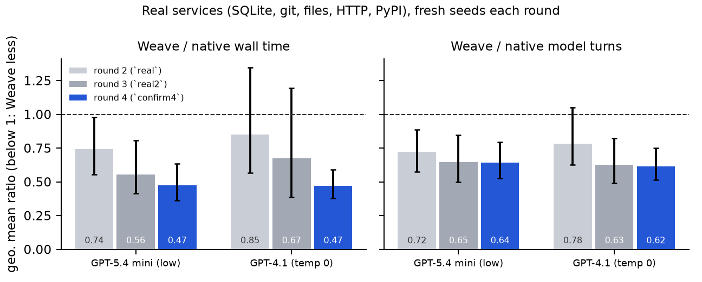
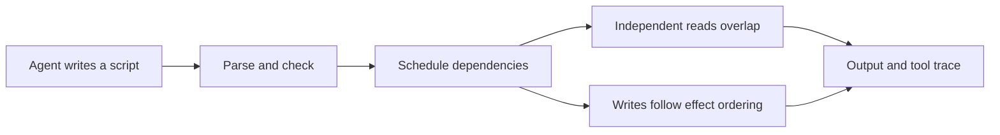
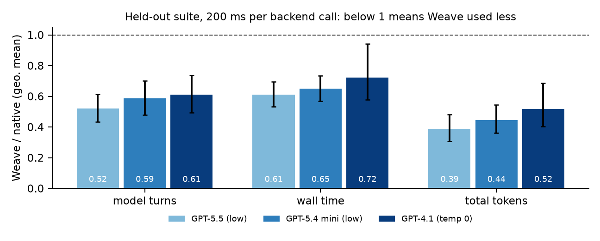
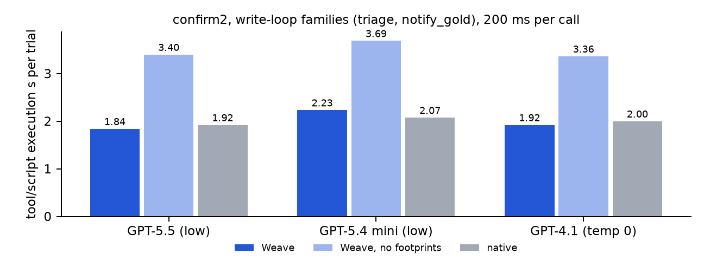
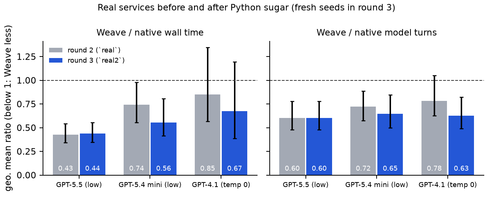
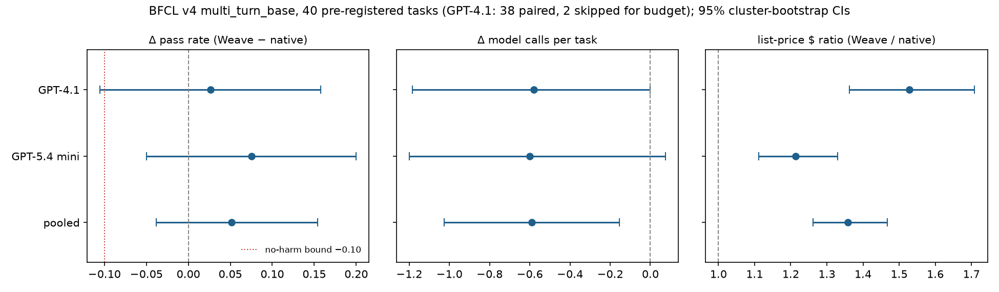
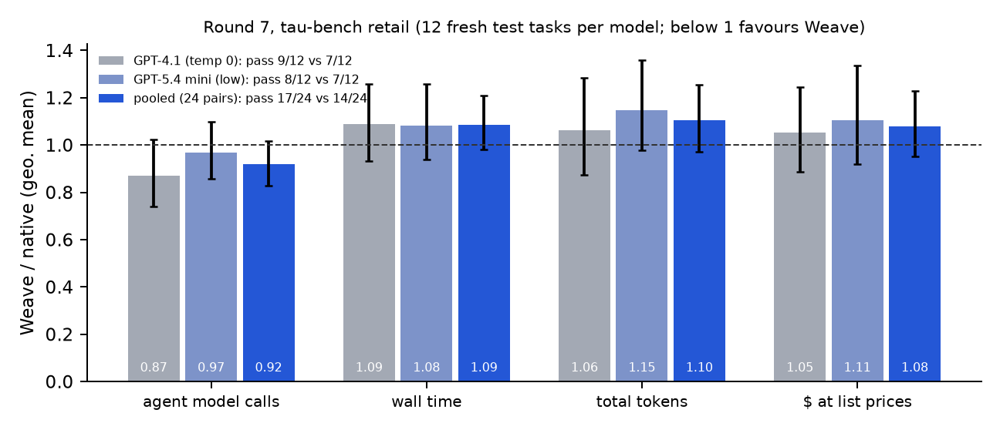
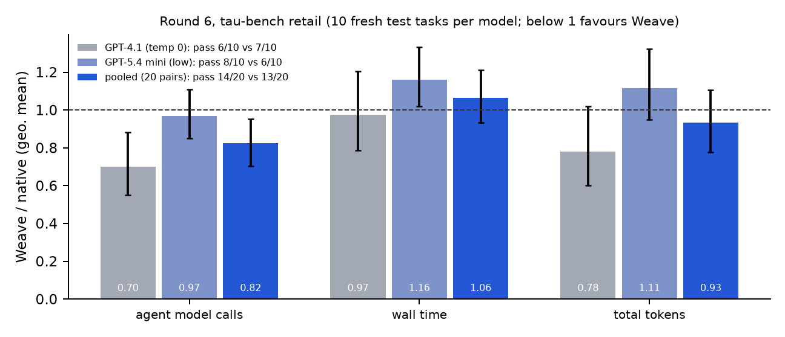
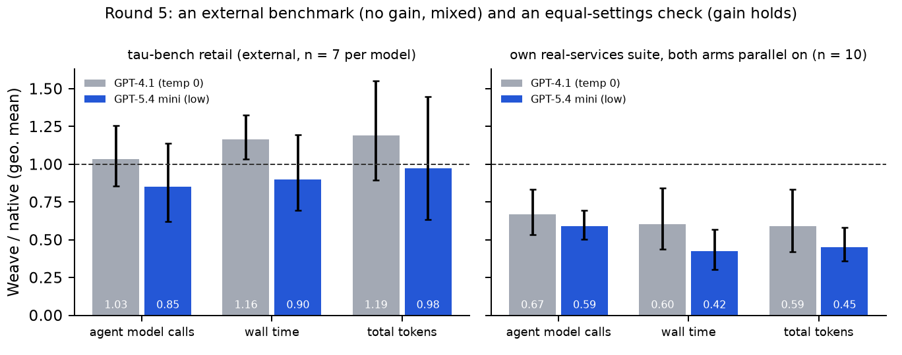

<div align="center">

# Weave: full reference

*The long-form guide and benchmark history that used to be the README. The short README is [here](../README.md); round 9 results are in [benchmarks](benchmarks.md).*

**A runtime for fan-out and chained tool work: one model turn, one script, many tool calls.**

A Rust runtime for agent-written workflows, with a small Python-like language,
Python bindings, and an MCP proxy.

[](https://github.com/AtharvRaotole/weave/actions/workflows/ci.yml)
[](https://github.com/AtharvRaotole/weave/releases)
[](../LICENSE)


[Try it](#try-it-in-one-minute) · [Quickstart](#quickstart) · [Getting started](getting-started.md) · [Agent integration](#give-your-agent-one-workflow-tool) · [MCP](#connect-mcp-servers) · [Benchmarks](#benchmarks) · [Production use](production.md) · [Contributing](../CONTRIBUTING.md)

</div>

<p align="center"></p>

<p align="center"><sub>A real run of <a href="../examples/demo.py"><code>examples/demo.py</code></a> (offline, no API key; recording: <a href="../assets/demo.cast"><code>assets/demo.cast</code></a>, animated SVG: <a href="../assets/demo.svg"><code>assets/demo.svg</code></a>).</sub></p>

Instead of one model turn per tool call, the model writes **one short script** (Python syntax:
loops, comprehensions, `key=` lambdas, helpers). Weave runs its independent calls together,
orders the writes by their declared effects, and returns only what the script printed.

**Measured, pre-registered, fresh seeds, against native *parallel* function calling on the same
model, tools and services** ([paper](paper/weave.md), [tables](paper/results-tables.md)):

- **Real services** (SQLite, git, files, HTTP, the live PyPI API; round 4, `confirm4`, 30 trials per arm):
  GPT-4.1 passed **30/30 vs 18/30** in **2.1 s vs 4.6 s** per task (Δ −2.5 s, 95% CI [−3.4, −1.6]) with
  **0.51×** the tokens; GPT-5.4 mini **30/30 vs 25/30**, Δ −3.8 s [−6.0, −1.7], **0.54×** the tokens.
- **Held-out simulated APIs** (round 1, 200 ms per call): **39–52% of the tokens** and **1.6–2.0 fewer model
  turns** on GPT-5.5, GPT-5.4 mini and GPT-4.1, with equal or higher success.
- **On an external conversational benchmark it is a draw.** On [tau-bench](https://github.com/sierra-research/tau-bench)
  retail (its tasks, simulated customer and grader unchanged), the latest pre-registered run covers 12 fresh test
  tasks per model (round 7). Weave passed **17/24 vs 14/24** (p = 0.45). It was **not significantly faster or
  cheaper**: the point estimates are +2.2 s per task and 1.08× the list-price cost, both CIs include no change. Round
  6's call saving for GPT-4.1 (−4.4 calls per task) shrank to −1.6, CI [−3.8, +0.6]. Those tasks wait on the customer
  at every step, so there is little to batch.
- **On BFCL multi-turn it costs more.** On 40 pre-registered [BFCL v4](https://github.com/ShishirPatil/gorilla)
  `multi_turn_base` tasks (its grader unchanged), success was equal within noise (**39/78 vs 35/78**) and Weave made
  0.6 fewer model calls per task, but it used **1.22× the tokens and 1.36× the list-price cost**. Short chains leave
  little to batch.
- **Equal settings:** with `parallel_tool_calls` on in both arms, the real-services gain held (GPT-4.1 −1.8 s
  [−3.0, −0.5], 0.59× tokens; GPT-5.4 mini −4.6 s, 0.45×). Every loss, including earlier rounds' and a
  GPT-4.1 runaway at `max_output_tokens`, is in the paper.

<p align="center"></p>

### When to use it, and when not to

| Use Weave when one answer needs… | Skip it when… |
|---|---|
| **fan-out**: the same lookup over many items (audit 40 packages, check 12 repos, fetch every order of a user) | a task is **one or two tool calls**: there is nothing to batch, and the script costs more (BFCL multi-turn: 1.36× the cost) |
| **chains**: lookups that feed each other (find id → fetch record → fetch related records) | **each step waits for a person** (support chat, confirmations): measured on tau-bench, it is a draw, see below |
| **local logic on results**: filter, sort, aggregate, branch before the model sees anything | the model must **reason freshly about every single result** before the next call |
| **fewer tokens in context**: only what the script prints goes back to the model | your tools have **side effects you cannot declare** (Weave orders writes by declared effects) |

Measured gains come from fewer model round trips and less tool output in context, not from raw concurrency. On
tau-bench retail (conversational, one confirmation per write), 48 pre-registered trials in round 7 showed no
significant difference in success, time, tokens or cost.

### Try it in one minute

No API key, no network after the clone. You need Python 3.9–3.13 and [Rust](https://rustup.rs/)
(the first build compiles Weave: 18 s on an 8-core Linux machine, 20 s from a fresh clone to `demo ok`,
with crates already downloaded; a first download adds to that).

```bash
git clone https://github.com/AtharvRaotole/weave.git && cd weave
python3 -m venv .venv && . .venv/bin/activate
pip install "maturin>=1.8,<2" && maturin develop --release --locked
python examples/demo.py        # the recording above
python examples/quickstart.py  # register two functions, run a script, replay it from its trace
```

Every file in [`examples/`](../examples/) runs offline without keys, and CI runs them on each push.

## What it is

Weave is a runtime for **fan-out and chained tool work**. It lets an agent express tool calls, dependencies, branches, and loops in one
script. The runtime runs independent reads concurrently and applies ordering
rules to tools that change state. You keep your existing Python functions or
stdio MCP servers.

Use it to fetch several records, combine their results, and make decisions in
code. Tasks that need fresh model reasoning after each result can still use
several model turns. Native function calling can also batch independent calls;
Weave adds local control flow and scheduling across a script.

**Where you can use it:** any Python app that calls a function-calling model
API (`WeaveTool` gives you one Chat Completions or Responses tool), the OpenAI
Agents SDK (`tool.agents_tool()`), LangChain and LangGraph (`tool.langchain_tool()`), any MCP client that launches stdio servers
(the `weave-mcp` binary, which can also proxy your other stdio MCP servers), the
`weave` CLI, and Rust hosts. [Getting started](getting-started.md) has
copy-paste recipes for each.

> **Production posture (1.0):** Weave is supported in production when the host
> trusts its own tools, runs them with worker isolation and deadlines, and treats
> tool results as model-visible. Each guarantee is tied to a CI test; the
> non-guarantees are inherent (no rollback of remote effects, tool code is not
> sandboxed, in-process tools have soft deadlines). Read
> [Running Weave in production](production.md) before connecting write tools.
> v0.1.0 is a historic experimental release with known defects; do not use it.

## Quickstart

No model account or API key is needed for this example.

### Install

**One command (prebuilt wheels from the latest GitHub release, no Rust):**

```bash
curl -fsSL https://raw.githubusercontent.com/AtharvRaotole/weave/main/scripts/install.sh | sh
# or, with pip directly (pick the release tag):
pip install weave-lang --only-binary weave-lang -f https://github.com/AtharvRaotole/weave/releases/expanded_assets/v1.1.2
```

[`scripts/install.sh`](../scripts/install.sh) checks your Python (3.9–3.13), installs the matching wheel and imports it;
`... | sh -s -- --mcp` also builds `weave-mcp` with cargo. Both commands need the repository and its releases to be
public. CI runs the script against freshly built wheels.

**Prebuilt wheels by hand:** download the wheel matching your Python version, operating
system, and architecture from the [latest release](https://github.com/AtharvRaotole/weave/releases/latest).
In a virtual environment, run `python -m pip install /path/to/downloaded.whl`,
replacing the path with the actual filename. The release includes CPython
3.9–3.13 wheels for Linux x86_64/aarch64, macOS Intel/Apple Silicon, and Windows
x64. Wheels do not require Rust.

**From source — macOS/Linux:** install [Rust via rustup](https://rustup.rs/) and
Python 3.9–3.13 first. The checkout pins Rust 1.99.1; the declared minimum is 1.97.

```bash
git clone https://github.com/AtharvRaotole/weave.git
cd weave
python3 -m venv .venv
source .venv/bin/activate
python -m pip install "maturin>=1.8,<2"
maturin develop --release --locked
```

<details>
<summary>From source — Windows PowerShell</summary>

Install Rust via rustup, its required C++ build tools, and Python 3.9–3.13, then:

```powershell
git clone https://github.com/AtharvRaotole/weave.git
cd weave
py -m venv .venv
.\.venv\Scripts\python -m pip install "maturin>=1.8,<2"
.\.venv\Scripts\maturin build --release --locked --out dist
.\.venv\Scripts\python -m pip install --no-index --find-links dist weave-lang
```

Run the example below with `.\.venv\Scripts\python`.

</details>

**Package name:** the distribution is `weave-lang` (import name `weave`).
`pip install weave-lang` is the public command. You can also install a release
wheel as above, or build from the tagged source with
`pip install "git+https://github.com/AtharvRaotole/weave@v1.1.2"` (needs Rust).
`pip install weave` installs
[Weights & Biases Weave](https://github.com/wandb/weave), a different project
with the same import name, so do not install both in one environment.

Check the install from a checkout with `python examples/quickstart.py` (prints
`49`, then `quickstart ok`).

### Run your first workflow

Save this as `demo.py` and run `python demo.py`:

```python
import time
from weave import Engine

def stock(product: str) -> int:
    time.sleep(0.1)  # Stand-in for an I/O-bound API call.
    return {"keyboard": 8, "mouse": 12}[product]

engine = Engine()
engine.tool("stock", stock, effect="read", arity=1, timeout_ms=1000)

source = """
keyboards = stock("keyboard")
mice = stock("mouse")
print(keyboards + mice)
"""

result = engine.run(source)
print(result.stdout, end="")  # 20

# Replay uses recorded results; it does not call stock again.
replayed = engine.replay(source, result.trace_json())
assert replayed.stdout == result.stdout
```

The two `stock` calls can overlap; `print` waits for both results. Run
`python examples/speedup.py` from a checkout for a timed comparison and replay check.

## How execution works



- **Local control flow:** branches, loops, and result processing run in the runtime.
- **Concurrent I/O:** independent `pure` and `read` tool calls can run together.
- **Effect ordering:** tools declare how they interact with external state.
- **Recorded calls:** JSON traces capture arguments, results, and handled tool errors.
- **Streaming:** `Session.push()` accepts incremental source; irreversible calls wait for `finish()`.

The restricted language is implemented in Rust. Scripts are not evaluated with
Python's `eval` or `exec`. Registered host tools provide external access.

## Give your agent one workflow tool

`WeaveTool` exposes your Python functions through one function-calling tool:

```python
import weave

@weave.declare(effect="read", arity=1)
def order_total(order_id):
    """Return an order's integer total."""
    return {"o1": 12, "o2": 30}[order_id]

tool = weave.WeaveTool([order_total])
tools = [tool.chat_tool()]
# Pass `tools` and **tool.request_options to Chat Completions or Responses.
# For a returned tool call: messages.append(tool.handle(call))
```

For an assistant that talks with a person between scripts (support, chat), use
`weave.WeaveTool(tools, conversational=True, persist_variables=True)`. The model is told to fetch everything the next
reply needs in one script and to change nothing before the person confirms, and each script can use the variables
earlier scripts set. To show the model what a tool returns, set `fn.__weave_returns__`, for example to
`weave.agent_tool.shape_of_samples([...a few real results...])`. See [getting started](getting-started.md#a-support-or-chat-assistant).

`tool.request_options` is `{"parallel_tool_calls": False}`: Weave already runs a script's
independent calls together, and scripts do not share variables, so one script per turn is
better. Without it GPT-4.1 sometimes sent two scripts and then ran to `max_output_tokens`
(see [the round-4 diagnosis](../bench/results/v7/diag-turn1/NOTES.md)).

Use `tool.responses_tool()` for a Responses definition, or `tool.agents_tool()`
with the optional `openai-agents` package.
[`examples/run_weave_tool.py`](../examples/run_weave_tool.py) contains a complete
loop and an offline smoke test. The wrapper returns printed output or repairable
errors; successful output is truncated to 20,000 characters by default.

Registered Python tools are synchronous functions; scripts may pass positional
or signature-bound keyword arguments. Rust hosts also have async tool registration.
For production, pass `worker_pool=N` so every tool runs in a killable worker
process (see [isolation](isolation.md)); `await tool.run_async(source)` and
the Agents SDK tool kill that work when the awaiting task is cancelled. Raise
`weave.ToolError("message")` for error text the model should see; other
exceptions reach the script as their type only.

## Use it from your agent framework

The same `WeaveTool` plugs into the common stacks. Each example runs offline with a scripted model (CI runs them) and
with `--live` against a real model.

| stack | one line | example |
|---|---|---|
| OpenAI Chat Completions / Responses | `tools=[tool.chat_tool()]` or `[tool.responses_tool()]` | [`run_weave_tool.py`](../examples/run_weave_tool.py) |
| OpenAI Agents SDK | `Agent(..., tools=[tool.agents_tool()])` | [`agents_sdk_agent.py`](../examples/agents_sdk_agent.py) |
| LangChain / LangGraph | `ToolNode([tool.langchain_tool()])`, `model.bind_tools([...])`, `create_react_agent` | [`langgraph_agent.py`](../examples/langgraph_agent.py) |
| Claude Desktop, Cursor, VS Code, Claude Code (MCP) | `weave mcp-config --client claude --config tools.json --write` (or `cursor`, `vscode`, `claude-code`) | [below](#connect-mcp-servers) |

**Demo apps** ([`examples/apps/`](../examples/apps/)): a [dependency auditor](../examples/apps/dep_audit.py) that checks
every pinned package of a requirements file against PyPI and OSV.dev in one script (offline: synthetic packages), and a
[multi-repo scan](../examples/apps/repo_scan.py) that inspects many git repositories at once for dirty trees, stale
branches and recent committers.

## Connect MCP servers

`weave-mcp` proxies local **stdio** MCP servers. Build it separately from the Python wheel:

```bash
cargo build --release --locked -p weave-mcp
```

Save this as `upstreams.json`, replacing `/absolute/path/to/data` with an existing
directory you intend to expose. This example requires Node.js/npx:

```json
{
  "upstreams": [
    {
      "name": "filesystem",
      "command": "npx",
      "args": ["-y", "@modelcontextprotocol/server-filesystem", "/absolute/path/to/data"],
      "prefix": "fs_",
      "results": {"list_directory": "lines"}
    }
  ]
}
```

**One-liner for Claude Desktop or Cursor:** with `weave-mcp` on your `PATH` (`cargo install --locked --git
https://github.com/AtharvRaotole/weave weave-mcp`), run

```bash
weave mcp-config --client claude --config upstreams.json --write   # or cursor, vscode, claude-code
```

It merges a `weave` entry with absolute paths into the client's config (Claude Desktop's
`claude_desktop_config.json` for your OS, `~/.cursor/mcp.json`, VS Code's user-profile `mcp.json`, or
project-local `.mcp.json` for Claude Code), keeps your other servers and writes a `.bak` copy.
Without `--write` it prints the JSON to paste by hand. Restart the client afterwards.

Or configure the client by hand, with absolute paths:

```json
{
  "mcpServers": {
    "weave": {
      "command": "/absolute/path/to/weave/target/release/weave-mcp",
      "args": ["--config", "/absolute/path/to/upstreams.json"]
    }
  }
}
```

On Windows, use `weave-mcp.exe` and Windows paths. Use a unique prefix for each
upstream and review its tools and directory permissions before connecting it.

The proxy exposes `weave_check`, `weave_run`, and `weave_replay`, **plus upstream
tools**. To give a model only the script interface, filter the tool list in your
host. `weave_run` returns only stdout/status by default; `debug: true` returns
bindings and a full trace, which may contain sensitive intermediate data.
Upstreams start with an allowlisted environment and discarded stderr, and their
error payloads are withheld from scripts unless the upstream sets `"debug": true`.
Upstream `outputSchema`, titles and annotations are forwarded. See
[privacy](privacy.md).

Optional settings include `effects`, text-result shaping with `results` (`text`, `lines`
or `json`), and `examples` that make sample read calls at startup. Without an
override, `readOnlyHint` maps to `read`; other tools default to `irreversible`.
Treat annotations as declarations from the server, not verified permissions.

Run `python examples/real_mcp_upstream.py` for a filesystem smoke test using
temporary data. See [MCP reference](mcp.html) for configuration details.

## Effects and language

| Effect | Scheduling rule |
| --- | --- |
| `pure` | Runs when arguments are ready; promises no observable external effects. |
| `read` | Waits for earlier writes; independent reads can overlap. |
| `reversible` | Waits for earlier observable calls; can run while source is still streaming. |
| `irreversible` | Also waits until the complete script has arrived. This is the default. |

Effects control scheduling, not permissions, transactions, or automatic rollback.
The host is responsible for compensating `reversible` operations. Resource
footprints guide speculative cache invalidation; they do not parallelize writes.

The language supports assignment, `if`/`elif`/`else`, `for`, `break`, `continue`,
`try`/`except` (`Exception`, `ToolError`, `KeyError`, ...), `raise`/`assert`, lists, dictionaries (iterate them
directly), f-strings with format specs, `str.format`, `%` formatting, `isinstance`, `round`, `json.dumps`, selected builtins and
methods, comprehensions and generator expressions, `key=` lambdas, `map`/`filter`, sets
(as duplicate-free lists), and top-level `def` helpers, which are inlined at each call. Imports, classes,
`while`, recursion, and `await` are rejected with a fix hint. This is a Python-like subset with its own value semantics.
See the [language reference](language.html).

## Benchmarks



**Benchmark v4 (2026-11-10, [paper](paper/weave.md), [pre-registration](paper/preregistration.md),
[all tables](paper/results-tables.md)).** Ten held-out tool-use tasks in seven families: fan-out, partial
failures, two-level dependent lookups, pointer chains, conditional writes, deduplicated irreversible sends, and argmax.
They run against a simulated backend with seeded per-call latency. **Native** gets one JSON tool per function,
including return types, and may call tools in parallel; the harness runs the reads of a turn concurrently. **Weave**
gets one `run_weave` tool. The two arms share the prompt, model, settings and endpoint. A trial passes only if the
answer **and** the backend's write log are right. The suites and hypotheses were committed before the held-out run,
and each configuration ran once (3 repeats × 10 tasks × 2 latencies).

| model, 200 ms/call | pass weave | pass native | turns W / N | Δ wall per task [95% CI] | tokens W/N [95% CI] |
|---|---|---|---|---|---|
| `gpt-5.5-2026-04-23` (low) | 30/30 | 30/30 | 2.00 / 4.00 | −2.9 s [−3.8, −2.1] | 0.39 [0.31, 0.48] |
| `gpt-5.4-mini-2026-03-17` (low) | 30/30 | 30/30 | 2.30 / 4.00 | −2.1 s [−2.8, −1.5] | 0.44 [0.36, 0.54] |
| `gpt-4.1-2025-04-14` (temp 0) | 28/30 | 23/30 | 2.43 / 4.03 | −1.4 s [−2.4, −0.1] | 0.52 [0.40, 0.69] |

What it shows:

- **Fewer turns and about half the tokens.** Native sends every tool result back through the model and pays for it
  again on each later turn. A Weave script returns only what it prints. On the scaling suite, native tokens grow by
  about 78 per fanned-out item and native turns grow by one per chain hop. Weave stays flat
  ([chart](../assets/benchmark-v4-scaling.png)).
- **The speedup comes from model round trips, not from concurrency.** At 0 ms backend latency the saving is almost
  the same as at 200 ms. Loop pipelining still matters: with it switched off, Weave's backend time on fan-out
  tasks rises 4–5×.
- **Where Weave lost in round 1.** In a loop that writes (`triage`), each read waited for the previous write, so
  Weave's backend time was about 2× native's. Round 2 fixed this (below).
- **Not covered.** Only OpenAI models were run in full. On Gemini's free tier only 4 of 20 trials finished in round 1
  and none in round 2 (daily quota of 20 requests). The NVIDIA-hosted GLM endpoint timed out at every attempt. No
  Anthropic key was available. The tasks are synthetic and written by the maintainer. See the paper's
  threats-to-validity section.

**Round 2 (pre-registered in [Addendum 2](paper/preregistration.md), fresh seeds).**



- **Footprint-aware ordering.** Tools can declare what they read and write, for example
  `declare(effect="read", reads=["ticket:{ticket_id}"])`. A read then waits only for writes that overlap it, and loops
  that write are pipelined. On the write-in-loop tasks of `confirm2`, Weave/native backend time is 0.97, 1.07 and 0.96
  (GPT-5.5, GPT-5.4 mini, GPT-4.1). The same engine without the declarations is about 1.5× slower. Undeclared tools keep
  the old, conservative order.
- **confirm2** (13 tasks, 200 ms): Weave passed 13/13, 39/39 and 37/39, against native's 13/13, 37/39 and 30/39. Weave
  used 0.36–0.46× native's tokens and 2.0–2.4 turns against about 4, and was 2.2–3.9 s faster per task. The REPL echo fix
  held: 71 GPT-4.1 scripts ended in a bare expression, and every one got its value back.
- **Real services** (`real`: SQLite, a git repository, JSON files, a local HTTP server, and the public PyPI API; no
  injected latency; grading reads the real end state):

| model | pass W / N | turns W / N | Δ wall per task [95% CI] | tokens W/N [95% CI] |
|---|---|---|---|---|
| `gpt-5.5-2026-04-23` (low, 1 repeat) | 8/8 / 8/8 | 2.00 / 3.50 | −4.9 s [−6.4, −3.3] | 0.44 [0.32, 0.61] |
| `gpt-5.4-mini-2026-03-17` (low) | 22/24 / 21/24 | 2.50 / 3.50 | −1.2 s [−2.35, −0.04] | 0.63 [0.44, 0.87] |
| `gpt-4.1-2025-04-14` (temp 0) | 21/23 / 12/24 | 2.78 / 3.50 | +0.1 s [−1.7, +2.0] | 0.77 [0.51, 1.30] |

  GPT-4.1 got no wall-time gain there: it kept writing `def` and list comprehensions, which Weave rejected, and paid a
  turn to rewrite them. Native GPT-4.1 failed every PyPI task by adding up version numbers in its head.

**Round 3 (pre-registered in [Addendum 3](paper/preregistration.md), fresh seeds).** Weave now accepts
comprehensions, generator expressions, `key=` lambdas, `map`/`filter`, sets and `def` helpers, lowered to the loops it
already schedules (tested against CPython and in the differential fuzzer).



| suite | model | pass W / N | turns W / N | Δ wall per task [95% CI] | tokens W/N [95% CI] |
|---|---|---|---|---|---|
| confirm3 (200 ms) | `gpt-5.5-2026-04-23` (low, 1 repeat) | 13/13 / 13/13 | 2.00 / 4.08 | −5.0 s [−8.1, −2.8] | 0.38 [0.32, 0.46] |
| confirm3 (200 ms) | `gpt-5.4-mini-2026-03-17` (low) | 39/39 / 37/39 | 2.10 / 4.08 | −4.6 s [−6.4, −3.0] | 0.40 [0.34, 0.49] |
| confirm3 (200 ms) | `gpt-4.1-2025-04-14` (temp 0) | 39/39 / 27/39 | 2.21 / 4.10 | −4.0 s [−8.3, −1.1] | 0.46 [0.38, 0.56] |
| real2 | `gpt-5.5-2026-04-23` (low, 1 repeat) | 8/8 / 8/8 | 2.00 / 3.50 | −4.7 s [−6.4, −3.1] | 0.47 [0.34, 0.64] |
| real2 | `gpt-5.4-mini-2026-03-17` (low) | 23/24 / 22/24 | 2.25 / 3.58 | −2.9 s [−5.0, −0.1] | 0.55 [0.36, 0.83] |
| real2 | `gpt-4.1-2025-04-14` (temp 0) | 21/24 / 13/24 | 2.17 / 3.50 | −1.4 s [−5.0, +2.3] | 0.60 [0.40, 1.04] |

- No Weave script was rejected for these forms; 92 of 269 used them. GPT-4.1's `pypi_major` time went from 7.5 s
  (native 3.1 s) to 3.5 s (native 3.6 s).
- The GPT-4.1 real-services wall-time loss is smaller but not gone: the mean is now −1.4 s per task, with a CI that
  includes zero. Two GPT-4.1 Weave `git_review` trials stopped on the first turn at the provider's output-token limit,
  and the pre-registered rules count them as failures.

**Round 4 (pre-registered in [Addendum 4](paper/preregistration.md), fresh seeds).** Two fixes. The harness now
records the tokens a provider bills for a failed (incomplete) response, which it used to count as 0. The traces showed
that the GPT-4.1 `git_review` failures came from splitting the work across two parallel `run_weave` calls: in 6 of 64
dev samples the second call was followed by a runaway to the output-token limit, and in one round-3 trial the model
printed the tags instead of creating them. `WeaveTool.request_options` now asks for one script per turn
(`parallel_tool_calls: false`), and the tool text says why. The Weave arm uses that setting; the native arm does not.


| suite | model | pass W / N | turns W / N | Δ wall per task [95% CI] | tokens W/N [95% CI] |
|---|---|---|---|---|---|
| confirm4 | `gpt-5.4-mini-2026-03-17` (low) | 30/30 / 25/30 | 2.10 / 3.40 | −3.8 s [−6.0, −1.7] | 0.54 [0.41, 0.72] |
| confirm4 | `gpt-4.1-2025-04-14` (temp 0) | 30/30 / 18/30 | 2.00 / 3.40 | −2.5 s [−3.4, −1.6] | 0.51 [0.40, 0.66] |

- No Weave trial hit the output-token limit. On the four `git_review` tasks GPT-4.1 Weave passed 12/12 (native 9/12)
  in 2.1 s against 4.0 s.
- Still a loss: GPT-5.4 mini's `pypi_major` Weave time was 5.0 s against native's 4.1 s (6 trials per arm).
- Rounds 2 and 3 undercounted three GPT-4.1 trials by at least 4,096 output tokens each. Their ledgers did not keep the
  billed usage, so those tables are not re-derived; the undercount is listed in the
  [tables](paper/results-tables.md).
- Gemini (quota) and GLM (timeout) failed their smoke requests again and were not run.

**Round 8 (pre-registered in [Addendum 8](paper/preregistration.md)): BFCL multi-turn, a public benchmark.**



40 seeded tasks from the [Berkeley Function Calling Leaderboard](https://github.com/ShishirPatil/gorilla) v4
`multi_turn_base` (`bfcl-eval==2026.3.23`), its tasks and grader unchanged; the native arm is BFCL's own OpenAI
handler ([`bench/bfcl/`](../bench/bfcl/)).

| model | pass W / N | Δ model calls [95% CI] | Δ wall per task [95% CI] | tokens W/N [95% CI] | $ W/N [95% CI] |
|---|---|---|---|---|---|
| `gpt-4.1-2025-04-14` (38 pairs) | 19/38 / 18/38 | −0.58 [−1.18, +0.00] | +0.5 s [−0.1, +1.1] | **1.24 [1.15, 1.33]** | **1.53 [1.36, 1.71]** |
| `gpt-5.4-mini-2026-03-17` (none) | 20/40 / 17/40 | −0.60 [−1.20, +0.07] | −0.0 s [−0.6, +0.5] | **1.20 [1.10, 1.31]** | **1.21 [1.11, 1.33]** |
| pooled | 39/78 / 35/78 | **−0.59 [−1.03, −0.15]** | +0.2 s [−0.2, +0.6] | **1.22 [1.15, 1.29]** | **1.36 [1.26, 1.47]** |

- **Weave costs more here:** 1.22× tokens and 1.36× list-price dollars pooled. Weave scripts averaged 1.6 tool calls,
  so there is little to batch, and each request carried more input (likely the longer tool description).
- Success is equal within noise (McNemar p = 0.42 pooled). GPT-4.1's no-harm bound (−0.105) narrowly misses the
  pre-registered −0.10; three GPT-4.1 trials were skipped by the budget guard.
- Spend: $4.15 and 5.69M tokens for the round (dev included).

**Round 7 (pre-registered in [Addendum 7](paper/preregistration.md)): a larger tau-bench rerun, with list-price
cost.**



12 fresh seeded test tasks (`retail_test12r7`, disjoint from rounds 5 and 6), 1 repeat, `parallel_tool_calls: true`
in both arms. The Weave arm is round 6's with the return-shape cache, and there were no other changes.

| model | pass W / N | Δ agent calls [95% CI] | Δ wall per task [95% CI] | tokens W/N [95% CI] | $ W/N [95% CI] |
|---|---|---|---|---|---|
| `gpt-4.1-2025-04-14` (temp 0) | 9/12 / 7/12 | −1.6 [−3.8, +0.6] | +2.1 s [−1.3, +5.4] | 1.06 [0.87, 1.29] | 1.05 [0.89, 1.24] |
| `gpt-5.4-mini-2026-03-17` (low) | 8/12 / 7/12 | −0.4 [−2.2, +1.6] | +2.3 s [−2.6, +8.1] | 1.15 [0.98, 1.36] | 1.11 [0.92, 1.34] |
| pooled | 17/24 / 14/24 | −1.0 [−2.4, +0.5] | +2.2 s [−0.8, +5.6] | 1.10 [0.97, 1.26] | 1.08 [0.95, 1.23] |

- No difference is significant. The point estimates favour Weave on success and agent calls, and native on time,
  tokens and cost.
- The host-time overhead from round 6 is gone (Δ −0.02 s pooled). The remaining time gap is model time: Weave writes
  more output tokens.
- Cost at OpenAI list prices (GPT-4.1 $2/$0.50/$8 per 1M input/cached/output; GPT-5.4 mini $0.75/$0.075/$4.50; the
  user simulator is GPT-4.1): **$2.35** for the round's 48 trials. That is $0.071 vs $0.067 per task for GPT-4.1 and
  $0.031 vs $0.028 for GPT-5.4 mini.
- Spend: 3.44M tokens, under the 4.0M cap; all 48 trials ran.
- Rounds 6 and 7 together (exploratory, 22 tasks per model):
  - GPT-4.1: −2.9 agent calls [−4.8, −1.1], with no time or token difference;
  - GPT-5.4 mini: **1.13× the tokens** [1.01, 1.28] with Weave.

**Round 6 (pre-registered in [Addendum 6](paper/preregistration.md)): Python for conversations, tau-bench on
fresh tasks.**



- **Language:** dict iteration, exception classes, `raise`/`assert`, `isinstance`, format specs, `str.format`, `%`
  formatting, `json.dumps`, `dict.update`/`pop`. A new CPython differential suite (663 programs) also found and fixed
  `//`/`%` with negative operands and the float repr of very large and very small numbers.
- **Agent tool:** `conversational=True`, `persist_variables=True`, and return shapes sampled from real results. They
  were tuned on tau-bench's train split only.
- **tau-bench retail, `retail_test10r6`** (10 fresh seeded test tasks, 1 repeat, `parallel_tool_calls: true` in both
  arms):

| model | pass W / N | agent calls W / N | Δ agent calls [95% CI] | Δ wall per task [95% CI] | tokens W/N [95% CI] |
|---|---|---|---|---|---|
| `gpt-4.1-2025-04-14` (temp 0) | 6/10 / 7/10 | 10.6 / 15.0 | **−4.4 [−7.5, −1.5]** | −0.6 s [−6.3, +5.1] | 0.78 [0.60, 1.02] |
| `gpt-5.4-mini-2026-03-17` (low) | 8/10 / 6/10 | 12.8 / 13.3 | −0.5 [−2.2, +1.3] | **+4.8 s [+0.5, +9.5]** (Weave slower) | 1.11 [0.95, 1.32] |
| pooled | 14/20 / 13/20 | 11.7 / 14.2 | **−2.5 [−4.5, −0.5]** | +2.1 s [−1.7, +6.1] | 0.93 [0.78, 1.11] |

  Weave script errors fell from 3.4 to 0.2 per GPT-4.1 trial. GPT-5.4 mini's slower wall time is a loss. About 2.5 s
  per task of it was our adapter's return-shape sampler, which deep-copied the database on every call. It is now
  cached (0.03 s), but the evidence has not been rerun. Airline was not run, to stay within budget. Round 6 used
  3.90M tokens, under its 5.0M cap.

**Round 5 (pre-registered in [Addendum 5](paper/preregistration.md)): an external benchmark, and equal
settings.**



- **tau-bench retail** ([sierra-research/tau-bench](https://github.com/sierra-research/tau-bench), MIT, commit
  `59a200c`, installed unmodified; [`bench/taubench/`](../bench/taubench/)). The native arm is tau-bench's own
  `ToolCallingAgent`. The Weave arm is the same loop with one `run_weave` tool that calls the same tools through
  `env.step`. Both arms use tau-bench's GPT-4.1 user simulator and grader and send `parallel_tool_calls: false`.
  7 test tasks, chosen by a seeded sample, 1 repeat.

| model | pass W / N | agent calls W / N | Δ wall per task [95% CI] | tokens W/N [95% CI] |
|---|---|---|---|---|
| `gpt-4.1-2025-04-14` (temp 0) | 4/7 / 3/7 | 17.1 / 17.1 | **+3.0 s [+0.3, +5.8]** (Weave slower) | 1.19 [0.90, 1.55] |
| `gpt-5.4-mini-2026-03-17` (low) | **2/7 / 4/7** | 12.9 / 15.1 | −3.4 s [−11.4, +4.5] | 0.98 [0.63, 1.45] |

  No gain, and GPT-4.1 was slower. With n = 7 the pass differences are noise, but one goes against Weave. The tasks
  wait for the customer at every step, and the policy requires a "yes" before every write, so there is little to batch.
  Of the 26 Weave script errors, 10 came from scripts written before the model had seen the data: the user record
  lists order ids, and the script indexed them as orders. Most of the rest were Python Weave did not support then:
  iterating a dict and `except Exception` (round 6 added both).
- **`parallel_tool_calls` ablation** (`confirm5`, fresh seeds, all four combinations). With parallel calls **on in both
  arms**, Weave still won: GPT-4.1 10/10 vs 6/10, −1.8 s [−3.0, −0.5], 0.59× the tokens; GPT-5.4 mini 10/10 vs 8/10,
  −4.6 s [−8.0, −2.3], 0.45×. Native with them off hits the 16-turn cap (2/10, 3/10), so the "both off" comparison is
  not informative. Weave with parallel calls on passed 10/10 for both models and did not run away in 10 trials, but
  GPT-4.1 used 1.17× the tokens.
- **Spend:** round 5 used 3.78M tokens, against a 2.5M budget; the project total is about 10.4M, over the ~10M
  ceiling. The runner's budget check ignored trials already in flight; it now reserves tokens for each one.
- Gemini (HTTP 429, quota) and GLM (timeout) failed their smoke requests again.

Reproduce: `make bench-mock` (offline) or `WEAVE_BENCH_LIVE=1 make bench-live MODEL=...` (spends tokens).
The real-services suite runs offline with oracle agents: `python -m bench.v4.run --mock --suite real --latency-ms 0`.
It needs network access for PyPI.

**Protocol v3 (strict mode, real MCP servers).** The earlier [protocol v3](benchmark-protocol-v3.md) hides
Weave's error hints and sends both arms the full tool results. It found no difference on 2026-11-09. Its traces led to
the fixes in this release (return types in the listing, clearer errors, loop pipelining). Rerun after the fixes,
Weave's first-try success rose from 11/30 to 30/30 on GPT-5.5, from 26/30 to 30/30 on GPT-5.4 mini, and from 20/30 to
26/30 on GPT-4.1. That suite was the diagnosis set, so this is a before/after result, not a held-out one. Full
tables are in [docs/benchmarks.md](benchmarks.md).

## Execution boundaries

[Running Weave in production](production.md) is the authoritative list of
guarantees (each with its test), non-guarantees and the threat model. In short:

- **Scripts are untrusted; the host and its tools are trusted.** Scripts reach
  the outside world only through registered tools and are bounded by step,
  value, nesting, source, stdout and trace budgets ([budgets](budgets.md)).
- **Deadlines are hard only for isolated tools.** With a worker pool, a runaway
  tool is SIGKILLed with its process group (POSIX) at its timeout, run deadline
  or cancellation, and `WorkerLimits` cap CPU, memory (Linux), open files and
  file size ([isolation](isolation.md)). In-process tools and MCP upstream
  calls have soft, cooperative cancellation.
- **No rollback.** Effects order calls; a failed expression stops later writes,
  but nothing undoes a remote effect already started. Writes are not retried
  unless the host marks them `retry_safe` ([cancellation and retries](cancellation-and-retries.md)).
- **Privacy is by channel.** Tool results are model-visible; host exceptions,
  stderr, environment and upstream error payloads are not, unless opted in
  ([privacy](privacy.md)). Traces are sensitive host artifacts.
- **Not an OS sandbox for tool code**, and the host process has no memory cap.

The [17-finding audit ledger](audit-status.md) records how each audited
defect was reproduced and fixed. The v0.1.0 tag and downloads are unchanged and
still contain those defects; 1.0.0 is the first release built with the fixes.

See [runtime reference](runtime.html) for API details and
[SECURITY.md](../SECURITY.md) for private vulnerability reporting.

## Documentation and development

The reference pages are static HTML. Serve them from a checkout:

```bash
python -m http.server 8000 --bind 127.0.0.1 --directory docs
```

Open [the local documentation](http://127.0.0.1:8000). References:
[language](language.html), [runtime](runtime.html), [CLI](cli.html),
[MCP](mcp.html), and [release process](releasing.md).

Core code is in `crates/weave`; Python bindings in `crates/weave-py` and
`python/weave`; the proxy and CLI in `crates/weave-mcp` and `crates/weave-cli`.
[Architecture](architecture.md) maps the scheduler for contributors, and the
[roadmap](../ROADMAP.md) lists measured weaknesses and good first issues. To cite Weave,
see [CITATION.cff](../CITATION.cff).

```bash
cargo test --workspace --locked
cargo clippy --workspace --all-targets --locked -- -D warnings
python tests/python/test_agent_tool.py
python tests/python/test_isolation.py
python tests/python/test_privacy.py
```

The Rust suite includes differential tests against an independent interpreter
across sequential, parallel, streamed, speculative, and replayed execution.
See [CONTRIBUTING.md](../CONTRIBUTING.md) for setup and longer runs. Small bug
reproductions are welcome; check traces for sensitive data before attaching them.

## License and research

[MIT](../LICENSE). The speculative cache draws on Nichols et al.,
[Optimizing Agentic Language Model Inference via Speculative Tool Calls](https://arxiv.org/abs/2512.15834).
